# Two-factor authentication: TOTP at login and as a step-up factor (#1274)

> **Rule.** This record is the design that slices #1276 to #1281 build. Each slice
> that lands a rule below adds the compact line to [`src/AGENTS.md`](../../src/AGENTS.md)
> with a `→` link here. Until then this file is the only statement of the rules.

**Status:** accepted design, no code yet
**Date:** 2026-10-20

## What happened

No incident. This record settles, before any slice writes code, the choices that interact in epic #1273, as #788's design did for OAuth. Several rules protect defences that shipped after defects (#128, #273, #364, #579, #1031).

Settled by the maintainer and not reopened here: TOTP is both a login factor and a step-up factor; the step-up grant stays the #308 grant, obtained a new way; every Owner must use two-factor authentication and Managers may; no `SignInManager`; no SMS or email codes; passkeys are out of scope.

## The rule

A correct password for an enrolled user mints nothing. Login answers with a short-lived, single-use signed challenge, and only the code step mints the refresh row, the cookie and the access token. One internal class, `TwoFactorCredentials`, owns every piece of two-factor state and is the only code that checks an authenticator code or a recovery code, at login and at step-up. It locks the user row, so its checks are exact under concurrency, and it keeps replay protection and the per-user budget in Postgres, so they survive restarts and never depend on Redis. A wrong code is charged to the same lockout counter as a wrong password, and no password check resets that counter for an enrolled user. Breaking any of these rules gives a password holder either a session without the second factor or more code guesses than decision 6 allows.

## Evidence

Every claim about ASP.NET Core Identity cites the public source at tag `v10.0.13` of dotnet/aspnetcore, commit `0ef4bbfa3291b306a21e5001cb0491277bdd35bc`, or the probe below. The app resolves `Microsoft.AspNetCore.Identity.EntityFrameworkCore` 10.0.13 (`src/Cluckwork.Infrastructure/packages.lock.json:20-23`). The shipped binary reports build commit `4099f839`, which is not in the public repository, so behaviour is also measured by the probe against that binary. Paths written `Identity/…` below mean `src/Identity/…` in that tag.

**The Identity probe.** A throwaway console app (deleted after the run) referenced `Microsoft.AspNetCore.Identity.EntityFrameworkCore` 10.0.13 and the EF Core in-memory provider. It registered `AddIdentityCore<IdentityUser>` with the app's lockout values (5 attempts), `AddEntityFrameworkStores` and `AddDefaultTokenProviders`, as `CluckworkIdentityServiceCollectionExtensions.cs:69-82` does. It computed RFC 6238 codes itself at step offsets −4 to +4 and called `VerifyTwoFactorTokenAsync`. Its output, unedited apart from the codes it printed:

```text
Identity assembly: 10.0.0.0 file 10.0.13+4099f83977f4d29604a9aeb971fb0a7bc1d5f699
Tokens.AuthenticatorTokenProvider = Authenticator
LockoutEnabled for new user: True
ResetAuthenticatorKeyAsync rotated stamp: True
Key: length 32 chars, alphabet A-Z2-7 only: True, decodes to 20 bytes
GenerateNewAuthenticatorKey length: 32
SetTwoFactorEnabledAsync(true) rotated stamp: True
GenerateTwoFactorTokenAsync(Authenticator) returns: ''
step offset -4: verify = False
step offset -3: verify = False
step offset -2: verify = True
step offset -1: verify = True
step offset  0: verify = True
step offset  1: verify = True
step offset  2: verify = True
step offset  3: verify = False
step offset  4: verify = False
same current code verified twice: first=True second=True
code with a space '<3 digits> <3 digits>': False
after 6 wrong codes: AccessFailedCount 0 -> 0, locked out: False, stamp rotated: False
GenerateNewTwoFactorRecoveryCodesAsync(10) rotated stamp: False
recovery codes: count 10, shape of first: AAAA9-AAAA9, all same shape: False
2000 codes: lengths 11, hyphen at index 5 in all: True, distinct chars 26: 23456789BCDFGHJKMNPQRTVWXY
CountRecoveryCodesAsync: 10
AspNetUserTokens row: LoginProvider='[AspNetUserStore]' Name='AuthenticatorKey' value length 32, equals plaintext key: True, contains plaintext recovery code: False, ';' separators: 0
AspNetUserTokens row: LoginProvider='[AspNetUserStore]' Name='RecoveryCodes' value length 119, equals plaintext key: False, contains plaintext recovery code: True, ';' separators: 9
redeem code once: True, stamp rotated: False, count now 9
redeem same code again: False
redeem lowercased code: False
wrong recovery code: AccessFailedCount 0 -> 0
second ResetAuthenticatorKeyAsync: new key differs True, old current code still verifies: False, recovery codes left 9, stamp rotated True
after SetTwoFactorEnabledAsync(false): key still stored True, recovery codes left 9
```

**The QR probe.** A throwaway Node script (deleted after the run) bundled three MIT-licensed QR encoders with esbuild, minified, and printed their size. It then encoded an `otpauth://totp/…` URI with `uqr`, drew the module matrix to pixels and decoded it with `jsqr`:

```text
qrcode-generator 21009 bytes, gzip 7672; license MIT; version 2.0.4
qrcode 24811 bytes, gzip 9576; license MIT; version 1.5.4
uqr 11651 bytes, gzip 4551; license MIT; version 0.1.3
uqr matrix 53x53 (border included); jsQR decodes: true
```

`qrcode` 1.5.4 also depends on `pngjs`, `yargs` and `dijkstrajs` (`npm view qrcode dependencies`); the other two have none.

### What Identity 10.0.13 does, item by item

| Fact | Source | Probe |
|---|---|---|
| `AddDefaultTokenProviders()` registers `AuthenticatorTokenProvider<TUser>` under the name `"Authenticator"`. | `Identity/Core/src/IdentityBuilderExtensions.cs:28-38`; `Identity/Extensions.Core/src/TokenOptions.cs:31,76` | line 2 |
| The key is 20 bytes from `RandomNumberGenerator`, encoded as 32 base32 characters. | `Identity/Extensions.Core/src/UserManager.cs:2436-2437,2834-2842`; `Identity/Extensions.Core/src/Base32.cs:14,17-29` | line 5 |
| The store keeps the key in `AspNetUserTokens` as plaintext, `LoginProvider = "[AspNetUserStore]"`, `Name = "AuthenticatorKey"`. | `Identity/Extensions.Stores/src/UserStoreBase.cs:885-887,896-906` | `AspNetUserTokens row` lines |
| Recovery codes are `XXXXX-XXXXX` from a 26-character alphabet, about 47 bits each, stored plaintext in one row joined by `;`. | `UserManager.cs:2479-2515`; `UserStoreBase.cs:952-956` | `2000 codes` line |
| Redemption is a case-sensitive exact match and a read-modify-write of that row; only the user row's `ConcurrencyStamp` stops a concurrent double spend. | `UserStoreBase.cs:966-983`; `Identity/EntityFrameworkCore/src/UserStore.cs:212-230`; `Identity/EntityFrameworkCore/src/IdentityUserContext.cs:417` | `redeem` lines |
| `AuthenticatorTokenProvider.ValidateAsync` accepts 30-second steps −2 to +2, HMAC-SHA1, 6 digits. Its comment says "90s"; the loop is ±60 s around the current step. | `Identity/Extensions.Core/src/AuthenticatorTokenProvider.cs:48-82`; `Identity/Extensions.Core/src/Rfc6238AuthenticationService.cs:23-68` | `step offset` lines |
| It keeps no state, so it accepts the same code again inside the window. It parses with `int.TryParse`, so it accepts a leading sign or surrounding whitespace, and rejects an inner space. | `AuthenticatorTokenProvider.cs:50-55` | `same current code` and `code with a space` lines |
| `VerifyTwoFactorTokenAsync` never touches `AccessFailedCount`; it only logs at debug level. | `UserManager.cs:1980-2006` | `after 6 wrong codes` line |
| `StoreOptions.ProtectPersonalData` encrypts every `[ProtectedPersonalData]` property, which includes `IdentityUserToken.Value` but also `UserName`, `Email` and `PhoneNumber`. | `Identity/Extensions.Core/src/StoreOptions.cs:19-23`; `Identity/Extensions.Stores/src/IdentityUserToken.cs:32`; `Identity/Extensions.Stores/src/IdentityUser.cs:67,78,111`; `IdentityUserContext.cs:473-485` | |

## The shape

### What a caller sees

An unenrolled user's login is byte-identical to today: `200 {accessToken, accessTokenExpiry}` and the per-farm cookie (`AuthEndpoints.Login.cs:153-154`).

An enrolled user's correct password returns no cookie and no token:

```text
POST /api/v1/auth/login                 {"farmCode":"…","email":"…","password":"…"}
401 application/problem+json
{ "title": "Auth.SecondFactorRequired", "status": 401,
  "detail": "Enter the code from your authenticator app.",
  "challenge": "<signed challenge>", "challengeExpiresAt": "<now + 5 min>" }

POST /api/v1/auth/login/second-factor   {"challenge":"<signed challenge>","code":"<6 digits or a recovery code>"}
200 {accessToken, accessTokenExpiry} + Set-Cookie cluckwork_rt_<farm>
400 Auth.SecondFactorIncorrect          wrong, reused or malformed code, or the account is locked: one body
400 Auth.SecondFactorKeyUnavailable     the stored key cannot be decrypted; use a recovery code
401 Auth.SecondFactorChallengeExpired   expired, forged or already used challenge, or the account changed; sign in again
401 Auth.FarmSuspended                  the farm was suspended between the two steps
429 Auth.SecondFactorThrottled          the user's daily budget of wrong authenticator codes is spent; Retry-After
429 (today's body)                      the per-address policy; Retry-After
```

The one `Auth.SecondFactorIncorrect` body says "That code did not work. If you just used it, wait for the next one." It is the same for a wrong code, a reused code and a locked account, so the response never confirms that a guessed code was valid. When the user typed a 6-digit code, the SPA adds "Still not working? Check that your phone sets its time automatically." (decided by the maintainer on 2026-10-21, #1278); it does not after a recovery code.

Step-up for an enrolled user sends both factors and gets the same #308 grant. Every refusal is 400 or 429, never 401, except a missing session:

```text
POST /api/v1/auth/step-up   {"password":"…"}                  unenrolled: unchanged
POST /api/v1/auth/step-up   {"password":"…","code":"…"}       enrolled
200 {token, expiresAt}                    the same cluckwork-step-up JWT
400 Users.CurrentPasswordIncorrect        wrong password, or the account changed under the request; the code is not checked
400 Auth.SecondFactorRequired             enrolled, correct password, no code; nothing charged
400 Auth.SecondFactorIncorrect            enrolled, correct password, wrong, reused or malformed code, or locked
400 Auth.SecondFactorKeyUnavailable       as at login
429 Auth.SecondFactorThrottled            as at login
429 (today's body)                        the auth-login per-address policy
```

Confirm (#1277) answers 200 with the recovery codes and a fresh pair for `Enrolled`, 200 with a fresh pair for `Replaced`, 400 `Auth.EnrolmentCodeIncorrect` with `attemptsLeft` for `Rejected`, and 409 `Auth.EnrolmentExpired`, meaning start again, for `Superseded`.

The three step-up 400 titles tell a session holder whether the password was right; the non-enumerating denial (`StepUpFailures_AllProduceTheIdenticalNonEnumeratingResponse`) covers grant spending only.

### Login state machine



```mermaid
stateDiagram-v2
    [*] --> PasswordStep: POST /auth/login
    PasswordStep --> Refused: unknown or suspended farm, unknown user, disabled, epoch below 1, locked, wrong password (401, today's codes)
    PasswordStep --> SignedIn: correct password, not enrolled (reset counter, re-check, mint; unchanged)
    PasswordStep --> Pending: correct password, enrolled (401 Auth.SecondFactorRequired + challenge; no reset)
    Pending --> Pending: wrong, reused or malformed code, or locked (400; only a wrong code is charged)
    Pending --> Throttled: per-address policy or the daily budget of wrong codes (429)
    Throttled --> Pending: the window rolls over, or a recovery code is used
    Pending --> Expired: 5 minutes pass, the challenge was used, or the epoch, stamp, disable or two-factor state moved (401)
    Pending --> Refused: farm suspended between the steps (401 Auth.FarmSuspended)
    Pending --> SignedIn: authenticator code or recovery code accepted (one transaction: counters cleared, refresh row inserted)
    Expired --> PasswordStep: sign in again
    SignedIn --> ForcedChange: must_change_password claim (#283)
    ForcedChange --> Session: /auth/change-password
    SignedIn --> Session
    Session --> Session: /auth/refresh (no code; an enrolled user's lineage ends after Auth:EnrolledSessionMaxDays)
```

### Types

```csharp
// Application/Modules/Access/Contracts. Parsed once, after the challenge is read; after that a code is never a string.
public abstract record SecondFactorCode
{
	private SecondFactorCode() { }
	public sealed record Totp(int Value) : SecondFactorCode;               // exactly 6 ASCII digits after removing spaces
	public sealed record Recovery(string Normalized) : SecondFactorCode;   // see decision 9 for the normal form
	public sealed override string ToString() => "[redacted]";             // records print their members
	public static bool TryParse(string? raw, [NotNullWhen(true)] out SecondFactorCode? code) => throw new NotImplementedException();
}

public abstract record LoginStep
{
	private LoginStep() { }
	public sealed record SignedIn(TokenPair Tokens) : LoginStep;
	public sealed record SecondFactorRequired(string Challenge, DateTimeOffset ExpiresAt) : LoginStep;
	public sealed override string ToString() => "[redacted]";
}

public sealed record RetryLaterError(TimeSpan RetryAfter)
	: Error("Auth.SecondFactorThrottled", "Too many wrong authenticator codes for this account. Use a recovery code or try again later.");

// IIdentityProvider and IAccessModule
Task<Result<LoginStep>> LoginAsync(Guid accountId, string email, string password, CancellationToken ct = default);   // was Result<TokenPair>
Task<Result<TokenPair>> CompleteSecondFactorLoginAsync(string challenge, string code, CancellationToken ct = default);   // reads the challenge, then parses the code

// #1279. IIdentityProvider: change-password takes the account and the code.
Task<Result<TokenPair>> ChangeOwnPasswordAsync(Guid accountId, Guid userId, string currentPassword, string newPassword, SecondFactorCode? code, CancellationToken ct = default);
// #1279. IAccessModule: the command gains Code, and the account comes from the endpoint's tenant.
Task<Result<TokenPair>> ChangeOwnPasswordAsync(ChangeOwnPasswordCommand command, Guid accountId, Guid userId, CancellationToken ct);

// IStepUpGrantService: one optional parameter; ValidateAsync and the grant do not change.
Task<Result<StepUpGrant>> IssueAsync(Guid accountId, Guid userId, string currentPassword, SecondFactorCode? code, CancellationToken ct = default);
```

```csharp
// Infrastructure/Modules/Access/Identity. The one owner of two-factor state. Public port, internal
// implementation, as IStepUpGrantRegistry and PersistentStepUpGrantRegistry do (PersistentStepUpGrantRegistry.cs:116-120).
// Every method takes ids. The write methods run inside the caller's AmbientTransaction and first lock the user row.
public interface ITwoFactorCredentials
{
	Task<TwoFactorStatus> GetStatusAsync(Guid accountId, Guid userId, CancellationToken ct);
	Task<FactorOutcome> VerifyAsync(Guid accountId, Guid userId, SecondFactorCode code, ProofBinding binding, CancellationToken ct);
	Task<EnrolmentStart> StartEnrolmentAsync(Guid accountId, Guid userId, CancellationToken ct);
	Task<ConfirmOutcome> ConfirmEnrolmentAsync(Guid accountId, Guid userId, SecondFactorCode.Totp code, CancellationToken ct);
	Task<IReadOnlyList<string>> RegenerateRecoveryCodesAsync(Guid accountId, Guid userId, CancellationToken ct);
	Task<ClearOutcome> ClearAsync(Guid accountId, Guid userId, CancellationToken ct);               // never reads a protected value
}

public enum ClearOutcome { NotFound, NotEnrolled, PendingDeleted, Cleared }

// #1281. The grace start's one-method port, implemented by TwoFactorCredentials.
public interface IOwnerGraceStart { Task StartAsync(Guid accountId, Guid userId, DateTimeOffset now, CancellationToken ct); }

// #1281. What ICredentialEpochVerifier returns; the middleware hands it to the gate on Current only.
public readonly record struct CredentialCheck(CredentialVerdict Verdict, bool TwoFactorEnabled, DateTimeOffset? SecondFactorRequiredSince);

public readonly record struct TwoFactorStatus(bool Enabled, int RecoveryCodesLeft, DateTimeOffset? RequiredSince);   // RequiredSince from #1281

public sealed record EnrolmentStart(string Key, string OtpauthUri) { public override string ToString() => "[redacted]"; }

// The credential state the proof was issued against. Login reads it from the challenge, with its sf_signins;
// step-up reads it from its password check, with no sign-in count.
public readonly record struct ProofBinding(int CredentialEpoch, string SecurityStampHash, long? SignIns) { public override string ToString() => "[redacted]"; }

public abstract record FactorOutcome
{
	private FactorOutcome() { }
	public sealed record Accepted(int? RecoveryCodesLeft) : FactorOutcome;   // set when a recovery code was spent
	public sealed record Rejected(bool Charged) : FactorOutcome;             // wrong (charged); reused or locked (not charged)
	public sealed record Superseded : FactorOutcome;                         // disabled, epoch, stamp or sign-in count moved, two-factor off
	public sealed record Unavailable : FactorOutcome;                        // the key cannot be decrypted; not charged
	public sealed record Throttled(TimeSpan RetryAfter) : FactorOutcome;
}

public abstract record ConfirmOutcome
{
	private ConfirmOutcome() { }
	public sealed record Enrolled(IReadOnlyList<string> RecoveryCodes) : ConfirmOutcome;   // a first enrolment
	public sealed record Replaced : ConfirmOutcome;
	public sealed record Rejected(int AttemptsLeft) : ConfirmOutcome;                      // a wrong code; the wrong-confirm count commits
	public sealed record Superseded : ConfirmOutcome;                                      // missing, expired, rebound or unreadable payload
}
```

### The state it owns

| Where | What | Written by |
|---|---|---|
| `AspNetUsers.TwoFactorEnabled` (existing column) | enrolled or not | confirm, `ClearAsync` |
| `AspNetUsers.SecondFactorWatermark` (`bigint`, default 0) | the last accepted TOTP step | an accepted TOTP code, confirm |
| `AspNetUsers.SecondFactorRequiredSince` (`timestamptz`, null) | when an Owner's grace began (decision 18) | the Owner's first request after #1281 |
| `AspNetUsers.SecondFactorSignIns` (`bigint`, default 0) | completed two-factor sign-ins; a challenge carries the value it was issued at | an accepted login code step |
| `AspNetUsers.SecondFactorFailures` (`int`, default 0), `SecondFactorFailuresSince` (`timestamptz`, null) | wrong authenticator codes since the window opened, 24 hours long | a wrong TOTP code; cleared by an accepted recovery code, by `ClearAsync` and when the window has passed |
| `AspNetUserTokens`, `LoginProvider = "Cluckwork"`, `Name = "AuthenticatorKey"` | the live key, protected | confirm |
| same, `Name = "PendingAuthenticator"` | one protected payload: the new key, the start's epoch and stamp hash, its issue time and its count of wrong confirms | start; a wrong confirm; consumed by confirm |
| same, `Name = "RecoveryCode:<hex digest>"`, one row per code | a recovery code's SHA-256 digest of `<userId>:<code>`, the code in its normal form | first-enrolment confirm, regenerate; one row deleted per use |

Identity's own `[AspNetUserStore]` rows are never written, and nothing calls Identity's authenticator or recovery-code API. Every protect and unprotect runs in `TwoFactorCredentials`, with one Data Protection purpose that names the account and the user.

Three rules hold for every method:

- **Locks.** Every write method takes its locks in one order: the account row when the path takes it, then the user row, then the token rows. The user-row lock is `SELECT 1 … FOR NO KEY UPDATE` through `ExecuteSqlInterpolated`, which loads no entity, filtered by `Id` and `AccountId`; it is a raw-SQL site, so #1278 adds its row to the #859 tenant-bypass allow-list (`GuardScanner.cs:94,100`). The grace start (decision 18) runs alone and takes no other lock. A missing row returns `Superseded`, or `ClearOutcome.NotFound`. The method then loads the user and calls `db.Entry(user).ReloadAsync()`, because a tracked query returns the identity-map instance with the values it read before the lock (`AccountLockout.cs:104-108`, `IdentityProvider.cs:191-197`).
- **Writes.** `TwoFactorCredentials` writes `AspNetUsers` only through that reloaded tracked entity and a `UserManager` save, which checks and rotates `ConcurrencyStamp` (`UserStore.cs:212-230`). It never runs `ExecuteUpdate` on the table, except the grace start's one guarded statement (decision 18). Because the reload discards unsaved changes, a caller saves its own tracked changes before it calls a write method, and the method throws `InvalidOperationException` if the tracked user entry is `Modified`. `GetStatusAsync` is the one read: untracked, unlocked, by `Id` and `AccountId`.
- **Transactions.** Every write but the grace start runs in the caller's one `AmbientTransaction`, which runs once under `SingleAttemptExecution` (`AmbientTransaction.cs:55-68`, #269), and holds the lock until it commits. The caller always commits what a write method wrote. A method writes only state meant to last (a charge, a count, a watermark, a spent code, a payload change), and `Superseded`, `Throttled`, `Unavailable` and a reuse write nothing beyond a window rollover. The caller rolls back only when its own work after an accept throws, and a failed outcome still commits. Routes whose non-2xx answer must keep a write sit outside `IdempotentUnit`, which rolls back every non-2xx response (`IdempotentUnit.cs:177-182`) and turns the caller's commit into a no-op (`AmbientTransaction.cs:93`). `ResponseNotCacheable` covers them, and keeps their keys, codes and tokens out of `idempotency_records`: the code step under `/api/v1/auth/login`, step-up, change-password, and `/api/v1/auth/two-factor` by prefix from #1280.

### Verifying a code

`VerifyAsync`, in order, under the user-row lock:

1. If `DisabledAt` is set, `TwoFactorEnabled` is false, `CredentialEpoch < 1`, the epoch or the stamp hash differ from the binding, or the binding's `SignIns` is set (a login) and differs from `SecondFactorSignIns`, return `Superseded`. Step-up carries no count and skips that comparison, and a first login carries 0 against the default 0. Nothing is charged (#1031, `AccountLockout.cs:93`).
2. If `IsLockedOutAsync`, return `Rejected(Charged: false)`. Charging a locked row would count the guess, and five such charges re-lock the account for another 15 minutes (`AccountLockout.cs:99-103`). Login refuses a locked user the same way (`IdentityProvider.cs:78-88`).
3. For a TOTP code only: if `SecondFactorFailuresSince` is more than 24 hours old, the window has passed, so set the daily count to 0 and the start to null. If the daily count is 20, return `Throttled`, with `Retry-After` set to the time until the window ends. Then read and unprotect the key. If it cannot be decrypted, return `Unavailable`. A recovery code never reads the key, so recovery codes keep working when the key cannot be read.
4. Match. A TOTP code matches when `TotpMatcher.MatchStep` finds a step in −2..+2 strictly above `SecondFactorWatermark`. A code that matches only at or below it is a reuse and returns `Rejected(Charged: false)`. A recovery code matches when `DELETE … WHERE UserId, LoginProvider = 'Cluckwork', Name = 'RecoveryCode:<digest>'` removes one row.
5. No match: log the identity-free `Auth.SecondFactorFailed`, call `AccountLockout.RecordFailedAccessAsync`, and log `Auth.AccountLockedOut` on the transition. For a TOTP code, then increment the daily count, setting the window's start if it is null, and save; the save that reaches 20 logs `Auth.SecondFactorBudgetSpent` through `AuthSecurityEventLogger`, which reads `ClientIp` from the request as `AccountLockedOut` does. Return `Rejected(Charged: true)`.
6. Match: set `AccessFailedCount` to 0, set the watermark to the matched step for a TOTP code, clear the daily count and its start for a recovery code, increment `SecondFactorSignIns` for a login, whichever factor matched, and save. Return `Accepted`, with the codes left after a recovery code.

After `Accepted`, the login code step resolves the tenant and the actor, writes any audit row, inserts the refresh row and mints the access token from the bound epoch, all before the commit. If the commit throws, it probes the refresh row by its hash after the transaction scope is disposed, on a fresh read, and one row proves the whole unit committed. It shares login's probe by hash, `MintedTokenIsDurableAsync` (`IdentityProvider.Tokens.cs:143`), and fails closed as login does; login calls it inside its catch (`IdentityProvider.cs:155`), because its insert runs in no explicit transaction. At step-up the transaction opens after the password check, around `VerifyAsync` and the mint. `IssueAsync` catches a failure of `CommitAsync` alone, whatever the outcome was, returns `Auth.StepUpRetry` and no grant, and the endpoint answers 503 with `Retry-After: 30`; the user steps up again with the next code, and a recovery code spent by that commit stays spent.

### Enrolling and replacing a key

`StartEnrolmentAsync` generates a key with `UserManager.GenerateNewAuthenticatorKey` (`UserManager.cs:2436-2437`) and writes the `PendingAuthenticator` payload. It never touches the live key, and a second start replaces the payload. The `otpauth://` URI uses "Cluckwork (<farm name>)" both as the `issuer` parameter and as the label's issuer prefix, with the user's email as the account. One function builds it. It replaces each `:` in the farm name with a space and trims the result, because apps split the label at the first `:`. It then cuts whole text elements from the end until `Uri.EscapeDataString` of the name is at most 120 bytes; a non-Latin name is cut earlier, at about 13 CJK characters, because the bound counts escaped bytes. A name that is not cut gives "Cluckwork (<farm name>)". A cut name adds "…" and the farm code: "Cluckwork (<cut name>… · <farm code>)", and a name left empty gives "Cluckwork (<farm code>)" (decided by the maintainer on 2026-10-21: "Add farm code if cut (Recommended)"). Two farms whose names are identical and short enough not to be cut still show the same label, an accepted limit, because a cut name carries the farm code; a farm-code rename leaves the old code in labels already saved, which is cosmetic. The account part is the email, cut only past 174 escaped bytes, which no real address reaches, and then given "… · " and the full user id in compact `N` format, 32 characters, so two users in one farm never share a label, unless an admin deliberately creates a user whose email reads as another user's cut label, which has no effect, because the label is only for display and each entry holds its own secret. The URI carries only `secret` and `issuer`, because the defaults (SHA-1, 6 digits, 30 s) hold. The worst case, built with the real `Uri.EscapeDataString`, is 673 bytes, which `uqr` 0.1.3 encodes at error-correction level M as QR version 21; version 21 holds up to 711 bytes, so 38 bytes remain, more than the 34 bytes the three omitted defaults (`&algorithm=SHA1&digits=6&period=30`) would take: with them it is 707 bytes, still version 21 (measured). The worst-case URI is tracked at `web/src/test/otpauth-worst-case.txt`, with a placeholder of 32 underscores where the secret goes, so the file holds no credential; it ends with one newline, as `.editorconfig` requires, and every compare strips it. The maintainer decided on 2026-10-21 that the farm name shows in the authenticator app, and the Key URI Format asks that the two issuer values match, because some apps show only the parameter. A farm rename does not update entries already saved in an app. A person with users in two farms enrols each one separately, because users belong to one account. `ConfirmEnrolmentAsync` returns `Superseded` if the payload is missing, older than 10 minutes, bound to another epoch or stamp, or cannot be decrypted. An undecryptable payload is also deleted, charges nothing and logs `Auth.SecondFactorKeyUnreadable`, and the user starts again. It matches the code against the pending key without the watermark, because the payload is single-use, and then raises the watermark to the larger of its old value and the matched step. A wrong code is not charged to the lockout, but it increments the payload's count, which commits, and the fifth wrong confirm deletes the payload, so a stolen session cannot search the code space while a user is part-way through enrolment. A matching code, in one transaction:

- writes the live key and deletes the payload;
- inserts ten recovery-code rows, for a first enrolment only;
- sets `TwoFactorEnabled` and the watermark;
- bumps `CredentialEpoch` and rotates the stamp (decision 8), and the caller mints the acting session's fresh pair from the new epoch.

The same flow replaces the authenticator of an enrolled user, and the old key works until confirm swaps it. If confirm's acknowledgement is lost, the user is enrolled without having seen the codes, and regenerating them is the way out.

`ClearAsync` deletes every `Cluckwork` token row for the user, sets `TwoFactorEnabled = false`, the daily count to zero and its start to null, and bumps `CredentialEpoch` and rotates the stamp as confirm does, without reading a protected value, and returns `Cleared`. For an unenrolled user it deletes the same rows and bumps nothing, because ending sessions for nothing has a cost, and returns `PendingDeleted` if that ended a started enrolment, `NotEnrolled` otherwise. On `Cleared` its callers revoke sessions and write their audit rows, turn-off answers 200 with the acting session's fresh pair, and the Owner reset answers 204. On the other two both routes answer 204 and revoke nothing, and the Owner reset writes `User.TwoFactorReset` with `pending: true` for `PendingDeleted`, because an ended enrolment can be a takeover in progress.

`GetStatusAsync` returns the enrolment and the recovery codes left, for the status route. Login and step-up read `TwoFactorEnabled` from the row they already loaded.

The call chain is three files deep: the endpoint, then `IdentityProvider` or `StepUpGrantService`, then `TwoFactorCredentials`.

## Decisions

### Login state machine

#### 1. The pending credential is a signed JWT with its own audience

The challenge is a JWT signed with `Jwt:PrivateKeyPem` under `Jwt:Issuer`, with the literal audience `cluckwork-second-factor`, as the step-up grant hard-codes `cluckwork-step-up` (`StepUpGrantService.cs:144`). Its claims are `sub`, `account_id`, `sf_epoch`, `sf_signins` (decision 2) and `sf_stamp`, a SHA-256 of the security stamp, so the raw stamp never reaches someone who has proven only the password. It has no role and no `credential_epoch` claim. The code step refuses a challenge with a missing or non-integer `sf_epoch` or `sf_signins` as forged. Reads cap it at 4,096 characters before parsing, as `StepUpGrantService.ValidateAsync` caps the grant (`StepUpGrantService.cs:157,285`).

The bearer handler refuses it on audience (`CluckworkIdentityServiceCollectionExtensions.cs:120`), and if that check were bypassed, the missing `credential_epoch` makes `CredentialEpochMiddleware` answer `Auth.CredentialsSuperseded`, which is why the claim is `sf_epoch`. `/auth/refresh` looks only for a `refresh_tokens` row (`IdentityProvider.Refresh.cs:14-18`), and none exists before the code step. `StepUpGrantService.ValidateAsync` requires its own audience (`StepUpGrantService.cs:295-296`).

Rejected: a `pending_logins` table, with its tenancy treatment and purge job, for state that decision 2 keeps in one column; and an HttpOnly challenge cookie, which every harness would need a cookie jar for.

#### 2. The challenge lives 5 minutes and completes one sign-in

The lifetime is a 5-minute constant, checked by hand against `TimeProvider`, as the grant's is (`StepUpGrantService.cs:347-350`). Decided by the maintainer on 2026-10-20: a challenge that completed a sign-in can never complete another. The challenge carries `sf_signins`, the user's `SecondFactorSignIns` as the password step read it. Under the user-row lock, `VerifyAsync` refuses a login whose `sf_signins` differs from the column as `Superseded`, uncharged, and every accepted login, by either factor, increments the column in the commit that mints the session. A completion so ends the used challenge and every challenge issued before it, and a challenge whose password step read the row after that commit carries the new count. The password step reads without the lock, so a read just before the commit carries the old count and is refused, and that sign-in starts again. The rule reads no clock, so it behaves the same on every host and under a frozen test clock, and the password step stays a read. It is one column on a row the code step already locks, with no table, no purge job and no Redis. Only the `UserManager` save that rotates `ConcurrencyStamp` writes it, so a stale full-entity write cannot lower it and revive a used challenge (G3.19), and nothing resets it. The cost: of two challenges outstanding at once for one user, the first to complete ends the other, and that sign-in starts again.

Until it is used, a challenge plus a fresh code is as good as the password, so it is a credential: never logged, never in a URL, event or audit row, and kept in SPA memory only.

Rejected: a floor on the whole-second `iat`, which refuses back-to-back sign-ins; a counter the password step increments, which adds a raw write there; and recording the challenge's id, which leaves older challenges usable.

Rejected: a `jti` claimed in `IClaimOnceStore` (`PersistentStepUpGrantRegistry.cs:51`), which fails closed while Redis is down and would stop every Owner signing in.

#### 3. The challenge binds account, user, epoch and stamp, not the logout epoch

Each bound value is checked again under the user-row lock (decision 4). Password changes and resets, disables, suspensions and factor changes bump both (`IdentityProvider.Passwords.cs:98,122-123,168`, `IdentityProvider.DisableEnable.cs:98,104`, `AccountSuspensionService.cs:166-185`), and enable rotates the stamp (`:184`). Each makes the pending login `Superseded`, answered 401 `Auth.SecondFactorChallengeExpired`.

`StepUpLogoutEpoch` is not bound: only logout bumps it (`PersistentStepUpGrantRegistry.cs:64-99`), and a pending login has no session to end.

#### 4. The code step re-checks the farm, the user, the epoch and lockout under the user-row lock

The code step carries `IgnoresAmbientPrincipalAttribute`, as login and refresh do (`AuthEndpoints.cs:27,53`, #532); otherwise another farm's valid bearer resolves that farm's tenant, `TenantStampInterceptor` refuses the charge, and the guess goes free. `CompleteSecondFactorLoginAsync` reads the challenge before it parses the code, so a malformed code on a dead challenge gets the 401. It then reads `Account.IsActive`, with the same `IgnoreQueryFilters` read refresh uses (`IdentityProvider.Refresh.cs:70-75`), and answers 401 `Auth.FarmSuspended` (#579), the code login uses (`AuthEndpoints.Login.cs:30,71-73`). Then `VerifyAsync` locks the user row, reloads it, and checks `DisabledAt`, `TwoFactorEnabled`, `CredentialEpoch >= 1` and equal to the binding (#1031), the stamp hash, and `IsLockedOutAsync` (#128). Because the row stays locked until the commit, nothing can change it between the checks and the update, and concurrent attempts for one user run one at a time. A concurrent password reset waits for the lock and then supersedes the tokens the code step minted, because they carry the old epoch. The farm read keeps today's accepted window (#579, `src/AGENTS.md` "Accepted risks"). A suspension that lands after that read leaves a minted token inert, because suspension bumps the epoch.

#### 5. A wrong code shares the five-attempt lockout, and no password check resets it for an enrolled user

A wrong TOTP code and a wrong recovery code each call `AccountLockout.RecordFailedAccessAsync` once and share the 5-attempt budget with the password (`CluckworkIdentityServiceCollectionExtensions.cs:72-73`). `SignInManager` charges a wrong authenticator code the same way (`SignInManager.cs:919-935`). Unlike `SignInManager` (`:832`), a wrong recovery code is charged too, so every factor has one budget.

For an enrolled user, neither the login password step nor the step-up password check calls `ResetFailedAccessCountAsync`. Today both do: login at `IdentityProvider.cs:122` and step-up at `StepUpGrantService.cs:241`. Only an accepted factor clears the counter; otherwise a password holder could alternate four wrong codes with a fresh password check for ever, which is why `SignInManager` resets only in `DoTwoFactorSignInAsync` (`SignInManager.cs:836-842`).

A lockout during the code step answers every further submission, the right code included, with the one 400 body, and charges nothing, as a locked account with the right password gets the generic answer at the password step today (`IdentityProvider.cs:78-88`). One new signal is accepted. For an enrolled user, a correct password returns a challenge when the account is unlocked and the generic 401 when it is locked, which only a password holder can see.

Only a wrong guess is charged. A locked account, a superseded challenge, an unreadable key, a throttled request, a malformed code and a reused authenticator code are not. A spent recovery code is a wrong code and is charged, so a double-submit of one costs a failed access.

Rejected: a separate counter for codes in place of the shared lockout, which `AccountLockout` alone increments (`AccountLockout.cs:75-114`).

#### 6. The code step has its own per-address policy and a durable daily budget of wrong authenticator codes

**Per address.** A new policy, `auth-second-factor`, is a `DistributedFixedWindowPolicy` on `/auth/login/second-factor` with 20 permits per 900 s, configurable under `RateLimiting:SecondFactor`. The global `OnRejected` handler answers it unchanged (`CluckworkRateLimitingServiceCollectionExtensions.cs:83-92`). A two-factor sign-in still spends one `auth-login` permit, and step-up stays on `auth-login` (`AuthEndpoints.cs:114`). Its counter is per process without Redis or while Redis is down (`ResilientFixedWindowCounter.cs`), so it is defence in depth, and the bound below does not rest on it.

**Per user.** The verifier keeps the count of wrong authenticator codes on the user row, in `SecondFactorFailures` and `SecondFactorFailuresSince`, under the user-row lock. Twenty wrong TOTP codes in a 24-hour window make every further TOTP code `Throttled` until the window ends. An accepted recovery code, `ClearAsync` and the end of the window clear the daily count. An accepted authenticator code does not, so a legitimate sign-in never gives an attacker another 20. The count is durable, shared by every instance and exact under concurrency, because it lives in Postgres behind the lock. A throttled attempt answers 429 `Auth.SecondFactorThrottled` with `Retry-After` and logs no `Auth.RateLimitRejected`, which stays the per-address policy's event.

Why per day. Lockout alone allows 5 guesses per 15 minutes, which is 480 a day. Each guess matches one of 5 valid steps out of 10^6 codes, so a year of that is 175,200 guesses and about a 58% chance of breaking the factor (1 − e^(−175200 × 5/10^6)). Twenty a day is 7,300 a year and about 3.6%. Restarts, Redis outages and replicas do not change that figure.

Recovery codes are outside the budget, because at about 75 bits they cannot be guessed (decision 9), and they are the way out of it.

Accepted risk. A password holder can spend a user's budget and keep their authenticator refused for up to 24 hours; a recovery code, an Owner's reset and `recover-admin` clear it, and `Auth.SecondFactorBudgetSpent` alerts on it.

Decided by the maintainer on 2026-10-20: the limits stay as written: 20 wrong authenticator codes a day, and a per-address limit on the code step. On 2026-10-21 the maintainer raised that limit's default from 10 to 20 requests per 15 minutes, and it stays configurable as `RateLimiting:SecondFactor:PermitLimit`. Twenty a day keeps a password holder's chance of guessing the factor in a year near 3.6%, and a lower number would throttle a user who mistypes sooner. The address policy is configuration; the budget is a constant.

#### 7. The code step comes before MustChangePassword

No token of any kind exists until both factors pass, so the #283 gate has nothing to act on before the code step. After it, `JwtTokenService` sets `must_change_password` from the row (`JwtTokenService.cs:52`) and `MustChangePasswordMiddleware` works unchanged. Its allowed paths stay change-password and logout (`MustChangePasswordMiddleware.cs:39-42`). Running the forced change first would need a password-only session, which is the credential this design refuses to create.

Rejected: enforcing the code through a session claim like `must_change_password`, a half session that every middleware, refresh and OAuth path would have to know about.

#### 8. Refresh carries the proof forward for a bounded time, and every factor change ends the user's other sessions and connected apps

A refresh row is minted only after every factor the user has, or by `ChangeOwnPasswordAsync` inside a session that already passed them (`IdentityProvider.Passwords.cs:142-214`). Refresh carries that proof forward and checks the epoch (`IdentityProvider.Refresh.cs:55-60`).

A refresh row records no authentication strength, so a session minted before a user enrols would otherwise survive the enrolment. Every factor change therefore bumps `CredentialEpoch`, rotates the stamp and calls `RevokeAllActiveForUserAsync`, as the shared password reset does (`IdentityProvider.Passwords.cs:78-140`). The changes are the two confirms and turn-off, which also mint the acting session a fresh pair as `ChangeOwnPasswordAsync` does, and an Owner's reset and `recover-admin`, which change only the target's epoch.

The cost, named. OAuth tokens carry `credential_epoch` (`OAuthEndpoints.cs:29-30`) and are revoked when it is superseded (#1229), so every factor change disconnects the user's connected apps, and under #1281 every Owner's apps disconnect once, at enrolment. A replacement bumps the epoch too, because the server cannot tell a phone upgrade from a stolen phone. Decided by the maintainer on 2026-10-21: enrolment still signs out other sessions and connected apps, and the setup screen warns before confirm: "Your other devices and connected apps will need to sign in again." (#1277).

**Enrolled sessions end after `Auth:EnrolledSessionMaxDays`.** Decided by the maintainer on 2026-10-21: "Yes, 30 days, configurable". Today each rotation slides `ExpiresAt` 30 days forward (`IdentityProvider.Tokens.cs:22`, called from `IdentityProvider.Refresh.cs:141`), so an active session never asks for the code again. `refresh_tokens` gains one nullable column, `SignedInAt`, the time of the lineage's last full sign-in. Every login mint sets it to now, and so does confirm's fresh pair, which follows a step-up with the password and a code from the new key. An enrolled user's change-password sets it too, because it now proves both factors (decision 11). Rotation copies it forward. For an enrolled user, refresh answers with the 401 an expired refresh token gets today once `SignedInAt` is null or more than `Auth:EnrolledSessionMaxDays` days old (default 30, a whole number from 1 to 365, validated at boot), so the SPA shows the login screen. The check sits beside the `ExpiresAt` check (`IdentityProvider.Refresh.cs:128`), after the epoch, account and replay checks (`:58-80`), so a test that hand-inserts a refresh row still reaches the check it pins. An unenrolled user's refresh does not read it, and connected apps are outside the cap (#1335). The column ships in #1276 with the other two-factor columns, so #1278, which sets and reads it, ships no migration and rolls back by image alone.

Rejected: an authentication-strength column on `refresh_tokens`, a second source of truth that rotation would copy. `SignedInAt` records when the lineage last signed in, not how; strength still comes from `TwoFactorEnabled` on the user row.

#### 9. Ten recovery codes, each used once, one row each

A first enrolment's confirm generates 10 codes with `RandomNumberGenerator.GetString`, each 16 characters from Identity's 26-character alphabet (`UserManager.cs:2513-2515`), shown as `XXXX-XXXX-XXXX-XXXX`. Each code holds about 75 bits. The parser removes spaces and hyphens, upper-cases, requires exactly 16 characters from that alphabet, and re-inserts the hyphens before the digest, so a code typed in lower case or without hyphens matches what enrolment showed. Anything else is malformed and not charged. Confirm and regenerate show the codes once; later reads return only the number left. Each code is one `AspNetUserTokens` row, `LoginProvider = "Cluckwork"`, `Name = "RecoveryCode:<lower-hex SHA-256 of the UTF-8 string <userId:D>:<XXXX-XXXX-XXXX-XXXX>>"`, computed by one function in `TwoFactorCredentials` from the submitted code. The user id is in it so a row copied to another user never matches. Spending a code is one `DELETE` that removes one row, so two redemptions of one code cannot both succeed. Counting is a `COUNT`. Regenerating deletes the rows and inserts ten new ones.

A recovery code works wherever an authenticator code works, at the login code step and at step-up, and it works when the key cannot be decrypted (verifier step 3). Running out changes nothing; the account page shows the number left, and from 2 or fewer it warns and offers Regenerate (#1277, decided by the maintainer on 2026-10-21). A user with no device and no codes is reset by an Owner (decision 17), or by `recover-admin` for an Owner (decision 16).

Rejected: Identity's recovery codes. At about 47 bits, an offline search of their digests at an assumed 10^10 SHA-256 a second takes about 4 hours, against over 100,000 years for 75 bits, and its store redeems from one `;`-joined row by read-modify-write (`UserStoreBase.cs:952-983`).

#### 10. The pending response is 401 with a distinct title

The pending response is 401 `application/problem+json` with `title: "Auth.SecondFactorRequired"` and the `challenge` and `challengeExpiresAt` extensions, with no `Set-Cookie`. Every caller fails safe on it. The SPA's `raw()` throws on `!res.ok` (`web/src/api/request.ts:18-40`), so no token is stored and no farm bound, and an old bundle shows "invalid email or password" (`Login.tsx:63`). `TestHarness.LoginAsync` (`TestHarness.cs:422`), k6 (`auth.js:94-107`), `reset.sh` (`:125-127`) and `signInForToken` (`api.ts:48`) fail on any status but 200.

401 also says what is true, because authentication is not complete. Login goes through `raw()`, not `apiFetch`, so a 401 here triggers no refresh-and-replay (`web/src/api/refresh.ts:328-372`). The pending outcome is not a failed login, so it logs no `Auth.LoginFailed` and does not call `RecordLoginFailure` (`AuthEndpoints.Login.cs:58,70`).

The cost, named. A correct password for an enrolled user is now a 401, so a test that asserts a refused login by status alone tests nothing for an enrolled user; such tests check the title, through #1278's `TryLoginAsync` helper.

Rejected: 200 or 202 with no `accessToken`, which the SPA and `signInForToken` read as a success with no token, and 403, which the SPA shows as "server unavailable".

### Step-up

#### 11. An enrolled user steps up with the password and a code

`IssueAsync` gains `SecondFactorCode? code`, and `StepUpRequest` becomes `StepUpRequest(string Password, string? Code = null)`. For an enrolled user, the password is checked first, as today (`StepUpGrantService.cs:165-228`), so a wrong password never reveals whether a code was right, but the reset at `:241` is skipped (decision 5). If `CheckPasswordAsync`'s rehash save failed and left the user `Modified` (the `AccountLockout.cs:127-145` case), `IssueAsync` reloads it before the transaction, so the Writes rule's throw fires only on a caller bug. Then `VerifyAsync` checks the code with the epoch and stamp the password check read. `Accepted` falls through to the unchanged mint (`:249-279`). The grant's audience, claims, lifetime, single use and spenders do not change, so there is one grant and no parallel mechanism. An unenrolled user's step-up is unchanged.

The access token of an enrolled user carries `two_factor: "true"`, minted from the row like `must_change_password` (`JwtTokenService.cs:52`) and copied into OAuth tokens through `SessionClaimTypes` (`OAuthEndpoints.cs:29-30`). The SPA shows the code field from it. An unenrolled user's token is unchanged.

Accepted cost. Each privileged action spends one grant, and each grant needs a code from an unused step, so an Owner creating five users in a row waits about 30 seconds between them.

Enrolment (#1277) follows the same rule. Starting a first enrolment needs a grant with the password alone, because the user is not enrolled yet. Confirming needs no second grant, because the code from the new key is the proof. Replacing an authenticator and regenerating recovery codes need a grant with the password and either an authenticator code or a recovery code. An Owner, who cannot turn two-factor off under #1281, replaces a lost or unreadable authenticator that way, with a recovery code.

Changing the password. Decided by the maintainer on 2026-10-21, asked "When a user with two-factor on changes their own password, should it also ask for an authenticator code (or recovery code)?" and answering "Ask for a code (Recommended)". For an enrolled user, `/auth/change-password` takes the current password, the new password and an authenticator or recovery code, in this order:

1. The current password, through step-up's password step, extracted once as `CheckCurrentPasswordAsync` and shared by both routes, with the account from the endpoint's tenant. It writes nothing but the lockout charge: a wrong current password charges the lockout and fires `Auth.LoginFailed`, and a locked user is refused, as at step-up (`StepUpGrantService.cs:199-208`; decided by the maintainer on 2026-10-21: "Same as step-up (Recommended)"). A user left `Modified` by a rehash save is reloaded. The cost, as at step-up: anyone who knows the farm code and the email can keep a person locked out, and that person cannot change the password until the lockout ends. An unenrolled user's change-password charges nothing, as today; this epic does not change that.
2. Identity's password validators on the new password, so a weak password spends no code.
3. The transaction opens, and `VerifyAsync` checks the code with step-up's binding, so it shares the lockout, the daily budget and the watermark.
4. Only on `Accepted`: the hash is written, the user's sessions are revoked, and a pair is minted with `SignedInAt` = now. The commit follows, and a failed outcome commits too, so its charge stands. Decided by the maintainer on 2026-10-21, asked whether to keep a durability probe and two new 503 codes or today's behaviour, and answering "Keep today's 500 (Recommended)": a commit failure is not caught, whether or not the commit landed and whatever the outcome, a refused one included, and answers the generic 500 with no pair, as today. The rare case stays ambiguous for the user, as it is today, by the maintainer's decision. A fault before the commit keeps today's mapping too. A fault that EF wraps in `DbUpdateException`, such as a failed refresh-row insert in `SaveChangesAsync`, answers 409 "Data conflict" (`Program.cs:421-424`). The 57P03 `PostgresException` that `CommandFault` raises from the revoke's `ExecuteUpdateAsync` (`IdentityProvider.Tokens.cs:67-70`), which EF does not wrap, reaches the 500 fallback (`Program.cs:435`); a 40P01 or 40001 one answers 409 instead (`:431`). A cancellation is rethrown.

The answers are step-up's (decision 12), never 401: a wrong current password, a locked account, a missing user (today `Identity.InvalidCredentials`) or `Superseded` is 400 `Users.CurrentPasswordIncorrect`, a weak password 400 `Users.PasswordRejected`, a missing code 400 `Auth.SecondFactorRequired`, `Rejected` 400 `Auth.SecondFactorIncorrect`, `Unavailable` 400 `Auth.SecondFactorKeyUnavailable`, `Throttled` 429, the hash write's lost concurrency check 400 `Users.Conflict` (`IdentityProvider.Passwords.cs:179-186`; the endpoint answers every failure 400, `AuthEndpoints.Password.cs:27-28`), success 200 with the pair, and any commit failure the generic 500. Before the commit, a wrapped fault answers 409 and the revoke's 57P03 fault 500, as above. The route is already on the not-cacheable list (`IdempotencyMiddleware.cs:26`). A spent recovery code writes `User.RecoveryCodeUsed`. Nothing sets `MustChangePassword` on an enrolled user: `bootstrap-admin` and `provision-account` create unenrolled Owners, `recover-admin` clears the factor before it sets the flag (decision 16), and an Owner's reset of another user's password clears the flag. So `SetPasswordPage`, which uses the same route, needs no code field. An unenrolled user changes the password as today, apart from the missing-user answer `Users.CurrentPasswordIncorrect`; a commit failure is unchanged. #1279 builds it, with step-up's code field.

Decided by the maintainer on 2026-10-20: an enrolled user steps up with the password and a code, because an unlocked phone holds both the session and the authenticator app, and the code alone would let whoever holds it create an Owner or approve a connected app; it would save only the password typing. Rejected: a second grant type, which the maintainer ruled out.

#### 12. A wrong code returns 400, never 401

On step-up a 401 would make `apiFetch` refresh and replay the request, so one typed code would count twice (`web/src/api/refresh.ts:328-372`, pinned for passwords at `web/src/api/client.test.ts:1260`). Only a missing session stays 401 there. At the code step, 401 means only that the challenge is dead and the user signs in again.

### Storage

#### 13. The authenticator key is encrypted with the #794 ring; recovery codes are digests outside it

`TwoFactorCredentials` protects the live key and the pending payload with one purpose that names the account and the user, so a copied value cannot authenticate another user. If unprotecting throws `CryptographicException`, the verifier returns `Unavailable`, logs the operational event `Auth.SecondFactorKeyUnreadable`, which carries no user id, and charges nothing. The response is 400 `Auth.SecondFactorKeyUnavailable`, so the SPA can say "Use a recovery code."

Why encrypt. #794 treats a database backup as a threat (`794-data-protection-key-ring.md:35-37`) and names TOTP as a consumer (`:19`); a plaintext key in a backup is a working second factor.

The cost, named. A certificate change or a ring deletion makes every protected payload unreadable (`794-data-protection-key-ring.md:63-76`). Recovery codes need no key, but each one is spent once (verifier step 4). Self-service recovery needs two unused recovery codes when the user is signed out, one to sign in and one for the step-up that replacing the authenticator needs, or one when the user already holds a session. A user with fewer needs an Owner's reset (decision 17), and an Owner with fewer needs `recover-admin` or another Owner; #1276 adds these rules to the 794 runbook. Previous-certificate support (`UnprotectKeysWithAnyCertificate`, `:116-117`, #1338) would remove the cost. Decided by the maintainer on 2026-10-20: that support does not need to ship before #1281, because after a certificate change a user with enough unused recovery codes still recovers alone, and every other user has an administrative recovery path.

One-shot verbs run an ephemeral ring (`CluckworkPlatformServiceCollectionExtensions.cs:56-59`), so they never create or read a protected key; `recover-admin` calls `ClearAsync` (decision 16).

Rejected: `ProtectPersonalData`. It would also encrypt `UserName`, `Email` and `PhoneNumber` (`IdentityUser.cs:67,78,111`), and `Protect` is not deterministic, so the `NormalizedEmail` equality in `AccountUserDirectory.FindByAccountEmailAsync` would stop matching. Rejected: a separate application key, which adds a second key lifecycle beside the one #794 owns.

#### 14. Code replay is closed by the watermark in Postgres

`TotpMatcher.MatchStep` accepts only a step strictly above `SecondFactorWatermark`, and the commit raises the watermark to the matched step. This meets RFC 6238 §5.2 and also refuses an older step after a newer one, across replicas and restarts, without Redis. The rule applies at login and step-up, and confirm raises the watermark too, so a code used to confirm is refused at both. Only TOTP codes move the watermark. A matched step can be up to two steps ahead of the clock, so after a code from the edge of the window the next code can be refused as a reuse for up to about 90 seconds.

The matched step needs a small hand-written matcher, because `AuthenticatorTokenProvider.ValidateAsync` returns only a bool (`AuthenticatorTokenProvider.cs:48-82`) and `Rfc6238AuthenticationService` is internal. It is the same algorithm (HMAC-SHA1, 6 digits, 30 s, −2..+2), compares all five candidates without an early exit, takes exactly six ASCII digits, and reads the host's `TimeProvider`. G3.17 pins it.

Rejected: claiming `(user, step)` in `IClaimOnceStore`, which locks every enrolled user out while Redis is down and, without Redis, forgets its claims on restart (`InProcessClaimOnceStore.cs`). Rejected: no replay check; the probe shows one code verifying again for up to 150 s.

Known ceiling: two sign-ins that share one key inside one 30-second step collide, which the #1281 test-factor policy handles.

#### 15. `AspNetUserTokens` gets the `AspNetUserRoles` tenant treatment before any write

#1276 gives `AspNetUserTokens` a shadow `AccountId`, a composite foreign key to `AspNetUsers(Id, AccountId)` with cascade, and a backfill migration, exactly as #670 did for `AspNetUserRoles` (`AppDbContext.cs:236-244`; `530-multi-farm-tenancy.md:184-208`). `TenantStampInterceptor` and the #562 walk select by the property name `AccountId`, so the column is stamped, checked and tokened (today the interceptor skips the table, `TenantStampInterceptor.cs:112-114`), with no query filter. The table stays on #536's non-tenant track, so every direct `db.UserTokens` site is a classified row in `FilterFreeSetSites.cs` and filters by both `UserId` and `AccountId`. #1276 updates 530 §5 (`:209-213`) and its enforcement section (`:437-440`), so three Identity tables remain the accepted risk, not four.

### Recovery and administration

#### 16. `recover-admin` clears two-factor in its own transaction and forces a password change

Inside the existing transaction (`AdminRecoveryService.cs:132-157`, `IdentityProvider.Passwords.cs:41-67`), `recover-admin` first calls `ClearAsync`, before anything is modified. It passes `twoFactorCleared` (the outcome is `Cleared`) and `mustChangePassword: true` to `BreakGlassResetAsync`, so the shared reset's one save and its one `User.BreakGlassReset` row carry `twoFactorCleared` and the flag (`AuditActions.cs:45`). The shared reset bumps the epoch again, which is harmless (`IdentityProvider.Passwords.cs:98,122-123,133`).

Today the shared reset clears `MustChangePassword` (`IdentityProvider.Passwords.cs:116-122`), so the printed temporary password is never forced to change. Decided by the maintainer on 2026-10-20: `recover-admin` sets `MustChangePassword = true`, so the Owner uses the printed password once and must pick a new one before enrolling again. The Owner's reset of another user's password keeps clearing the flag. The chain after recovery is then the temporary password, the forced change, and enrolment again for an Owner (decision 18). Whether the DML-only role may delete from `AspNetUserTokens` is not proven yet. G5.3 extends `RecoverAdmin_UnderALeastPrivilegeDmlOnlyRole_StillRecovers` with an enrolled user to prove it.

#### 17. An Owner resets another user's two-factor as its own step-up action

`DELETE /api/v1/users/{id}/two-factor` is Owner-only and needs a step-up grant. It follows the role, email and disable pattern: the account lock, then `RequireActiveOwnerAsync` inside the transaction (`IdentityProvider.cs:202-219`, `IdentityProvider.DisableEnable.cs:49-58`). It refuses the Owner's own id with 400 `Users.CannotResetOwnTwoFactor` before validation, as the password, role and disable routes do (`UserEndpoints.cs:262-267,310-314,388-392`). It calls `ClearAsync`: `NotFound` is 404, the other outcomes answer as the `ClearAsync` paragraph says, and `Cleared` revokes with `RevokeAllActiveForUserAsync` and writes `User.TwoFactorReset`. `UserSummary` and `UserResponse` gain `TwoFactorEnabled`, so the Users page offers the reset only for an enrolled user. The target's pending challenges die with the epoch and the stamp, and their step-up grants with the stamp (`StepUpGrantService.cs:369-372`). An Owner may reset another Owner. An Owner replaces their own authenticator through decision 11's replacement flow, because #1281 forbids an Owner to turn two-factor off.

An Owner's reset of a user's password does not clear that user's two-factor, so the password reset gains no new power. Unlike `SetUserPasswordAsync`, which takes no account lock today (`IdentityProvider.Passwords.cs:11-24`), the new action re-checks the actor.

#### 18. A new Owner goes from the generated password to the forced change, then to enrolment

`bootstrap-admin` and `provision-account` create an unenrolled Owner with `MustChangePassword = true` (`FirstRunAdminService.cs:341-343`, `AccountProvisioner.cs:116-118`). The order is:

1. Sign in with the generated password. Login is one step, because the Owner is unenrolled.
2. `MustChangePasswordMiddleware` allows only change-password and logout.
3. Change the password, which mints a fresh pair.
4. From the Owner's grace deadline (the grace period below), the #1281 gate allows change-password, enrolment, step-up, logout and the reads the enrolment screen needs, until the Owner is enrolled. Before the deadline it refuses nothing. It sits after `MustChangePasswordMiddleware`, and because it lets change-password through, a user with both flags can clear the first.
5. Enrolment confirm bumps the epoch and mints a fresh pair (decision 8). From then on, the Owner's login has two steps.

The gate refuses an Owner whose row is not enrolled once the Owner's grace deadline has passed (the grace period below). The `role` claim is current because every role change bumps `CredentialEpoch` (`IdentityProvider.Roles.cs:127,133`), and `CredentialEpochMiddleware` refuses a superseded token before the gate runs. The SPA routes on the `two_factor` claim as it routes on `must_change_password`. Like `MustChangePasswordMiddleware` (`:58,61-68`), the gate skips the exception-handler re-execution and refuses with 403 `Auth.TwoFactorEnrolmentRequired` and no `WWW-Authenticate` challenge, because a 401 challenge would loop an MCP client through re-authorisation. From the deadline, it refuses connected-app tokens too, including tokens issued before #1281 ships, and gates the consent route.

**The grace period.** Decided by the maintainer on 2026-10-21: no hard cutover, and "a buffer of x days" per person rather than a date. Each Owner gets `TwoFactor:OwnerGraceDays` days, default 14, counted from `SecondFactorRequiredSince`, one nullable `AspNetUsers` column that #1276 adds, so #1281 ships no database migration and rolling back to the previous image always works.

`CredentialEpochVerifier` already reads the user's row once per authenticated request (`CredentialEpochVerifier.cs:30-48`). In #1281 its port returns `CredentialCheck(Verdict, TwoFactorEnabled, SecondFactorRequiredSince)` instead of the bare verdict, with exactly those three members, and `CredentialEpochMiddleware` sets it as a request feature on `Current` only. The gate reads it with the `role` claim, so it adds no query and covers every token, connected-app tokens included, which never refresh (`OAuthServerRegistration.cs:42-45`). Only logout, exception re-execution and anonymous requests skip the check (`CredentialEpochMiddleware.cs:26-28`), and the gate allows or skips all three, matching logout with the same predicate, which #1281 moves out of `CredentialEpochMiddleware` (`:91-92`) so both share it, so an authenticated Owner request past the allowed paths without the feature is a pipeline bug: the gate throws, and the request answers 500 rather than passing as if in grace.

When an Owner's request finds the start null, enrolled or not, the gate calls `IOwnerGraceStart.StartAsync` with its own `now` from the host `TimeProvider`. `TwoFactorCredentials` implements that one-method port with one guarded `ExecuteUpdateAsync`, as `SetLanguageAsync` writes the row (`IdentityProvider.Users.cs:197-198`), so G3.20's symbol walk sees the write: `WHERE Id, AccountId AND SecondFactorRequiredSince IS NULL`, setting the column to `now` and `ConcurrencyStamp` to a new value. It returns nothing; the gate takes `now` as the start for that request, so two concurrent first requests both pass. The statement runs before `IdempotencyMiddleware` opens any transaction (`Program.cs:338-351`), takes only the row lock its update needs, and can only move the value from null, once per Owner. Rotating the stamp makes a stale full-entity save fail its concurrency check instead of clearing the value (G3.19). If the statement fails, the gate rethrows `OperationCanceledException` and otherwise logs the warning event `Auth.OwnerGraceStartFailed`, with no user id, and lets the request through; the next request tries again (decided by the maintainer on 2026-10-21: "Log an alert event (Recommended)"). The risk, accepted: while the write keeps failing, that Owner's grace does not end, and the operator's signal is the event's rate. A start that the verifier read later than now plus 5 minutes of clock skew counts as past the deadline, so a future-dated value cannot exempt anyone. Nothing on the refresh path writes it. A promotion bumps the epoch, so the promoted user's next request sets the column if it is null. Role changes and `ClearAsync` never move it, so a re-promoted former Owner, and an Owner after a reset or `recover-admin`, keeps the original start. Once that deadline has passed, the Owner must enrol at the next request; they can still sign in and enrol, and the setup screen says so.

Before the deadline, which is the start plus the days, the gate refuses nothing, connected-app tokens and the consent route included, and the SPA shows "Set up two-factor by <date and time>" in the browser's time zone, reading `requiredBy`, which the status route from #1277 returns, from #1281 on and to an Owner only, as `TwoFactorStatus.RequiredSince` plus the days. From the deadline, the gate works as above, and the setup screen is where the app sends an unenrolled Owner. Sign-in itself is never gated.

`TwoFactor:OwnerGraceDays` is a whole number from 1 to 365, validated at boot with `ValidateOnStart`, as `FarmLogoOptions` does (`FarmModuleServiceCollectionExtensions.cs:60-62`). Unset means 14, and a value out of range fails the boot, so no value ever means "enforce now". One-shot verbs never read it. The gate adds the days per request from the snapshot read at boot, so if a bug blocks enrolment, the operator raises the setting and restarts, and every deadline moves out with no code rollback. While the setting is above 14, the app logs a "grace extended" warning at startup, so a forgotten extension stays visible. The grace keeps counting while a rolled-back image runs no gate, so #1281's runbook says to raise `OwnerGraceDays` before redeploying after a rollback.

No per-user setting, flag or seed exempts a user from the gate. The one global setting is the only exception, and it moves every Owner's deadline at once. The simulation app service has no `env_file:`, and its `environment:` block does not set `TwoFactor__OwnerGraceDays`, so the simulation stack runs 14 days and no env file can raise them (G6.8). The simulation Owner enrols through the API.

The gate never runs at the password step. If it did, `reset.sh:130` could not provision a stack.

#### 19. Audit vocabulary

New `AuditActions` entries, with entity type `User`:

| Action | Written by | Details |
|---|---|---|
| `User.TwoFactorEnabled` | enrolment and replacement confirm (#1277) | `replaced: true` or `false` |
| `User.RecoveryCodesRegenerated` | regenerate (#1277) | none; never a code |
| `User.TwoFactorDisabled` | the user turns it off (#1280) | none |
| `User.TwoFactorReset` | an Owner resets another user (#1280) | `pending: true` when only a started enrolment was ended; the actor and the target are the row's actor and entity |
| `User.RecoveryCodeUsed` | an accepted recovery code at login (#1278), step-up or change-password (#1279) | `remaining` |
| `User.BreakGlassReset` (existing) | `recover-admin` (#1280) | gains `twoFactorCleared` |

A recovery-code login has no resolved tenant or actor yet, and `AuditWriter` throws without both (`AuditWriter.cs:20-59`). `CompleteSecondFactorLoginAsync` resolves the tenant from the user's `AccountId` and the actor as that user (`CurrentUserContext.Resolve`, `CurrentUserContext.cs:29`) only after `VerifyAsync` returns `Accepted`, then writes the audit row and the refresh row and commits. On any other outcome it stays unresolved and writes no audit row.

`AuditVocabularyCoverageTests` (`:91,107`) needs each value in the three maps of `web/src/i18n/enums-audit.ts` (`:15,35,112`), and `web/src/i18n/enums.test.ts` walks the `auditAction.*` keys.

#### 20. Security events

New events in `SecurityEvents` (`SecurityEvents.cs:23-88`), each with a row in `docs/security/log-redaction-policy.md:113-121`:

- `Auth.SecondFactorFailed` (a wrong code at the code step or step-up) and `Auth.SecondFactorChallengeExpired`: `ClientIp` only.
- `Auth.SecondFactorBudgetSpent` (decision 6), `Auth.TwoFactorEnrolmentStarted` and `Auth.TwoFactorEnrolled`: `UserId` and `ClientIp`, as `Auth.AccountLockedOut` has, because each fires only after a correct password. The enrolment events make a first-enrolment takeover visible.
- `Auth.OwnerGraceStartFailed` (decision 18), a warning: `ClientIp` only.
- `Auth.LoginFailed` also fires from an enrolled user's change-password (decision 11); its `SecurityEvents` doc and its policy row name the route.

`Auth.SecondFactorKeyUnreadable` is operational, with no fields. The per-address rejection is `Auth.RateLimitRejected policy=auth-second-factor`.

`Auth.LoginFailed` keeps meaning a failed password check (`SecurityEvents.cs:24-31`), so alert rules can tell a wrong password from a right password with a wrong code.

### Delivery

#### 21. The SPA draws the QR code with `uqr`

The enrolment screen draws the `otpauth://` URI with `uqr` (MIT, no dependencies, 11,651 bytes minified) as a React `<svg>` path from its module matrix, shows the key as text, and makes the URI a link on a phone. The lazy chunk is still precached (`web/scripts/verify-sw.mjs:294-299`) against the 1,600 KiB ceiling (`:452-458`), so #1277 reports the measured size.

It is the smallest of the three measured, and `jsqr` decoded its output. Rejected: drawing on the server, which needs an image endpoint carrying the secret or a `data:` URI that the CSP forbids (`SecurityHeaders.cs:63`). `qrcode-generator` is the fallback if `uqr` fails #146's audit gate.

#### 22. Which login callers change, and how

The build order is #1276, #1278, #1279, #1280, #1277, #1281. Login, step-up and every recovery path exist before #1277 maps the enrolment routes, so no build on `main` lets a user enrol while a check or a way back is missing.

| Slice | Builds in `TwoFactorCredentials` | Maps |
|---|---|---|
| #1276 | the protect site, the rows and the columns, `refresh_tokens.SignedInAt` included | nothing |
| #1278 | `VerifyAsync`, `StartEnrolmentAsync`, `ConfirmEnrolmentAsync`, `TotpMatcher`, the otpauth label, the `two_factor` claim, `SignedInAt` and the enrolled-session cap | the code step, with `IgnoresAmbientPrincipalAttribute` and `auth-second-factor` |
| #1279 | nothing new | the `code` field on step-up and on an enrolled user's change-password |
| #1280 | `ClearAsync` | `DELETE /api/v1/auth/two-factor`, with the prefix on `ResponseNotCacheable`; `DELETE /api/v1/users/{id}/two-factor` and the Users-page reset |
| #1277 | `GetStatusAsync`, `RegenerateRecoveryCodesAsync` | `/api/v1/auth/two-factor` status, start, confirm and recovery codes, and the Security section with the turn-off control, the sign-out warning and the low-codes warning |
| #1281 | `IOwnerGraceStart` | the gate, the two columns in `CredentialEpochVerifier`'s read, `TwoFactor:OwnerGraceDays` and the banner; no database migration |

Tests and the harness enrol through `ConfirmEnrolmentAsync`, the one writer. No other enrolment path exists, and no dev-only seeding, so no stack has an enrolled user before #1277, and #1278 to #1280 take their after-frames from intercepted API answers or Vitest. Cast users stay unenrolled until #1281. Each one is read, not assumed (#394).

| Caller | Change | Slice |
|---|---|---|
| `web/src/api/session.ts:63-180`, `web/src/auth/AuthContext.tsx:113-149`, `web/src/routes/Login.tsx:202-230` | `login()` returns `{kind:"signedIn"} \| {kind:"secondFactor", challenge, expiresAt}`. `completeSecondFactor()` reuses `performLogin`'s lock, deadline, generation check and stale-cookie revoke. `AuthContext` binds the farm and navigates only on `signedIn`. `Login.tsx` keeps `location.state.from` for `/connect` (`returnPath.ts:5-10`) and has its own `Auth.SecondFactorThrottled` message (`Login.tsx:65`). `parseError` keeps the problem extensions, which `ApiError` drops today (`web/src/api/errors.ts:4-13`), and `login()` takes the challenge off the `ApiError` at once, so no generic catch prints it. | #1278 |
| `tools/simulation/ui/src/api.ts:35-58` (`signInForToken`) | a clear error on a pending 401 (#1278); completes the step for a member with a key (#1281) | #1278, #1281 |
| `TestHarness.LoginAsync`, `LoginForAccessTokenAsync`, `TryLoginAsync` (`TestHarness.cs:415-428,594-600`) | asserts a non-empty `accessToken`; adds `LoginWithSecondFactorAsync` and a helper that returns the refusal's title (decision 10); about 440 call sites unchanged, here and in #1281 | #1278 |
| `tools/simulation/ui/src/fixtures.ts:135-150`, `mutants.ts:389-408`, `specs/session-refresh.spec.ts:54-71`, `specs/session-races.spec.ts:302-319` | fill the code step for a cast member with a key; forge and observe the code step's response | #1281 |
| `tools/simulation/k6/auth.js:84-115` | computes the code with `k6/crypto` HMAC-SHA1; Owner VUs wait for a fresh step after each accepted code, or sign in as distinct users | #1281 |
| `tools/simulation/reset.sh:95-194` | after the password change, steps up, enrols through the API, stores the key in `.sim-cast.json`, and computes codes in its Python helper | #1281 |
| `tools/verify/mcp/client.ts:85-136`, `tools/verify/features/mcp.md:85-93` | fill the code step; the runbook shows computing a code | #1281 |

**Test factors, owned by #1281.** Seeded users stay unenrolled by default (a coordinator decision, 2026-10-21). Under the grace period an unenrolled Owner passes the gate, because the clock starts at the Owner's first request and no test runs for 14 days, so the default fixtures need no codes. Two-factor tests (G2 to G6, G3.31 and the step-up suites) seed `enrolled: true`, which enrols through `ConfirmEnrolmentAsync` and keeps the key and the recovery codes. For those tests:

- `TotpMatcher` reads the host's `TimeProvider`, and the harness computes codes from that same instance, so hosts that replace it (`StepUpAuthTests.cs:361-363`, `CredentialEpochFreshReadTests.cs:39`) still work. A fixture uses its recovery codes, or a controlled `TimeProvider`, set per test about ten minutes behind the wall clock, that spends its window's five steps and then advances one step per code. `JwtTokenService` stamps `nbf` and `exp` from that clock (`JwtTokenService.cs:23-24,55-61`), and the bearer checks them against the wall clock with 30 s of skew (`CluckworkIdentityServiceCollectionExtensions.cs:124`). A clock ahead therefore mints tokens that are not yet valid, and a clock `d` behind leaves 15 minutes minus `d` plus 30 s of wall time before its tokens expire, about 5.5 minutes at ten minutes behind. A controlled-clock host seeds and signs in its own users, and signs a user in one sign-in at a time, because of two outstanding challenges only one completes (decision 2). A recovery code writes `User.RecoveryCodeUsed`, so an audit-count test uses the controlled clock.
- One `TestHarness` helper completes the second factor, and `LoginAsync` and `LoginForAccessTokenAsync` use it for an enrolled user, so their call sites do not change.
- `CluckworkWebApplicationFactory` raises `RateLimiting:SecondFactor:PermitLimit` as it raises `Login` (`CluckworkWebApplicationFactory.cs:82-89`). G3.10 keeps the production limit in its own factory.
- `TestHarness.SeedUserAsync`, `SeedAccountWithUserAsync` and `SeedUserPendingPasswordChangeAsync` call `IOwnerGraceStart.StartAsync` for an Owner after their last `UserManager` save, with `now` from the host's `TimeProvider`, because the statement's stamp rotation would otherwise fail a later save such as `AddToRoleAsync`, so a test's first request writes nothing. An Owner a test creates through `UserManager` directly gets the first-request write. Stale-write tests that hold `ConcurrencyStamp` across the actor's first request, such as `ChangeUserEmailTests.SoleOwnerSelfChange_Is422_AndNamesAddingASecondOwner`, keep passing for that reason. A host with a frozen clock, such as `CredentialEpochFreshReadFactory`, or a clock 10 minutes behind, seeds its own users, so their start comes from that host's clock and sits inside the 5-minute tolerance. A gate test past the deadline sets the value in the past directly, and a test that needs an unenrolled user unaffected by the gate seeds a non-Owner.

#### 23. Login keeps its hand-written shape instead of `SignInManager`

`SignInManager` is not registered (`CluckworkIdentityServiceCollectionExtensions.cs:69-82`). Its two-factor flow signs into a cookie (`SignInManager.cs:1236-1237`), knows none of the hand-written login's defences (#579, #1031, #364, timing equalisation), does not charge a wrong recovery code (`:832`) and has no replay check, so adopting it means re-proving each defence on a second login path.

## What this does NOT cover

- Passkeys. An assertion could become another `SecondFactorCode` case; nothing here builds it.
- A setting with which an Owner requires two-factor for other roles. Deferred by the maintainer on 2026-10-21 to #1336.
- A notice to the user when their two-factor changes. The audit row is the only record; the notice is deferred to #1337.
- A forced reconnect for connected apps after a number of days. Connected apps are outside `Auth:EnrolledSessionMaxDays`; the setting is deferred to #1335.
- "Remember this device". Not designed. Every enrolled sign-in asks for a code.
- First-enrolment takeover, accepted. Until a user enrols, someone who holds the password, or a new Owner's printed temporary password, can enrol their own phone first, which ends the real user's sessions. An Owner's reset or `recover-admin` gives the account back, and the enrolment events and audit row make it visible.
- A password holder spending a user's daily budget, accepted (decision 6).

## Existing tests the design touches

Found by `grep` over `tests/`, `web/src/**/*.test.ts(x)`, `tools/simulation/ui/` and `tools/simulation/k6/`. `IT/` is `tests/Cluckwork.Api.IntegrationTests/`, `AT/` is `tests/Cluckwork.Application.Tests/`. "Kept" means the test's assertions do not change. Seeded users stay unenrolled in every slice, and two-factor tests seed `enrolled: true` (decision 22).

| Group | Tests (path) | Kept or changed |
|---|---|---|
| Login | `IT/AuthSessionContractTests.cs`, `IT/AuthCookieContractTests.cs`, `IT/AuthBodyLimitTests.cs`, `IT/LoginRequestValidatorTests.cs`, `IT/AmbientPrincipalOnLoginTests.cs`, `IT/FirstRunLoginNoticeTests.cs`, `IT/AccountSuspensionTests.SuspendedFarm_RejectsLogin_WithFarmSuspended`, `IT/RetryBoundaryTests.LostAcknowledgmentOnLoginsTokenInsert_IssuesTheSessionItAlreadyMinted`, `web/src/routes/Login.test.tsx`, `web/src/auth/AuthContext.lifecycle.test.tsx`, login cases in `web/src/api/client.test.ts` | Kept. #1278 extends the not-cacheable pin (G3.10) and the SPA tests. |
| Direct `IIdentityProvider.LoginAsync` calls | `IT/AdminRecoveryServiceTests.cs`, `IT/CredentialEpochTests.cs`, `IT/RecoverAdminCommandTests.cs`, `IT/MustChangePasswordGateTests.cs`, `IT/StepUpAuthTests.cs`, and the decorators in the last two | Changed in #1278: unwrap `LoginStep.SignedIn`; decorators gain `CompleteSecondFactorLoginAsync`. Assertions unchanged. |
| Refresh | `IT/RefreshTokenFlowTests.cs`, `IT/RefreshAccountBindingTests.cs`, `IT/RefreshGraceClockRaceTests.cs`, `IT/LogoutRefreshLineageRaceTests.cs`, `IT/RefreshTokenPurgeSweepTests.cs`, `IT/RefreshTokenPurgeBatchTests.cs`, `IT/AccountSuspensionTests.ARefreshTokenWhoseEpochStillMatches_IsRejected_WhenTheFarmIsInactive`, `tools/simulation/ui/specs/session-refresh.spec.ts` | Kept (decision 8): the cap reads only enrolled users' rows, and runs after the checks these tests pin; #1278 adds G3.31. |
| Step-up | `IT/StepUpAuthTests.cs` (including `StepUpToken_CannotBeUsedAsANormalAccessToken`, `StepUpFailures_AllProduceTheIdenticalNonEnumeratingResponse`, `StepUp_LockoutTripsOnTheFifthUserAttempt_NotTheThird`), `IT/StepUpGrantRegistryTests.cs`, `IT/StepUpGrantRegistrySharedStoreTests.cs`, `IT/CredentialEpochRaceTests.StepUpThatVerifiedTheOldPassword_CannotAdoptAConcurrentPasswordReset`, `IT/DisableUserRaceTests.StepUpIssuedWhileADisableIsQueued_IsNotSpendableAfterAReEnable`, the `stepUp (#308)` block in `web/src/api/client.test.ts:1230-1298` | Changed in #1279: direct `IssueAsync` callers pass `code: null`, the decorator at `StepUpAuthTests.cs:697` takes `ChangeOwnPasswordAsync`'s new parameters, and the three race and auth files gain an enrolled case. |
| OAuth consent | `IT/OAuthConsentTests.cs`, `IT/OAuthConsentTests.PartialConsent.cs`, the `StepUpAsync` helpers in `IT/OAuthServerTests.cs:292` and `IT/OAuthFailClosedTests.ConnectedAppsSwitch.cs:232`, `web/src/routes/ConnectPage.test.tsx` | Kept. #1279 adds an enrolled consent case. |
| MustChangePassword | `IT/MustChangePasswordGateTests.cs`, `IT/CredentialEpochMiddlewareOrderTests.Program_PinsTheCompleteCredentialGateSequence`, `IT/CredentialEpochTests.SupersededPendingUser_IsRejectedBeforeTheMustChangePasswordGate`, `web/src/routes/SetPasswordPage.test.tsx`, `web/src/auth/claims.test.ts`, `web/src/routes/ProtectedRoute.test.tsx` | Changed in #1279: the decorator at `MustChangePasswordGateTests.cs:260` takes `ChangeOwnPasswordAsync`'s new parameters. #1281 changes the gate sequence pin. |
| Lockout | `IT/AccountLockoutTests.cs`, `IT/SecurityEventLoggingTests.Login_attempts_crossing_the_lockout_threshold_emit_AccountLockedOut_exactly_once` and its step-up twin, `IT/AmbientPrincipalOnLoginTests.AForeignFarmsValidBearer_DoesNotSuppressTheVictimsLockoutCounter` | Kept. |
| Rate limits | `IT/RateLimitingTests.cs`, `IT/AuthRateLimitLoggingTests.cs`, `IT/RateLimitingOptionsTests.cs`, `IT/DistributedRateLimiterWiringTests.cs`, `IT/MultiInstanceRateLimitTests.cs`, `IT/LoginCounterKeyProbeTests.cs`, `IT/SharedState/FixedWindowCounterContractTests.cs` | Kept. #1278 adds an options case for `auth-second-factor`. |
| Security events | `IT/SecurityEventLoggingTests.Failed_login_for_unknown_user_and_wrong_password_emit_the_identical_LoginFailed_shape`, `…Failed_step_up_emits_LoginFailed_with_the_identical_shape_as_a_failed_login` | Kept. #1279 adds a change-password case (G4.6). |
| Users page | `web/src/routes/UsersPage.test.tsx` | Kept. #1280 adds the reset cases. |
| Change password | `IT/UserPasswordTests.cs`, `IT/AuthSessionContractTests.cs`, `IT/AuthBodyLimitTests.cs`, `IT/AuthRateLimitLoggingTests.cs`, `IT/CredentialEpochTests.cs`, `IT/ExceptionHandlerReExecutionTests.cs`, `IT/MultiInstanceIdempotencyTests.cs`, `IT/MustChangePasswordGateTests.cs`, `IT/OAuthFailClosedTests.SupersededApps.cs`, `IT/RefreshAccountBindingTests.cs`, `IT/RequestLoggingTests.cs`, `IT/StepUpAuthTests.cs`, `IT/TwoFarmIsolationMatrixTests.cs`, `AT/Validation/PasswordMaxLengthValidatorTests.cs`, `web/src/api/client.test.ts`, `web/src/auth/AuthContext.lifecycle.test.tsx`, `web/src/routes/AccountPage.test.tsx`, `web/src/routes/SetPasswordPage.test.tsx` | Kept: seeded users are unenrolled. #1279 adds enrolled cases to `UserPasswordTests`, `AuthSessionContractTests`, `AuthBodyLimitTests` (a code as a third field, still under the 4 KB cap), `CredentialEpochTests`, `client.test.ts` and `AccountPage.test.tsx` (G4.6), and updates the `AT/TenantBypass/FilterFreeSetSites.cs:78` row, which is keyed by `ChangeOwnPasswordAsync`'s signature and token hash. |
| Credential epoch check | `IT/CredentialEpochMiddlewareVerdictTests.cs`, `IT/CredentialEpochFloorTests.cs`, `IT/CredentialEpochFreshReadTests.cs` | Changed in #1281: the verifier returns `CredentialCheck`. |
| recover-admin | `IT/RecoverAdminCommandTests.cs`, `IT/AdminRecoveryServiceTests.Recover_ResetsPassword_RevokesSessions_RotatesStamp_AndAuditsBreakGlass`, `IT/OperatorVerbContractTests.RecoverAdmin_WithAccount_ResetsOnlyThatFarmsUser_AndAuditsTheReason`, `IT/SecretCliLoggingGuardTests.cs` | Changed in #1280: the first two assert `MustChangePassword = true` and the cleared factor. |
| bootstrap-admin, provision-account | `IT/BootstrapAdminCommandTests.cs`, `IT/BootstrapAdvisoryLockContinuityTests.cs`, `IT/FirstRunAdminUnlockCleanupTests.cs`, `IT/ProvisionAccountCommandTests.cs`, `IT/AccountProvisioningTests.Provision_CreatesAFarmWithReferenceDataAndAnOwner` | Kept. #1281 adds the whole chain. |
| Operator verbs | `IT/CliDispatcherTests.cs`, `IT/ProcessRoleRegistryTests.cs`, `IT/OneShotVerbMinimalConfigTests.cs`, `IT/ProcessRoleGuardTests.cs` | Kept: no new verb. |
| Audit vocabulary | `AT/Common/AuditVocabularyCoverageTests.cs`, `web/src/i18n/enums.test.ts`, `web/src/routes/AuditPage.test.tsx` | Changed by each slice that adds an action. |
| `AspNetUserTokens` tenancy | `AT/Architecture/TableOwnerRealModelTests.cs` with `RealModuleLedger.Tables.cs:74`, `AT/TenantBypass/TenantBypassDiscoveryTests.cs:91`, `AT/TenantBypass/FilterFreeSetSites.cs`, `TenantBypassRealTreeTests`, `IT/GlobalUserLookupGuardTests.cs`, `IT/SchemaDocsTests.cs`; the precedent `IT/UserRoleTenantWriteTests.cs`, `IT/UserRoleAccountIdModelTests.cs`, `IT/UserRoleAccountIdMigrationTests.cs` | Changed in #1276: token tests copy the `UserRole*` set, schema docs are regenerated, and each `db.UserTokens` site gets a classified row. The raw-SQL user fixtures (`IT/AccountScopedIdentityMigrationTests.cs:51,97`, `IT/UserRoleAccountIdMigrationTests.cs:47`, `IT/CredentialEpochFloorTests.cs:289`, `IT/BusinessRecordChronologyMigrationTests.cs:166`) keep working because the new columns have defaults. |

No existing test mentions `TwoFactor` other than as a column name in those fixtures, and none mentions an authenticator, TOTP or recovery codes (`grep -rnE "TwoFactor|Authenticator|TOTP|Totp|RecoveryCodes" tests web/src tools/simulation`).

## Guard tests each slice adds

Per AGENTS.md "Writing a guard". Each guard asserts the invariant, not a message. Each one is first shown red under the named mutation, and the PR reports the mutations it ran. Each mutation breaks only the check it names. Where two checks stand behind one invariant, the guard says so and the mutation removes both. Guard ids follow the issue (G1 #1276, G2 #1277, G3 #1278, G4 #1279, G5 #1280, G6 #1281); the sections follow the build order in decision 22.

### #1276: tenant guard and storage

- **G1.1** `AspNetUserTokens` copies the six `UserRoleTenantWriteTests` cases: detached add for another farm's user refused by the foreign key; detached remove refused by the interceptor; forged remove refused by the database; add under no resolved tenant refused; tracked relabel and tracked remove refused by the interceptor. Mutations: drop the foreign key; drop the shadow property.
- **G1.2** `UserTokenAccountIdModelTests`: shadow property, required, concurrency token, composite foreign key with cascade. `UserTokenAccountIdMigrationTests`: backfill and no default left. The five new `AspNetUsers` columns have their stated defaults: 0, or null for `SecondFactorFailuresSince` and `SecondFactorRequiredSince`; `refresh_tokens.SignedInAt` is nullable with no default. Mutation: leave the default in the backfill migration.
- **G1.3** The protect site in `TwoFactorCredentials`: a value written for the live key or the pending payload reads back after a restart and from a second app instance on the same database; the raw `Value` is not the key; a value copied to another user's row does not unprotect. Mutations: write without the protector; drop the user from the purpose.
- **G1.4** `ProtectPersonalData` stays off: `UserName` and `Email` stay plaintext in the table. Mutation: turn it on.

### #1278: login, and enrolment without routes

- **G3.1** An enrolled user's correct password writes no `refresh_tokens` row and no `Set-Cookie`, the body has no `accessToken`, and neither `Auth.LoginFailed` nor `RecordLoginFailure` fires. Mutations: let the branch fall through to minting; return the pending outcome as a failure.
- **G3.2** The challenge is refused as a bearer on every `RequireAuthorization` route, as a refresh cookie and as `X-Cluckwork-Step-Up`. Each barrier has its own case: a token with the challenge audience and a `credential_epoch` claim is refused by the bearer handler (mutation: accept that audience), and one with `aud = Jwt:Audience` and only `sf_epoch` by `CredentialEpochMiddleware` (mutation: rename `sf_epoch`).
- **G3.3** One challenge and one code sent concurrently through two app instances on one database give exactly one 200 (the `MultiInstanceIdempotencyTests` pattern), a code accepted at login is refused with a challenge issued after it, and a code accepted at confirm is refused at the code step. Mutations: drop the watermark comparison; skip confirm's watermark raise.
- **G3.4** Events between the two steps each answer 401 with no session and no charge. An epoch-only row (`ExecuteUpdate`) and a stamp-only row (`UpdateSecurityStampAsync`) isolate the two bindings; mutations: drop each comparison. A theory runs the real events (password change, Owner password reset, disable, disable then enable, suspension, authenticator replacement) with a floor of 6, and #1280 adds turn-off. Mutation: drop both comparisons.
- **G3.5** Two wrong passwords and three wrong codes lock the account. Four wrong codes, a fresh correct password, then one wrong code also lock it. While locked, the right code gets the one 400 body and `AccessFailedCount` does not move. Mutation: put `ResetFailedAccessCountAsync` back on the password step.
- **G3.6** Eight concurrent wrong codes for one user from a zero count: five are charged and lock the account, three are refused uncharged, `AccessFailedCount` is 0 after the lockout, and `Auth.AccountLockedOut` fires once. Mutation: charge a user entity loaded before the lock. Nothing is tracked before the lock at login, so the reload mutation belongs to G4.4.
- **G3.7** An unenrolled user's 200 body has exactly `accessToken` and `accessTokenExpiry`, and its access token's claim set equals today's. An enrolled user's session token and connected-app token carry `two_factor: "true"`. Mutations: add a claim for every user; drop `two_factor` from `SessionClaimTypes`.
- **G3.8** Twenty wrong codes make the next code 429 `Auth.SecondFactorThrottled` with `Retry-After` near the window's end; an accepted authenticator code between them does not clear the daily count, a new app instance still sees it, a recovery code clears it, the window reopens after 24 hours, and `Auth.SecondFactorBudgetSpent` fires once. Identity's lockout reads `DateTimeOffset.UtcNow`, so the test clears `LockoutEnd` and `AccessFailedCount` by SQL after each fifth failure and fakes only the 24-hour clock. Mutations: skip the increment; skip the check; hold the daily count in memory; clear it on an accepted authenticator code; skip the rollover.
- **G3.9** At challenge age 5 minutes plus one second (`FakeTimeProvider`), the code step answers 401 and charges nothing. Mutation: validate the lifetime with the wall clock.
- **G3.10** The code-step twin of `AmbientPrincipalOnLoginTests.cs:39-59,62-84,104-140` (#532): with another farm's valid bearer, a wrong code is charged to the victim's `AccessFailedCount` and `SecondFactorFailures`, a correct code signs in, and a superseded bearer does not block it (mutation: drop `IgnoresAmbientPrincipalAttribute`). The twenty-first code from one address in 900 s gets 429 (mutation: drop the policy from the endpoint). `LoginAndRefresh_AreBothOnTheIdempotencyResponseNotCacheableList` gains the code step, asserted as a path that an entry matches under `StartsWithSegments`, not as a literal entry.
- **G3.11** A recovery code works once at the code step, also when typed in lower case without hyphens, writes `User.RecoveryCodeUsed`, and the number of codes left drops by one. Through `VerifyAsync` with step-up bindings, two different codes redeemed at the same moment both succeed, and one code redeemed twice succeeds once; at login, one code redeemed again with a challenge issued after its first use is refused, so `SecondFactorSignIns` cannot mask a missing delete. A superseded attempt leaves `TenantContext.IsResolved` false and writes no audit row. Mutations: resolve the tenant before `VerifyAsync`; accept the code without deleting its row.
- **G3.12** A wrong code, a reused code and a locked account give the same status, title and detail. Mutation: give the reuse its own title.
- **G3.13** With the protector's ring replaced, a TOTP code answers 400 `Auth.SecondFactorKeyUnavailable`, charges nothing and logs `Auth.SecondFactorKeyUnreadable`, and a recovery code is accepted. Mutation: read the key before branching on the code type.
- **G3.14** A lost acknowledgement of the code step's commit still returns the session, found by its refresh row (driven by `TransientCommitFaultInterceptor`'s `CommitFault`, `TransientFaultInterceptors.cs:142-167`). Mutation: run the transaction under the retrying strategy, whose replay finds the step spent.
- **G3.15** SPA: a pending 401 changes no auth state, binds no farm, writes no farm code and does not navigate. `login()` returns the challenge from the 401 body. A wrong code issues one request and no refresh. Mutations: return 202 for pending; drop the extensions in `parseError`.
- **G3.16** A password reset that commits right after the code step leaves the new tokens refused. No isolated mutation exists, because the lock lets a reset land only after the mint.
- **G3.17** `TotpMatcher.Compute` matches the RFC 6238 Appendix B SHA-1 vectors (last 6 digits) at their fixed times. For 200 random keys at the real time, more than 1 s from a step boundary, Identity's provider (`AuthenticatorTokenProvider.cs:60`) accepts exactly what the matcher accepts at −2..+2, and the matcher refuses ±3. Mutations: an off-by-one in dynamic truncation; a window of ±3.
- **G3.18** `TotpMatcher.MatchStep` refuses a code whose matching step equals the watermark and accepts the next step. Mutation: change `>` to `>=`.
- **G3.19** A stale full-entity `UpdateAsync` that read the user before an accepted login code cannot lower `SecondFactorWatermark` or `SecondFactorSignIns`, and from #1281 one that read the user before the grace start cannot clear `SecondFactorRequiredSince` (the shape of `StepUpGrantRegistryTests.RecordLogout_FencesAStaleFullEntityWrite_SoTheEpochCannotBeReverted`). Mutation: save the watermark with `db.SaveChangesAsync` instead of a `UserManager` save, so `ConcurrencyStamp` does not rotate; in #1281, leave `ConcurrencyStamp` out of the guarded statement.
- **G3.20** One oracle and one protect site. A `SemanticModel` walk of `src/` (as `SpellingScannerRatchetTests` requires) finds every reference to `TotpMatcher`, the `"Cluckwork"` token rows, the two-factor protector purpose, writes to `TwoFactorEnabled` and to every `SecondFactor*` column, a `SetProperty` target counting as a write of its property, reads of the other `SecondFactor*` columns, and Identity's `*TwoFactor*`, `*Authenticator*` and `*RecoveryCode*` members on `UserManager` and its stores. Each containing type, keyed by symbol, is `TwoFactorCredentials`, except the `IEntityTypeConfiguration<ApplicationUser>` that sets the column defaults. Property declarations do not count. Reads of `TwoFactorEnabled` and `SecondFactorSignIns` are allowed anywhere, and from #1281 `CredentialEpochVerifier` may read `SecondFactorRequiredSince`, both keyed by property symbol, and the walk must find the password step's read of `SecondFactorSignIns` as an allowed hit. Every method that writes `TwoFactorEnabled` also writes `CredentialEpoch`. The floor is 4 owned hits and that allowed read. Mutations: call `TotpMatcher.MatchStep` from `StepUpGrantService`; write `SecondFactorWatermark` through `SetProperty` outside `TwoFactorCredentials`; write `SecondFactorSignIns` from `IdentityProvider`; drop the epoch bump from `ConfirmEnrolmentAsync`, and in #1280 from `ClearAsync`.
- **G3.21** No harness keeps or prints a failed login's body, only its status and title: k6 `auth.js:104`, `reset.sh:125`, `ApiProbeError.body` (`tools/simulation/ui/src/api.ts`) and `tools/verify/features/mcp.md`, found by a walk of `tools/simulation` and `tools/verify` with a floor of 4. Mutation: restore `body=${res.body}`.
- **G3.22** A start that is never confirmed leaves `TwoFactorEnabled` false and login one step, and the next start replaces the payload. Mutation: set the flag at start.
- **G3.23** Two concurrent confirms of one payload leave one enrolment and one set of recovery codes. Four checks stand behind this: the user-row lock, the payload deletion, the payload's epoch and stamp binding, and the save's `ConcurrencyStamp` check. No single mutation turns it red, so it pins the end-to-end invariant.
- **G3.24** A payload older than 10 minutes is refused at confirm (mutation: skip the age check). An epoch-only change between start and confirm is refused (mutation: skip the epoch comparison), and so is a stamp-only change (mutation: skip the stamp comparison).
- **G3.25** The fifth wrong confirm deletes the payload, and a sixth confirm with the right code is refused. Mutation: skip the wrong-confirm count.
- **G3.26** With the protector's ring replaced between start and confirm, confirm answers `Superseded`, deletes the payload, charges nothing and logs `Auth.SecondFactorKeyUnreadable`. Mutation: let the `CryptographicException` escape.
- **G3.27** A user enrolled through `ConfirmEnrolmentAsync` signs in at the code step with a TOTP code and with one of the codes confirm returned, and a refresh cookie and a connected-app token minted before confirm are refused after it. Mutations: digest the code at confirm in a different case than at redemption; skip confirm's epoch bump.
- **G3.28** A write method called with a `Modified` tracked user throws `InvalidOperationException`. Mutation: drop the check.
- **G3.29** A reflection walk builds every concrete type of `SecondFactorCode` and `LoginStep`, and `ProofBinding` and `EnrolmentStart`, and each `ToString()` returns exactly `"[redacted]"`. The floor is 6. Mutation: delete one override.
- **G3.30** A second completion with the same challenge and a fresh valid code answers 401 `Auth.SecondFactorChallengeExpired`, mints nothing, and leaves `AccessFailedCount` and the daily count unchanged, both after a TOTP completion and after a recovery-code completion. Two concurrent completions with different fresh codes give one session. A challenge issued before another completes is refused. A user's first login, two back-to-back sign-ins on a frozen clock, and a step-up by a user whose `SecondFactorSignIns` is 1 after one code-step login are accepted. Mutations: skip the sign-in count check; increment `SecondFactorSignIns` only after a TOTP match; treat a missing `SignIns` as 0.
- **G3.31** On a controlled clock, an enrolled user who refreshes every day is refused 30 days and one minute after the code step, with the 401 an expired refresh token gets, although each rotation slid `ExpiresAt` forward; the test checks refresh answers only. Mutation: copy forward skipped. An unenrolled non-Owner's session refreshes past 30 days, so the #1281 gate cannot change the answer (mutation: apply the cap to every user). An OAuth token minted for an enrolled user is still accepted 31 days later (mutation: apply the cap to connected-app tokens). Confirm's fresh pair refreshes, and is refused 30 days after confirm (mutation: leave confirm's `SignedInAt` null). `Auth:EnrolledSessionMaxDays` below 1, above 365 or not a whole number fails the boot.
- **G3.32** The otpauth function, given farm names with a space, `:`, `&`, `+`, `%`, `/`, `#` and non-ASCII characters, gives a URI that a URI parser reads back to the expected issuer and account, with the label's issuer prefix equal to the `issuer` parameter; 120 code points of combining marks on one base character are cut, whole, to at most 120 encoded bytes with the farm code added; a multi-element name over the bound is cut to a prefix; a name of only `:` gives "Cluckwork (<farm code>)"; two farms whose names share their first 120 encoded bytes get different labels; an email over 174 escaped bytes is cut and gets the full user id, and two such emails with ids that share their first 6 characters (`abcdef00-0000-4000-8000-000000000001` and `abcdef11-1111-4111-8111-111111111111`) get different labels. The worst-case inputs come from the function's declared cap constants, each part reaches its cap, and both suffixes are present. The worst-case URI is 673 bytes, and with its secret replaced by the placeholder it equals the tracked `web/src/test/otpauth-worst-case.txt`, trailing newline stripped; a missing or different file fails the test, which rewrites the file, in its placeholder form, only with `CLUCKWORK_REGENERATE_OTPAUTH=1`, and finds it under `GuardScanner.FindRepoRoot`, as `CouplingMatrixRealTreeTests.cs:13,23` does. Mutations: encode with `WebUtility.UrlEncode`; skip the `:` replacement or the trim; cut by text elements instead of bytes; drop the farm code; drop the account suffix.

### #1279: step-up

- **G4.1** Over HTTP with an `Idempotency-Key`, five wrong codes sent with the correct password lock the account, and so do four wrong codes at login, a password-only step-up and one wrong code at step-up. An enrolled twin of `StepUp_LockoutTripsOnTheFifthUserAttempt_NotTheThird` locks on the fifth wrong password. Mutations: restore the reset at `StepUpGrantService.cs:241`; reset on the password-only path; open the transaction before the password check and roll it back on a wrong password; take `/api/v1/auth/step-up` off the not-cacheable list.
- **G4.2** An enrolled user with the password alone gets 400 `Auth.SecondFactorRequired` and no grant, and `AccessFailedCount` does not move. A wrong code from the SPA issues one request and no refresh (sibling of `client.test.ts:1260`). Mutation: return 401.
- **G4.3** A grant minted with a code passes the existing `ValidateAsync` tests unchanged: replay, stamp, logout and account.
- **G4.4** Two concurrent step-ups with one code give one grant, and a code accepted at login is refused at step-up. Mutation: drop the watermark comparison. The G3.6 case at step-up, where `StepUpGrantService.cs:168` tracks the user before the lock: mutation: skip the reload. A password check that leaves the user `Modified` after a failed rehash save still steps up. Mutation: skip the reload after the password check.
- **G4.5** A commit failure at step-up (`CommitFault`) answers 503 `Auth.StepUpRetry` with no grant, and the watermark stands. A failed user-row update before the commit answers 409 "Data conflict", rolls back, and the same code is then accepted. At change-password, for an enrolled and an unenrolled user, a fault before the commit rolls back: the old password still signs in, the epoch is unchanged, no session is revoked and no new refresh row exists; a failed refresh-row insert, which EF wraps in `DbUpdateException`, answers 409 "Data conflict", and `CommandFault.Arm("UPDATE refresh_tokens", afterExecution: false)` on the revoke's `ExecuteUpdateAsync`, which throws an unwrapped 57P03 `PostgresException`, answers 500; for an enrolled user these run with a TOTP code and with a recovery code, and the same code is accepted again. A commit failure at change-password (`CommitFault`) answers 500 and returns no pair. Mutations: return the minted grant on a commit failure; catch around the whole transaction, which turns step-up's before-commit 409 into a 503; catch change-password's commit failure and return the pair.
- **G4.6** An enrolled user's change-password without a code answers 400 and changes nothing. A wrong code answers step-up's 400 `Auth.SecondFactorIncorrect` with its status, title and detail. A direct provider call for a missing user returns `Users.CurrentPasswordIncorrect`, because over HTTP the epoch check answers 401 first. A wrong current password emits one `Auth.LoginFailed` with the shape `SecurityEventLoggingTests` pins. G4.2's case runs here too: a wrong code from the SPA issues one request and no refresh. After a wrong code, the old password still signs in, the epoch is unchanged, no session is revoked, and the attempt is charged once. A weak new password with a valid code spends no code. A locked account, a spent budget, and a recovery code with an unreadable key each get their row's answer. On a controlled clock, a user who signs in, waits 10 days and changes the password with a code refreshes at 39 days and is refused at 40 days and one minute. An unenrolled user's change-password is unchanged apart from the missing-user answer. G4.1 and G4.4 run over change-password as well as step-up, and G4.5 has its own change-password case. Mutations: accept the password alone; leave the new pair's `SignedInAt` null; copy the acting session's `SignedInAt` forward; write the hash before the code check; return the 400 without committing; answer 401; check the code before the new-password validators; skip `Auth.LoginFailed` at change-password.

### #1280: turn off and reset

- **G5.1** After a self turn-off, login asks for no code, the old key and the old recovery codes no longer verify, any pending payload is gone, other sessions and connected apps are refused, the acting session holds a fresh pair, and a call with an `Idempotency-Key` stores no idempotency record. An unenrolled user's turn-off answers 204, writes no `User.TwoFactorDisabled` row, mints nothing, and the acting session still works. Mutations: mint no fresh pair; take `/api/v1/auth/two-factor` off the not-cacheable list; bump on `NotEnrolled`.
- **G5.2** After three wrong codes and an Owner reset, the target's key, codes and pending payload are gone, the daily count is 0 and its start null, and the target's pending challenge, step-up grant, access token and connected-app token are refused. A reset of an unenrolled user answers 204 and leaves the target's access token and refresh row working, in both outcomes: with a started enrolment (`PendingDeleted`) it deletes the payload and writes `User.TwoFactorReset` with `pending: true`; with none (`NotEnrolled`) it writes no row. A non-Owner, an Owner of another farm, an Owner demoted while the request waits, and an Owner naming their own id are refused. Mutations: drop the epoch bump from `ClearAsync`; skip the daily-count clear; bump on `NotEnrolled`, and on `PendingDeleted`; revoke on `NotEnrolled`, and on `PendingDeleted`; skip the delete on `PendingDeleted`; write no row for `PendingDeleted`; skip `RequireActiveOwnerAsync`; drop the self check.
- **G5.3** `recover-admin` deletes every `Cluckwork` row without reading `Value`, under the ephemeral ring and the DML-only role, in the same transaction as the password reset; its one `User.BreakGlassReset` row says `twoFactorCleared: true`, the daily count is 0 and its start null, and `MustChangePassword` is set; for an unenrolled Owner the row says `false`. A test enrols an Owner, sends three wrong codes, runs the verb, then signs in with the temporary password without a code and is held at the forced change. The target's old access token and connected-app token are refused. Mutations: read the key before deleting it; drop the `mustChangePassword` argument; write `twoFactorCleared: true` for every outcome.

### #1277: enrolment routes and the Security section

- **G2.1** Through `POST /start` and `/confirm`, a user enrols, the acting session holds a fresh pair, and the status route reports ten codes. Mutation: skip the fresh pair, which leaves the acting session superseded.
- **G2.2** Recovery codes appear only in the first confirm's response; every later read returns a count and no code, and no stored row holds a plaintext code. Mutation: store the code in `Value`.
- **G2.3** Over HTTP with an `Idempotency-Key`, five wrong confirms delete the payload. Mutation: take `/api/v1/auth/two-factor` off the not-cacheable list.
- **G2.4** A started replacement leaves the live key working until confirm, and a replacement started with a recovery code completes. Mutation: write the new key to the live row at start.
- **G2.5** Every route under `/api/v1/auth/two-factor`, the code step and step-up store no idempotency record and no cached body, with a floor of 6. Mutation: remove the `/api/v1/auth/two-factor` entry.
- **G2.6** A Vitest case reads the worst-case URI from `web/src/test/otpauth-worst-case.txt`, fails when the file is missing, strips the trailing newline, asserts that the placeholder occurs exactly once and is 32 characters long, and draws the file's URI as it is with `uqr` at error-correction level M; it asserts QR version 21 or lower, both for the URI and for the URI plus `&algorithm=SHA1&digits=6&period=30`. Mutation: drop the farm-name cut in the C# function and rerun G3.32 with `CLUCKWORK_REGENERATE_OTPAUTH=1`, which rewrites the fixture.

### #1281: Owners must enrol

- **G6.1** Past an Owner's grace deadline, a walk over every mapped route shows an unenrolled Owner reaches only the gate's allowed paths, and before it every route; the gate sits after `MustChangePasswordMiddleware` in `Program_PinsTheCompleteCredentialGateSequence`; a user with both flags changes the password, then reaches enrolment. Mutations: drop change-password from the gate's allowed paths; refuse before the deadline.
- **G6.2** A connected-app token minted for an unenrolled Owner before #1281 is accepted on `/mcp`; with the column nulled and checked null first, its first request starts the Owner's grace. Before the deadline the token is accepted; past it, the same token gets 403 `Auth.TwoFactorEnrolmentRequired` on `/mcp`, with no `WWW-Authenticate` header, and an enrolled Owner's token is not refused. Mutations: exempt connected-app tokens from the gate; answer with the MCP 401 challenge; skip the grace start for a connected-app request; gate before the deadline.
- **G6.3** `bootstrap-admin` and `provision-account` produce an Owner who signs in, changes the password, enrols and then reaches the app, in one test. A promotion to Owner starts the grace at the promoted user's first request, a re-promoted former Owner whose start is older than the grace is gated at once, and a demotion lifts the gate. Managers, Workers and ReadOnly users sign in without enrolling. The gate's constructor and `InvokeAsync` take no `IConfiguration`, no `IHostEnvironment`, and no `IOptions<>` except the one options type that holds `OwnerGraceDays` and nothing else. The gate also runs in a unit test whose only inputs are the `role` claim, the verifier's `TwoFactorEnabled` and `SecondFactorRequiredSince`, that number and a `FakeTimeProvider`, with an `HttpContext` whose `RequestServices` resolves only `IOptions<JsonOptions>`, which `WriteAsJsonAsync` needs for the 403, and a fake `IOwnerGraceStart`, and throws on any other lookup: before an Owner's deadline an unenrolled Owner passes; from it, an unenrolled Owner gets 403 and an enrolled one passes; a start 4 minutes 59 seconds ahead is in grace and one 5 minutes 1 second ahead is gated; a missing check throws. None of those inputs can carry a per-user exemption: a start more than 5 minutes ahead counts as past the deadline, and only the grace start writes the column (G3.20, G6.7). Mutations: add a per-user exemption; pass a missing check; add a second option, such as an `Enabled` flag, that the gate honours.
- **G6.4** An Owner cannot turn their own two-factor off through either route: turn-off refuses an Owner, and the reset refuses the Owner's own id. Mutation: drop the Owner check from turn-off.
- **G6.5** With the simulation Owner enrolled, Playwright signs in through `/connect` with a code and keeps the return path, approves a connected app with a code, and the `mutants.ts` role forgery and the two session specs cover the code step. Mutation: drop `location.state.from` at the code step.
- **G6.6** An enrolled Owner who signs in and steps up through the shared helper gets a 2xx from a representative set of Owner endpoints: a read, a write, an Owner-only step-up action, consent and `/mcp`. The helper asserts that the password step answered the pending 401 before it completes the code. It replaces a walk that kept every test-local login and step-up helper on the shared helper, which mattered only while seeded Owners were enrolled by default. Mutations: break the helper's code step; seed the fixture unenrolled.
- **G6.7** `TwoFactor:OwnerGraceDays` below 1, above 365 or not a whole number fails the serving host's boot, unset means 14, the shipped `appsettings.json` leaves it at 14, and a one-shot verb still runs without it. A value above 14 logs one "grace extended" warning at startup, and 14 or less logs none. An Owner's first authenticated request, enrolled or not, with a session or a connected-app token, sets `SecondFactorRequiredSince` once from the host clock and is not refused, with the column nulled and checked null first; two concurrent first requests both pass and leave one value; later requests, a role change and `ClearAsync` leave it; a non-Owner's request writes nothing; with a throwing `IOwnerGraceStart` the request passes, one `Auth.OwnerGraceStartFailed` is logged per failed request, a cancellation is rethrown, and the next request sets the value; raising the setting and restarting moves an existing deadline out; the status route returns `requiredBy` to an Owner and omits it for a Manager. A text walk of `tools/` and `deploy/` finds no write of the column, with a floor on the files it visits (mutation: add an `UPDATE … SecondFactorRequiredSince` to `reset.sh`). Mutations: unset means enforce now; set the time on every request; skip the start for an enrolled Owner; let `ClearAsync` reset it; let the start's failure refuse the request; log no event on a failure; swallow the cancellation; send `requiredBy` to every user.
- **G6.8** The app service in `tools/simulation/docker-compose.sim.yml` has no `env_file:`, and its `environment:` block sets no `TwoFactor__OwnerGraceDays`, so the simulation stack runs the shipped 14 days and no env file can raise them, and a walk of `tools/simulation` finds no value for the key; `reset.sh` enrols the simulation Owner (G6.5). The check fails if it finds no `environment:` block on that service. Mutation: add `TwoFactor__OwnerGraceDays: ${TwoFactor__OwnerGraceDays}` to the block.

## Glossary terms

The UI slices add these terms to `specs/product/GLOSSARY.md`, with their in-app definitions and the en, es and tl strings, in their own PRs. This PR does not edit the glossary.

| Term | Meaning | Added by |
|---|---|---|
| **Two-factor authentication** | Signing in with the password and a second proof from a phone. | #1277 |
| **Authenticator app** | The phone app that shows a new 6-digit code every 30 seconds. | #1277 |
| **Authenticator code** | The 6-digit code from the authenticator app. Not "verification code", and never shortened to "code" where the farm code is also on screen. | #1277 |
| **Recovery code** | One of ten single-use codes, shown once at enrolment, for signing in without the phone. | #1277 |
| **Turn off two-factor authentication** | A user removes their own second factor. | #1277 |
| **Reset two-factor authentication** | An Owner, or `recover-admin`, removes another user's second factor so they can enrol again. | #1280 |

The **Step-up authentication** entry (`GLOSSARY.md:1488-1518`) changes in #1279. Its last sentence says TOTP step-up is deferred, and it gains the rule in decision 11.

## How it is enforced

Nothing enforces this record yet; it relies on review until the slices land. Each slice adds the guards listed for it above and the `src/AGENTS.md` line for the rules it lands.
