# Two-factor authentication: TOTP at login and as a step-up factor (#1274)

> **Rule.** This record is the design that slices #1276 to #1281 build. Each slice
> that lands a rule below adds the compact line to [`src/AGENTS.md`](../../src/AGENTS.md)
> with a `→` link here. Until then this file is the only statement of the rules.

**Status:** accepted design, no code yet
**Date:** 2026-10-20

## What happened

No incident. This is a forward-looking design. The maintainer decided that TOTP is both a login second factor and a step-up factor (epic #1273), and this record settles the choices that interact before any slice writes code, as #788's design did for OAuth. A rule here has no shipped defect behind it, so a reader can weigh it as a reasoned choice, not a scar. Several rules protect defences that did ship after defects (#128 lockout, #273 shared password oracles, #364 credential epoch, #579 suspension, #1031 the epoch floor), and those carry the weight of their own records.

Settled by the maintainer and not reopened here: TOTP is both a login factor and a step-up factor; the step-up grant stays the #308 grant, obtained a new way; every Owner must use two-factor authentication and Managers may; no `SignInManager`; no SMS or email codes; passkeys are out of scope.

## The rule

A correct password for an enrolled user mints nothing. Login answers with a short-lived signed challenge, and only the code step mints the refresh row, the cookie and the access token. One internal verifier, `SecondFactorVerifier`, is the only code that checks an authenticator code or a recovery code, at login and at step-up. Its one conditional database update raises a per-user watermark, which makes each code single-use and each challenge single-use without Redis. A wrong code is charged to the same lockout counter as a wrong password, and a correct password does not reset that counter for an enrolled user. Breaking any of these rules gives a password holder either a session without the second factor or unlimited code guesses.

## Evidence

Every claim about ASP.NET Core Identity cites the public source at tag `v10.0.13` of dotnet/aspnetcore, commit `0ef4bbfa3291b306a21e5001cb0491277bdd35bc`, or the probe below. The app resolves `Microsoft.AspNetCore.Identity.EntityFrameworkCore` 10.0.13 (`src/Cluckwork.Infrastructure/packages.lock.json:20-23`). The shipped binary reports build commit `4099f839`, which is not in the public repository, so behaviour is also measured by the probe against that binary. Paths written `Identity/…` below mean `src/Identity/…` in that tag.

**The Identity probe.** A throwaway console app (deleted after the run) referenced `Microsoft.AspNetCore.Identity.EntityFrameworkCore` 10.0.13 and the EF Core in-memory provider. It registered `AddIdentityCore<IdentityUser>` with the app's lockout values (5 attempts), `AddEntityFrameworkStores` and `AddDefaultTokenProviders`, as `CluckworkIdentityServiceCollectionExtensions.cs:69-82` does. It computed RFC 6238 codes itself at step offsets −4 to +4 and called `VerifyTwoFactorTokenAsync`. Its output, unedited apart from the codes it printed:

```text
Identity assembly: 10.0.0.0 file 10.0.13+4099f83977f4d29604a9aeb971fb0a7bc1d5f699
Tokens.AuthenticatorTokenProvider = Authenticator
LockoutEnabled for new user: True
ResetAuthenticatorKeyAsync rotated stamp: True
Key: length 32 chars, alphabet A-Z2-7 only: True, decodes to 20 bytes
GenerateNewAuthenticatorKey length: 32
SetTwoFactorEnabledAsync(true) rotated stamp: True
GenerateTwoFactorTokenAsync(Authenticator) returns: ''
step offset -4: verify = False
step offset -3: verify = False
step offset -2: verify = True
step offset -1: verify = True
step offset  0: verify = True
step offset  1: verify = True
step offset  2: verify = True
step offset  3: verify = False
step offset  4: verify = False
same current code verified twice: first=True second=True
code with a space '<3 digits> <3 digits>': False
after 6 wrong codes: AccessFailedCount 0 -> 0, locked out: False, stamp rotated: False
GenerateNewTwoFactorRecoveryCodesAsync(10) rotated stamp: False
recovery codes: count 10, shape of first: AAAA9-AAAA9, all same shape: False
2000 codes: lengths 11, hyphen at index 5 in all: True, distinct chars 26: 23456789BCDFGHJKMNPQRTVWXY
CountRecoveryCodesAsync: 10
AspNetUserTokens row: LoginProvider='[AspNetUserStore]' Name='AuthenticatorKey' value length 32, equals plaintext key: True, contains plaintext recovery code: False, ';' separators: 0
AspNetUserTokens row: LoginProvider='[AspNetUserStore]' Name='RecoveryCodes' value length 119, equals plaintext key: False, contains plaintext recovery code: True, ';' separators: 9
redeem code once: True, stamp rotated: False, count now 9
redeem same code again: False
redeem lowercased code: False
wrong recovery code: AccessFailedCount 0 -> 0
second ResetAuthenticatorKeyAsync: new key differs True, old current code still verifies: False, recovery codes left 9, stamp rotated True
after SetTwoFactorEnabledAsync(false): key still stored True, recovery codes left 9
```

**The QR probe.** A throwaway Node script (deleted after the run) bundled three MIT-licensed QR encoders with esbuild, minified, and printed their size. It then encoded an `otpauth://totp/…` URI with `uqr`, drew the module matrix to pixels and decoded it with `jsqr`:

```text
qrcode-generator 21009 bytes, gzip 7672; license MIT; version 2.0.4
qrcode 24811 bytes, gzip 9576; license MIT; version 1.5.4
uqr 11651 bytes, gzip 4551; license MIT; version 0.1.3
uqr matrix 53x53 (border included); jsQR decodes: true
```

`qrcode` 1.5.4 also depends on `pngjs`, `yargs` and `dijkstrajs` (`npm view qrcode dependencies`); the other two have none.

### What Identity 10.0.13 does, item by item

| Fact | Source | Probe |
|---|---|---|
| `AddDefaultTokenProviders()` registers `AuthenticatorTokenProvider<TUser>` under the name `"Authenticator"`. | `Identity/Core/src/IdentityBuilderExtensions.cs:28-38`; `Identity/Extensions.Core/src/TokenOptions.cs:31,76` | line 2 |
| The key is 20 bytes from `RandomNumberGenerator`, encoded as 32 base32 characters. | `Identity/Extensions.Core/src/UserManager.cs:2436-2437,2834-2842`; `Identity/Extensions.Core/src/Base32.cs:14,17-29` | line 5 |
| The store keeps the key in `AspNetUserTokens` as plaintext, `LoginProvider = "[AspNetUserStore]"`, `Name = "AuthenticatorKey"`. | `Identity/Extensions.Stores/src/UserStoreBase.cs:885-887,896-906` | `AspNetUserTokens row` lines |
| Recovery codes are `XXXXX-XXXXX` from a 26-character alphabet, about 47 bits each, stored plaintext in one row joined by `;`. | `UserManager.cs:2479-2515`; `UserStoreBase.cs:952-956` | `2000 codes` line |
| Redemption is a case-sensitive exact match and a read-modify-write of that row; only the user row's `ConcurrencyStamp` stops a concurrent double spend. | `UserStoreBase.cs:966-983`; `Identity/EntityFrameworkCore/src/UserStore.cs:212-230`; `Identity/EntityFrameworkCore/src/IdentityUserContext.cs:417` | `redeem` lines |
| `AuthenticatorTokenProvider.ValidateAsync` accepts 30-second steps −2 to +2, HMAC-SHA1, 6 digits. Its comment says "90s"; the loop is ±60 s around the current step. | `Identity/Extensions.Core/src/AuthenticatorTokenProvider.cs:48-82`; `Identity/Extensions.Core/src/Rfc6238AuthenticationService.cs:23-68` | `step offset` lines |
| It keeps no state, so it accepts the same code again inside the window. It parses with `int.TryParse`, so it accepts a leading sign or surrounding whitespace, and rejects an inner space. | `AuthenticatorTokenProvider.cs:50-55` | `same current code` and `code with a space` lines |
| `VerifyTwoFactorTokenAsync` never touches `AccessFailedCount`; it only logs at debug level. | `UserManager.cs:1980-2006` | `after 6 wrong codes` line |
| `ResetAuthenticatorKeyAsync` and `SetTwoFactorEnabledAsync` rotate the security stamp. Generating and redeeming recovery codes do not. `SetTwoFactorEnabledAsync(false)` leaves the key and the codes stored. | `UserManager.cs:2413-2430,2064-2082,2445-2473,2558-2586` | `rotated stamp` and last lines |
| Store writes are tracked only; they reach the database when a later `UpdateUserAsync` saves the user row. | `UserStoreBase.cs:828-883`; `UserStore.cs:185-188,218-223` | |
| `StoreOptions.ProtectPersonalData` encrypts every `[ProtectedPersonalData]` property, which includes `IdentityUserToken.Value` but also `UserName`, `Email` and `PhoneNumber`. | `Identity/Extensions.Core/src/StoreOptions.cs:19-23`; `Identity/Extensions.Stores/src/IdentityUserToken.cs:32`; `Identity/Extensions.Stores/src/IdentityUser.cs:67,78,111`; `IdentityUserContext.cs:473-485` | |
| `SignInManager` charges a wrong authenticator code with `AccessFailedAsync`, resets lockout only after the full two-factor sign-in, does not charge a wrong recovery code, and keeps the pending state in a cookie under `IdentityConstants.TwoFactorUserIdScheme`. | `Identity/Core/src/SignInManager.cs:919-935,836-842,832,1236-1237` | |

## The shape

### What a caller sees

An unenrolled user's login is byte-identical to today: `200 {accessToken, accessTokenExpiry}` and the per-farm cookie (`AuthEndpoints.Login.cs:153-154`).

An enrolled user's correct password returns no cookie and no token:

```text
POST /api/v1/auth/login                 {"farmCode":"…","email":"…","password":"…"}
401 application/problem+json
{ "title": "Auth.SecondFactorRequired", "status": 401,
  "detail": "Enter the code from your authenticator app.",
  "challenge": "<signed challenge>", "challengeExpiresAt": "<now + 5 min>" }

POST /api/v1/auth/login/second-factor   {"challenge":"<signed challenge>","code":"<6 digits or a recovery code>"}
200 {accessToken, accessTokenExpiry} + Set-Cookie cluckwork_rt_<farm>
400 Auth.SecondFactorIncorrect          wrong, reused or malformed code, or the account is locked; retry
401 Auth.SecondFactorChallengeExpired   expired, spent or forged challenge, or the account changed; sign in again
401 Auth.FarmSuspended                  the farm was suspended between the two steps
429 + Retry-After                       the per-address policy or the per-user failure budget
```

Step-up for an enrolled user sends both factors and gets the same #308 grant:

```text
POST /api/v1/auth/step-up   {"password":"…"}                  unenrolled: unchanged
POST /api/v1/auth/step-up   {"password":"…","code":"…"}       enrolled
200 {token, expiresAt}                    the same cluckwork-step-up JWT
400 Users.CurrentPasswordIncorrect        unchanged; the code is not checked
400 Auth.SecondFactorRequired             enrolled, correct password, no code; nothing charged
400 Auth.SecondFactorIncorrect            enrolled, correct password, wrong code; one failed access
```

### Login state machine



```mermaid
stateDiagram-v2
    [*] --> PasswordStep: POST /auth/login
    PasswordStep --> Refused: unknown or suspended farm, unknown user, disabled, epoch below 1, locked, wrong password (401, today's codes)
    PasswordStep --> SignedIn: correct password, not enrolled (reset counter, re-check, mint; unchanged)
    PasswordStep --> Pending: correct password, enrolled (401 Auth.SecondFactorRequired + challenge; no reset, no row)
    Pending --> Pending: wrong, reused or malformed code, or locked (400; a wrong code charges lockout and the daily budget)
    Pending --> Throttled: per-address policy or per-user failure budget (429)
    Throttled --> Pending: the window rolls over
    Pending --> Expired: 5 minutes pass, or epoch, stamp, disable, two-factor off or watermark moved (401)
    Pending --> Refused: farm suspended between the steps (401 Auth.FarmSuspended)
    Pending --> SignedIn: code or recovery code accepted (one commit raises the watermark and clears the counter; mint)
    Expired --> PasswordStep: sign in again
    SignedIn --> ForcedChange: must_change_password claim (#283)
    ForcedChange --> Session: /auth/change-password
    SignedIn --> Session
    Session --> Session: /auth/refresh (no code; unchanged)
```

### Types

```csharp
// Application/Modules/Access/Contracts. Parsed at the endpoint; inside, a code is never a string.
public abstract record SecondFactorCode
{
	private SecondFactorCode() { }
	public sealed record Totp(int Value) : SecondFactorCode;               // exactly 6 ASCII digits after removing spaces
	public sealed record Recovery(string Normalized) : SecondFactorCode;   // XXXX-XXXX-XXXX-XXXX, upper case
	public static bool TryParse(string? raw, [NotNullWhen(true)] out SecondFactorCode? code) => throw new NotImplementedException();
}

public abstract record LoginStep
{
	private LoginStep() { }
	public sealed record SignedIn(TokenPair Tokens) : LoginStep;
	public sealed record SecondFactorRequired(string Challenge, DateTimeOffset ExpiresAt) : LoginStep;
}

public sealed record RetryLaterError(TimeSpan RetryAfter)
	: Error("Auth.SecondFactorThrottled", "Too many code attempts. Try again later.");

// IIdentityProvider and IAccessModule
Task<Result<LoginStep>> LoginAsync(Guid accountId, string email, string password, CancellationToken ct = default);   // was Result<TokenPair>
Task<Result<TokenPair>> CompleteSecondFactorLoginAsync(string challenge, SecondFactorCode code, CancellationToken ct = default);

// IStepUpGrantService: one optional parameter; ValidateAsync and the grant do not change.
Task<Result<StepUpGrant>> IssueAsync(Guid accountId, Guid userId, string currentPassword, SecondFactorCode? code, CancellationToken ct = default);
```

```csharp
// Infrastructure/Modules/Access/Identity. Public port, internal implementation, as IStepUpGrantRegistry
// and PersistentStepUpGrantRegistry do (PersistentStepUpGrantRegistry.cs:116-120): IdentityProvider and
// StepUpGrantService are public classes, and IFixedWindowCounter is internal (Cluckwork.Infrastructure.csproj:8).
public interface ISecondFactorVerifier
{
	Task<SecondFactorOutcome> VerifyAsync(ApplicationUser user, SecondFactorCode code, ProofBinding binding, CancellationToken ct);
}

// The credential state the proof was issued against. Login reads it from the challenge; step-up from the row its password check read.
public readonly record struct ProofBinding(int CredentialEpoch, string SecurityStamp, long Watermark);

public abstract record SecondFactorOutcome
{
	private SecondFactorOutcome() { }
	public sealed record Accepted : SecondFactorOutcome;                   // the commit ran; mint from the binding
	public sealed record Wrong : SecondFactorOutcome;                      // charged once
	public sealed record Locked : SecondFactorOutcome;                     // not charged; answered like Wrong
	public sealed record Replayed : SecondFactorOutcome;                   // the code matches a step at or below the watermark; not charged
	public sealed record Superseded : SecondFactorOutcome;                 // disabled, epoch or stamp moved, two-factor off, watermark moved
	public sealed record Unavailable : SecondFactorOutcome;                // the key cannot be decrypted; not charged
	public sealed record Throttled(TimeSpan RetryAfter) : SecondFactorOutcome;
}

// ApplicationUser: the one new column. Written only by SecondFactorVerifier.
public long SecondFactorWatermark { get; set; }   // bigint, default 0
```

The verifier, in order:

1. If `DisabledAt` is set, `TwoFactorEnabled` is false, `CredentialEpoch < 1`, or the epoch, stamp or watermark differ from the binding, return `Superseded`. Nothing is charged (#1031, `AccountLockout.cs:93`).
2. Spend one per-user attempt permit with an atomic `IncrementAsync`. Over the limit, return `Throttled`. Then read the daily failure budget; if it is spent, return `Throttled`. Decision 6 gives both limits.
3. If `IsLockedOutAsync`, return `Locked`. Nothing is charged, because `AccountLockout.RecordFailedAccessAsync` calls `AccessFailedAsync` even on a locked row (`AccountLockout.cs:99-103`) and would extend the lockout. Login refuses a locked user the same way (`IdentityProvider.cs:78-88`).
4. Match the code. For a TOTP code, `Totp.MatchStep` looks for a matching step in −2..+2. A step strictly above the binding's watermark is a match. A step at or below it returns `Replayed`, which is not charged and is answered like a wrong code; the SPA says "Wait for the next code." A recovery code matches when its digest is in the stored set. An unreadable key returns `Unavailable`.
5. No match at any step: log the identity-free `Auth.SecondFactorFailed`, increment the failure budget, call `AccountLockout.RecordFailedAccessAsync`, log `Auth.AccountLockedOut` on the transition, and return `Wrong`. The failed access commits before the 400 returns.
6. Match: commit, as below, and return `Accepted` or `Superseded`.

The commit is one transaction. For a recovery code, it first removes the digest with a compare-and-swap `ExecuteUpdate` on the token row (`WHERE Value = <the value read>`). Then one conditional update on the user row holds every binding:

```sql
UPDATE "AspNetUsers"
SET "SecondFactorWatermark" = @newWatermark, "AccessFailedCount" = 0, "ConcurrencyStamp" = @newStamp
WHERE "Id" = @userId AND "AccountId" = @accountId AND "DisabledAt" IS NULL AND "TwoFactorEnabled"
  AND "CredentialEpoch" = @boundEpoch AND "SecurityStamp" = @boundStamp
  AND "SecondFactorWatermark" = @boundWatermark
  AND ("LockoutEnd" IS NULL OR "LockoutEnd" <= @now)
```

Zero rows rolls back and returns `Superseded`. `@newWatermark` is the matched step, or `max(bound + 1, current step)` for a recovery code. A matched step can be up to two steps ahead of the clock, so after a code from the future edge of the window, or after a recovery code, the user's next code can be refused as `Replayed` for up to about 90 seconds. Rotating `ConcurrencyStamp` in the same statement stops a stale full-entity Identity save from writing the old watermark back, the fence `PersistentStepUpGrantRegistry.RecordLogoutAsync` uses for `StepUpLogoutEpoch` (`PersistentStepUpGrantRegistry.cs:85-99`). The caller does not reload the user afterwards. It mints the refresh row and the access token from the bound epoch, so a password reset that commits after the update leaves the new tokens dead on arrival. Login uses the same rule today (`IdentityProvider.cs:114-129`).

Enrolment confirm is the verifier's second operation, `ConfirmEnrolmentAsync`, so the one-oracle rule still holds. Starting enrolment writes a new key to a separate, protected row (`LoginProvider = "Cluckwork"`, `Name = "PendingAuthenticatorKey"`) and never touches the live key. Confirm matches the code against that pending key, checks the epoch and stamp the start read, and in one transaction moves the pending key into the live row, sets `TwoFactorEnabled`, raises the watermark to the matched step and bumps `CredentialEpoch` (decision 8). It does not require `TwoFactorEnabled`, because it is the step that sets it. The same flow replaces the authenticator of a user who is already enrolled: the old key keeps working until confirm swaps in the new one.

The call chain is three files deep: the endpoint, then `IdentityProvider` or `StepUpGrantService`, then `SecondFactorVerifier`.

## Decisions

### Login state machine

#### 1. The pending credential is a signed JWT with its own audience

The challenge is a JWT signed with `Jwt:PrivateKeyPem` under `Jwt:Issuer`, with the literal audience `cluckwork-second-factor`, as the step-up grant hard-codes `cluckwork-step-up` (`StepUpGrantService.cs:144`). Its claims are `sub`, `account_id`, `sf_epoch`, `security_stamp` and `sf_watermark`. It has no role and no `credential_epoch` claim. The client gets it in the 401 body and sends it back in the code-step body. Reads cap it at 4,096 characters before parsing, as `StepUpGrantService.ValidateAsync` caps the grant.

The bearer handler cannot accept it as a session. `AddJwtBearer` requires `aud == Jwt:Audience` (`CluckworkIdentityServiceCollectionExtensions.cs:120`). If that check were ever bypassed, the token still has no `credential_epoch`, so `CredentialEpochMiddleware` reads 0 and answers `Auth.CredentialsSuperseded`. That is why the epoch claim is named `sf_epoch`. `/auth/refresh` reads only the `cluckwork_rt_*` cookie and looks its SHA-256 up in `refresh_tokens` (`IdentityProvider.Refresh.cs:14-18`). No refresh row exists before the code step. `StepUpGrantService.ValidateAsync` requires `aud = cluckwork-step-up` (`StepUpGrantService.cs:295-296`), so the challenge is not a grant either.

Rejected: a `pending_logins` table with an opaque handle. Three of the four design candidates chose it. It needs a new table with the #670 tenancy treatment, a purge job, schema docs and a filter-free-site row, and it buys nothing the watermark (decision 2) does not already give. Rejected: an HttpOnly challenge cookie, as `SignInManager` uses (`SignInManager.cs:1236-1237`). Every harness would need a cookie jar, and the per-farm cookie naming would grow a second family.

#### 2. The challenge lives 5 minutes and is single-use through the watermark

The lifetime is a 5-minute constant. Expiry is checked by hand against `TimeProvider`, as the grant's is (`StepUpGrantService.cs:347-350`). The challenge carries `sf_watermark`, and the commit's `WHERE` requires the column to still equal it. A successful commit raises the column, so the same challenge never matches again. That holds across replicas because it is one Postgres `UPDATE`. A wrong code leaves the watermark alone, so the user can retype within the 5 minutes, bounded by lockout and the budgets.

Rejected: a `jti` claimed in `IClaimOnceStore`, as the grant does (`PersistentStepUpGrantRegistry.cs:51`). `ResilientClaimOnceStore` fails closed when Redis is down. With mandatory Owner two-factor, every Owner would then be unable to sign in during a Redis outage. Step-up already accepted that failure for privileged writes (#338); sign-in must not.

Accepted cost: any accepted factor raises the watermark, so a step-up in another session during those 5 minutes supersedes the pending login, and the user types the password again.

#### 3. The challenge binds account, user, epoch, stamp and watermark, not the logout epoch

Each bound value is in the token and again in the commit's `WHERE`. A password change or reset rotates the stamp and bumps the epoch (`IdentityProvider.Passwords.cs:98,122-123,168`). A disable bumps both (`IdentityProvider.DisableEnable.cs:98,104`). A suspension bumps both for every user in one statement (`AccountSuspensionService.cs:166-185`). Enrolment changes rotate the stamp (probe; `UserManager.cs:2074,2422`). Enable rotates only the stamp (`IdentityProvider.DisableEnable.cs:184`), which is why the stamp is bound as well as the epoch. Each of these makes the pending login `Superseded`, and the code step answers 401 `Auth.SecondFactorChallengeExpired`.

`StepUpLogoutEpoch` is not bound. Only logout bumps it (`PersistentStepUpGrantRegistry.cs:129-164`). A logout ends one session, and a pending login has none, so binding it would let a logout on another device cancel a sign-in in progress with no gain.

#### 4. The code step re-checks the farm, the user, the epoch and lockout

Before matching the code, the verifier checks `DisabledAt`, `TwoFactorEnabled`, `CredentialEpoch >= 1` and equal to the binding (#1031), the stamp, the watermark, and `IsLockedOutAsync` (#128). `CompleteSecondFactorLoginAsync` reads `Account.IsActive` first, with the same `IgnoreQueryFilters` read refresh uses (`IdentityProvider.Refresh.cs:70-75`), and answers 401 `Auth.FarmSuspended` (#579), the code login uses (`AuthEndpoints.Login.cs:30,71-73`). Every check except the farm read runs again in the commit's `WHERE`, so a change that lands between the read and the commit still refuses. The farm read keeps today's accepted window (#579, `src/AGENTS.md` "Accepted risks"). A suspension that commits after the read leaves a minted token inert, because suspension bumps the epoch.

#### 5. A wrong code shares the five-attempt lockout, and the password step does not reset it

A wrong TOTP code and a wrong recovery code each call `AccountLockout.RecordFailedAccessAsync` once and share the 5-attempt budget with the password (`CluckworkIdentityServiceCollectionExtensions.cs:72-73`). `SignInManager` charges a wrong authenticator code the same way (`SignInManager.cs:919-935`). Unlike `SignInManager` (`:832`), a wrong recovery code is charged too, so every factor has one budget.

For an enrolled user, the password step does not call `ResetFailedAccessCountAsync`. Only the commit clears the counter. If the password step reset it, a password holder could alternate four wrong codes with a fresh sign-in and guess codes for ever. `SignInManager` resets only in `DoTwoFactorSignInAsync` for the same reason (`SignInManager.cs:836-842`).

A correct password followed by a lockout during the code step answers every further submission, the right code included, with 400 `Auth.SecondFactorIncorrect`, and charges nothing. A locked account with the right password gets the generic answer at the password step today (`IdentityProvider.cs:78-88`), and this keeps lockout invisible in the same way. The challenge expires before the 15-minute lockout ends, so the user then signs in again.

Nothing is charged for a locked account, a superseded challenge, an unreadable key, a throttled request, a malformed code, or a reused code that matches only at or below the watermark. None of these is a wrong guess.

Rejected: a separate counter for codes. It would be a second budget that drifts from the first, and `AccountLockout` is the one writer of `AccessFailedCount` (`AccountLockout.cs:75-114`).

#### 6. The code step has its own per-address policy and a per-user failure budget

**Per address.** A new policy, `auth-second-factor`, is a `DistributedFixedWindowPolicy` on `/auth/login/second-factor` with 10 permits per 900 s, configurable under `RateLimiting:SecondFactor`. The global `OnRejected` handler writes the 429, `Retry-After` and `Auth.RateLimitRejected policy=auth-second-factor` unchanged (`CluckworkRateLimitingServiceCollectionExtensions.cs:83-92`). The password step stays the only login spender of `auth-login`, so a two-factor sign-in does not halve what one address gets. Step-up stays on `auth-login` (`AuthEndpoints.cs:114`), as `AuthRateLimitLoggingTests.StepUp_rate_limit_rejection_emits_RateLimitRejected_because_it_shares_the_login_policy` pins.

**Per user.** A policy cannot read the user, because `GetPartition` runs before the body is read and before authentication (`DistributedFixedWindowPolicy.cs:46-66`). So the verifier calls `IFixedWindowCounter` itself, with two keys that hold only the server-verified user id. Login and step-up share both.

- An attempt limit, keyed `second-factor-attempt:<userId:N>`, 20 per 15 minutes. The verifier spends one permit with an atomic `IncrementAsync` before it matches anything, so it is a hard bound even under concurrency. Successes count too. Twenty is above an Owner's busiest legitimate quarter hour, which is one sign-in and a step-up for each of the eight user-administration actions.
- A failure budget, keyed `second-factor-fail:<userId:N>`, 20 wrong codes per 24 hours. The verifier reads the count before matching and increments it after a wrong code, the `FailedAuthenticationBudget` pattern (`src/Cluckwork.Infrastructure/RateLimiting/FailedAuthenticationBudget.cs:16-33`). Successes do not spend it.

Why per day. Lockout alone allows 5 guesses per 15 minutes, which is 480 a day. Each guess matches one of 5 valid steps out of 10^6 codes, so a year of that is 175,200 guesses and about a 58% chance of breaking the factor (1 − e^(−175200 × 5/10^6)). Twenty a day is 7,300 a year and about 3.6%.

A rejection maps to 429 with `Retry-After` from the counter's clock and logs `Auth.RateLimitRejected policy=auth-second-factor-user` with the existing field set and no user id. The key holds a server-verified GUID and no request text, so `DistributedRateLimiterWiringTests.No_attacker_supplied_dimension_in_key_or_log` keeps its meaning.

Concurrency. Neither lockout nor the failure budget is atomic. Lockout is checked before matching and charged after, so concurrent guesses can all pass the check before the fifth failure lands. The failure budget is check-then-record, as `FailedAuthenticationBudget.cs:12-15` says of its own budget. The attempt limit is the atomic bound. A burst can therefore admit at most 20 guesses per 15 minutes, and once the failure budget reads spent, nothing more that day. The worst case is the budget plus one window of overshoot, 40 wrong codes a day, which is about 7% a year by the formula above. The 3.6% figure holds for guesses that arrive one at a time.

#### 7. The code step comes before MustChangePassword

No token of any kind exists until both factors pass, so the #283 gate has nothing to act on before the code step. After it, `JwtTokenService` sets `must_change_password` from the row (`JwtTokenService.cs:52`) and `MustChangePasswordMiddleware` works unchanged. Its allowed paths stay change-password and logout (`MustChangePasswordMiddleware.cs:39-42`). Running the forced change first would need a password-only session, which is the credential this design refuses to create.

Rejected: enforcing the code through a session claim like `must_change_password`. That is a half session that every middleware, refresh and OAuth path would have to know about, and refresh would need a stored authentication strength.

#### 8. Refresh does not change and never asks for a code

The refresh row is minted only after every factor the user has: the password for an unenrolled user, and the password and the code for an enrolled one. `ChangeOwnPasswordAsync` also mints one (`IdentityProvider.Passwords.cs:142-214`), but it needs an authenticated session, which exists only after login completed. Refresh carries that proof forward through rotation and checks the epoch (`IdentityProvider.Refresh.cs:55-60`).

One gap needs a rule, because a refresh row records no authentication strength. A session minted before a user enrols would otherwise survive the enrolment. So every factor lifecycle change bumps `CredentialEpoch`, calls `RevokeAllActiveForUserAsync`, and mints a fresh pair for the acting session, as `ChangeOwnPasswordAsync` does. The changes are enrolment confirm, turning two-factor off (`DELETE /api/v1/auth/two-factor`, #1280), an Owner's reset and `recover-admin`. The enrolment routes sit under `/api/v1/auth/two-factor` beside change-password. Every response that carries a key, codes or tokens goes on `IdempotencyMiddleware`'s not-cacheable list, as change-password and step-up do. Identity's stamp rotation alone kills only step-up grants. The access token does not carry the stamp, and refresh does not check it (`IdentityProvider.Refresh.cs:55-75`).

Rejected: an authentication-strength column on `refresh_tokens`. It would be a second source of truth that rotation must copy.

#### 9. Ten recovery codes, each used once, generated and stored by Cluckwork

A first enrolment's confirm generates 10 codes with `RandomNumberGenerator.GetString`, each 16 characters from Identity's 26-character alphabet (`UserManager.cs:2513-2515`), shown as `XXXX-XXXX-XXXX-XXXX`. Each code holds about 75 bits. The response shows them once. The store keeps a SHA-256 digest of `<userId:N>:<code>` for each, in one `AspNetUserTokens` row with `LoginProvider = "Cluckwork"` and `Name = "RecoveryCodeDigests"`, prefixed with a format version.

A recovery code works wherever a TOTP code works, at the login code step and at step-up. A user who lost the device can therefore still step up to turn two-factor off or to regenerate codes. Redemption removes one digest with the compare-and-swap in the commit. A lost compare-and-swap means another redemption won the row. The verifier reads the row again and retries once. If it loses again, it answers 400 and charges nothing.

When the codes run out, nothing changes automatically. TOTP still works, and no login response reveals the count. The account page shows how many remain (#1277). Regenerating replaces all ten and needs step-up. A user with no device and no codes is reset by an Owner (decision 17), or by `recover-admin` for an Owner (decision 16).

Rejected: Identity's codes and recovery-code API. Its codes hold about 47 bits. A fast digest of one is open to an offline search: 2^47 is about 1.4 × 10^14 guesses, and at an assumed 10^10 SHA-256 a second on one GPU that is about 4 hours. At 75 bits the same search takes about 3.8 × 10^12 seconds, over 100,000 years. A slow digest would instead cost a key derivation per stored code on every attempt. Its store also cannot be wrapped safely. `RedeemCodeAsync` passes the remaining stored values back through the virtual `ReplaceCodesAsync` (`UserStoreBase.cs:974-979`), so an override that digests in `ReplaceCodesAsync` digests the remainder twice. A failed redemption also leaves a modified tracked token, which a later lockout save in the same scope writes back, bringing a spent code back to life. The compare-and-swap avoids both. Rejected: uncharged recovery attempts, as `SignInManager` allows (`SignInManager.cs:832`).

#### 10. The pending response is 401 with a distinct title

The pending response is 401 `application/problem+json` with `title: "Auth.SecondFactorRequired"` and the `challenge` and `challengeExpiresAt` extensions, with no `Set-Cookie`. Every current caller fails safe on it:

- The SPA's `raw()` throws on `!res.ok`, so `performLogin` never stores a token and `AuthContext.login` never binds the farm or navigates (`web/src/api/request.ts:18-40`, `web/src/api/session.ts:85-180`). An old bundle shows "invalid email or password" (`web/src/routes/Login.tsx:63`), which is wrong but safe.
- `TestHarness.LoginAsync` throws in `EnsureSuccessStatusCode` (`tests/Cluckwork.Api.IntegrationTests/Infrastructure/TestHarness.cs:422`).
- k6 `auth.js` throws on a status other than 200 (`tools/simulation/k6/auth.js:94-107`).
- `reset.sh` exits 1 on an HTTP error (`tools/simulation/reset.sh:125-127`).
- Playwright `signInForToken` throws (`tools/simulation/ui/src/api.ts:48`).

401 also says what is true, because authentication is not complete. Login goes through `raw()`, not `apiFetch`, so a 401 here triggers no refresh-and-replay (`web/src/api/refresh.ts:328-372`).

Rejected: 200 or 202 with no `accessToken`. The SPA reads any 2xx JSON as success and lands the user in the app with no token, and `signInForToken` returns `undefined` as a bearer. Rejected: 403, which the SPA shows as "server unavailable". Rejected: 409, which one candidate chose. It fails safe the same way but misstates the meaning.

### Step-up

#### 11. An enrolled user steps up with the password and a code

`IssueAsync` gains `SecondFactorCode? code`, and `StepUpRequest` becomes `StepUpRequest(string Password, string? Code = null)`. For an enrolled user, the password is checked first, exactly as today (`StepUpGrantService.cs:165-228`), so a wrong password never reveals whether a code was right. Then the verifier checks the code with the binding the password check read. Accepted falls through to the unchanged mint (`:249-279`), and the commit has already cleared the counter. The grant's audience, claims, lifetime, single use and spenders do not change, so there is one grant and no parallel mechanism. An unenrolled user's step-up is unchanged.

Why both factors. Step-up then is never weaker than the login it re-confirms. An unlocked phone holds both the SPA session and the authenticator app, and code alone would let whoever holds it create an Owner or approve a connected app. The password stops that. Changing the password from that session also needs the current password (`IdentityProvider.Passwords.cs:142-168`), so the session alone cannot get around it.

The access token gains a `two_factor: "true"` claim only while the user is enrolled, as `must_change_password` appears only while set (`JwtTokenService.cs:52`). The SPA reads it to show the code field next to the password. An unenrolled user's token claims are unchanged.

Enrolment (#1277) follows the same rule. Starting enrolment needs a grant: the password alone for a user who is not enrolled, and the password and a code, or a recovery code, for a user who is replacing an authenticator. Confirming needs no second grant, because the code from the new key is the proof (`ConfirmEnrolmentAsync`, see "The shape"). Regenerating recovery codes needs a grant with the password and a code. Starting never touches the live key, so an abandoned start leaves the working authenticator in place. An Owner, who cannot turn two-factor off under #1281, replaces a lost or unreadable authenticator this way with a recovery code.

Rejected: the code alone. It is less typing for an Owner doing many user edits, and it is open question 1. Rejected: a second grant type, which the maintainer ruled out.

Accepted cost: the watermark refuses a second use of one step, so an Owner who signs in and steps up inside one 30-second step waits for the next code. The SPA says "Wait for the next code."

#### 12. A wrong code returns 400, never 401

A wrong or missing code answers 400 at step-up and at the login code step. On step-up, a 401 would make `apiFetch` refresh and replay the request, so one typed code would count as two failed accesses (`web/src/api/refresh.ts:328-372`). `web/src/api/client.test.ts:1260` pins this for passwords. Only a missing session stays 401 at step-up. At the code step, 401 means "this challenge is dead, sign in again", which the SPA handles by returning to the password form.

### Storage

#### 13. The authenticator key is encrypted with the #794 ring; recovery codes are digests outside it

**The key.** `TwoFactorUserStore`, a subclass of the EF `UserStore<ApplicationUser, ApplicationRole, AppDbContext, Guid>` registered with `AddUserStore`, overrides the virtual `SetAuthenticatorKeyAsync` and `GetAuthenticatorKeyAsync` (`UserStoreBase.cs:896,905`). It protects the key with a Data Protection protector whose purpose names the account and the user, so a copied value cannot authenticate another user. `UserManager`'s API does not change. If unprotecting throws `CryptographicException`, the getter returns null. The verifier then returns `Unavailable` and logs the operational event `Auth.SecondFactorKeyUnreadable`, which carries no user id, and nothing is charged.

Why encrypt. #794 already treats a database backup as a threat. Its rule says dropping either Production guard "lets anyone with a database backup forge every token the ring protects" (`docs/decisions/794-data-protection-key-ring.md:35-37`), and it names TOTP as a consumer the ring exists for (`:19`). A plaintext key in a backup is a working second factor for every enrolled user.

The cost, accepted and named. Any certificate change makes every protected payload unreadable (`794-data-protection-key-ring.md:63-76`), and so does deleting the ring after a compromise. Every authenticator would then stop working at once. The recovery codes are digests that need no key, so every user can still sign in with a recovery code, step up with the password and a recovery code, and enrol a new authenticator through the replacement flow in decision 11. An Owner with no codes uses `recover-admin`, or another Owner's reset (decision 17). The 794 runbook gains that line in #1276. Overlap support for the previous certificate (`UnprotectKeysWithAnyCertificate`, `794-data-protection-key-ring.md:116-117`) would remove the cost, and open question 2 asks whether it must ship before #1281.

**One-shot verbs.** They run an ephemeral ring (`src/Cluckwork.Api/Hosting/Modules/CluckworkPlatformServiceCollectionExtensions.cs:56-59`), so they never create or read a protected key. `recover-admin` deletes the rows without reading `Value` (decision 16).

Rejected: `ProtectPersonalData`. It would also encrypt `UserName`, `Email` and `PhoneNumber` (`IdentityUser.cs:67,78,111`), and `Protect` is not deterministic, so the `NormalizedEmail` equality in `AccountUserDirectory.FindByAccountEmailAsync` would stop matching. Rejected: a plaintext key, the Identity default, for the backup reason above. Rejected: a separate application key from configuration. It adds a second key lifecycle, with its own boot guard and rotation runbook, beside the one #794 owns.

#### 14. Code replay is closed by the watermark in Postgres

`Totp.MatchStep` accepts only a step strictly above the stored watermark, and the commit raises the watermark to the matched step. This meets RFC 6238 §5.2, which forbids accepting the same one-time password twice, and goes further, because no older step is accepted after a newer one. It holds across replicas and across a restart, and it does not use Redis. The same rule applies at enrolment confirm, at login and at step-up, so a code used for one is refused for the others.

The matched step needs a small hand-written TOTP matcher, because `AuthenticatorTokenProvider.ValidateAsync` returns only a bool (`AuthenticatorTokenProvider.cs:48-82`) and `Rfc6238AuthenticationService` is internal. The matcher is the same algorithm (HMAC-SHA1, 6 digits, 30 s, −2..+2). It compares all five candidates without an early exit and takes exactly six ASCII digits, not `int.TryParse`. A guard (G4.1) pins it against RFC 6238's test vectors and against Identity's provider.

Rejected: claiming `(user, step)` in `IClaimOnceStore`. With Redis configured but down, the claim fails closed and every enrolled user is locked out of sign-in. Without Redis, the in-process store forgets its claims on restart (`src/Cluckwork.Infrastructure/SharedState/InProcessClaimOnceStore.cs`), so a code used just before a restart works again after it. Rejected: no replay check. The probe shows one code verifies again and again for up to 150 s.

Known ceiling: two sign-ins that share one key inside one 30-second step collide. Signing in one at a time is not enough, because two sequential sign-ins can fall in the same step. A harness must wait for a fresh step after each accepted code, or use distinct users (#1281).

#### 15. `AspNetUserTokens` gets the `AspNetUserRoles` tenant treatment before any write

#1276 gives `AspNetUserTokens` a shadow `AccountId`, a composite foreign key to `AspNetUsers(Id, AccountId)` with cascade, and a backfill migration, exactly as #670 did for `AspNetUserRoles` (`src/Cluckwork.Infrastructure/Persistence/AppDbContext.cs:236-244`; `docs/decisions/530-multi-farm-tenancy.md:184-208`). `TenantStampInterceptor` and the #562 concurrency-token walk select by the property name `AccountId`, so the shadow column is stamped, checked and tokened. Today the interceptor skips the table because it has no such property (`TenantStampInterceptor.cs:112-114`). No query filter, as on `AspNetUserRoles`. The table stays on #536's non-tenant track, so every direct `db.UserTokens` site, such as `recover-admin`'s delete and the recovery-code compare-and-swap, is a classified row in `FilterFreeSetSites.cs` and filters by both `UserId` and `AccountId`. #1276 updates 530 §5 (`:209-213`) and its enforcement section (`:437-440`), so three Identity tables remain the accepted risk, not four.

### Recovery and administration

#### 16. `recover-admin` clears two-factor in its own transaction and forces a password change

Inside the existing transaction (`AdminRecoveryService.cs:132-157`, `IdentityProvider.Passwords.cs:41-67`), `recover-admin` also:

- deletes the user's `AuthenticatorKey` and `RecoveryCodeDigests` rows with `ExecuteDelete`, filtered by `UserId` and `AccountId`, never reading `Value`, because the verb's ring is ephemeral;
- sets `TwoFactorEnabled = false`;
- sets `MustChangePassword = true` (open question 3);
- writes `twoFactorCleared: true` or `false` into the `User.BreakGlassReset` details (`AuditActions.cs:45`).

The epoch bump, the stamp rotation and the revocation already happen (`IdentityProvider.Passwords.cs:98,122-123,133`). The watermark stays, because it only ever rises. A new key's codes count the same clock steps, so after recovery the first code of a new key can be refused as `Replayed` for up to about 90 seconds, and the enrolment screen says "Wait for the next code."

Today the shared reset clears `MustChangePassword` (`IdentityProvider.Passwords.cs:116-122`), so the operator-printed temporary password is never forced to change. This design changes that for `recover-admin` only. The Owner's reset of another user's password keeps clearing it. The chain after recovery is then the temporary password, the forced change, and enrolment again for an Owner (decision 18). Whether the DML-only role may delete from `AspNetUserTokens` is not proven yet. G5.3 extends `RecoverAdmin_UnderALeastPrivilegeDmlOnlyRole_StillRecovers` with an enrolled user to prove it.

#### 17. An Owner resets another user's two-factor as its own step-up action

`DELETE /api/v1/users/{id}/two-factor` is Owner-only and needs a step-up grant. It follows the role, email and disable pattern: the account lock, then `RequireActiveOwnerAsync` inside the transaction (`IdentityProvider.cs:202-219`, `IdentityProvider.DisableEnable.cs:49-58`). It deletes the target's key and recovery digests, calls `SetTwoFactorEnabledAsync(false)`, which rotates the stamp, bumps `CredentialEpoch`, revokes the target's sessions with `RevokeAllActiveForUserAsync`, and writes `User.TwoFactorReset`. The target's pending challenges die with the stamp and the epoch. Their step-up grants die with the stamp (`StepUpGrantService.cs:369-372`). An Owner may reset another Owner. An Owner cannot reset their own two-factor this way. They replace their authenticator through the replacement flow in decision 11, with a code or a recovery code, because #1281 forbids an Owner to turn two-factor off.

An Owner's reset of a user's password does not clear that user's two-factor. Recovering a lost phone is a separate action, so the password reset gains no new power. `SetUserPasswordAsync` takes no account lock and makes no `RequireActiveOwnerAsync` re-check today (`IdentityProvider.Passwords.cs:11-24`). The new action does not copy that.

#### 18. A new Owner goes from the generated password to the forced change, then to enrolment

`bootstrap-admin` and `provision-account` create an unenrolled Owner with `MustChangePassword = true` (`FirstRunAdminService.cs:341-343`, `AccountProvisioner.cs:93-135`). The order is:

1. Sign in with the generated password. Login is one step, because the Owner is unenrolled.
2. `MustChangePasswordMiddleware` allows only change-password and logout.
3. Change the password, which mints a fresh pair.
4. The #1281 gate allows only enrolment, step-up, logout and the reads the enrolment screen needs, until the Owner is enrolled. It sits next to `MustChangePasswordMiddleware` and after it, so a user with both flags sees the password change first.
5. Enrolment confirm bumps the epoch and mints a fresh pair (decision 8). From then on, the Owner's login has two steps.

The gate never runs at the password step. If it did, `reset.sh:130` could not provision a stack. #1281 decides the claim that drives the gate, such as `two_factor_setup_required` derived at every mint from the role and `TwoFactorEnabled`. A promotion to Owner rotates the stamp and bumps the epoch (`IdentityProvider.Roles.cs:127,133`), so the next token carries it.

#### 19. Audit vocabulary

New `AuditActions` entries, with entity type `User`:

| Action | Written by | Details |
|---|---|---|
| `User.TwoFactorEnabled` | enrolment confirm (#1277) | none |
| `User.RecoveryCodesRegenerated` | regenerate (#1277) | none; never a code |
| `User.TwoFactorDisabled` | the user turns it off (#1280) | none |
| `User.TwoFactorReset` | an Owner resets another user (#1280) | none; the actor and the target are the row's actor and entity |
| `User.RecoveryCodeUsed` | an accepted recovery code at login or step-up (#1278, #1279) | `remaining` |
| `User.BreakGlassReset` (existing) | `recover-admin` (#1280) | gains `twoFactorCleared` |

A recovery-code login has no resolved tenant or actor yet, and `AuditWriter` throws without both (`src/Cluckwork.Infrastructure/Repositories/AuditWriter.cs:20-59`). So `CompleteSecondFactorLoginAsync` resolves the tenant from the user's `AccountId` and the actor as that user (`CurrentUserContext.Resolve`, `src/Cluckwork.Infrastructure/Persistence/CurrentUserContext.cs:29`) before the commit. The audit row joins the commit's transaction.

The registry's readers, found by `grep -rln AuditActions tests web/src`: `AuditVocabularyCoverageTests` compares the registry with `AUDIT_ACTION_VALUES` in `web/src/i18n/enums-audit.ts` (`tests/Cluckwork.Application.Tests/Common/AuditVocabularyCoverageTests.cs:91,107`); `enums-audit.ts` needs the value, the key and the entity type in all three maps (`:15,35,112`); `web/src/i18n/enums.test.ts` walks the `auditAction.*` keys in `en.ts`, `es.ts` and `tl.ts`; `AuditPage.test.tsx` renders them. Each slice that adds an entry greps again before writing it.

#### 20. Security events

Two new identity-free events in `SecurityEvents` (`src/Cluckwork.Application/Common/SecurityEvents.cs:23-88`), each with a row in `docs/security/log-redaction-policy.md:113-121`:

- `Auth.SecondFactorFailed`: a wrong code at the login code step or at step-up. Fields: `ClientIp` only. It is reachable only after a correct password, so a burst of it means someone holds a password, which is worth an alert.
- `Auth.SecondFactorChallengeExpired`: an expired, spent, forged or superseded challenge. Fields: `ClientIp` only.

`Auth.AccountLockedOut` keeps its fields (`UserId`, `ClientIp`) and still fires once, on the transition, now also from the verifier. `Auth.SecondFactorKeyUnreadable` is operational, in the non-credential table, with no fields; it means the ring cannot read stored keys (decision 13). The per-user budget's rejection is `Auth.RateLimitRejected` with `policy=auth-second-factor-user`. A recovery-code login is audited (decision 19), not logged as an event.

`Auth.LoginFailed` keeps its meaning: a failed password check (`SecurityEvents.cs:24-31`). A wrong code is not a failed password, so it gets its own name, and alert rules can tell "wrong password" from "right password, wrong code".

### Delivery

#### 21. The SPA draws the QR code with `uqr`

The enrolment screen draws the `otpauth://` URI with `uqr` (MIT, no dependencies, 11,651 bytes minified, the QR probe), as a React `<svg>` path built from its module matrix. The key is also shown as text for manual entry, and on a phone the URI is a link that opens the authenticator app. The page loads lazily with the enrolment route. Every emitted JavaScript chunk is precached (`web/scripts/verify-sw.mjs:294-299`), so the bytes still count against the fixed 1,600 KiB ceiling (`web/scripts/verify-sw.mjs:452-458`). #1277 reports the measured precache size before and after.

Why `uqr`. It is the smallest of the three measured, and a round trip through `jsqr` decoded the URI. Rejected: drawing on the server. It needs a NuGet package, and either an image endpoint that returns the secret and must be kept out of every cache, or a `data:` URI, which the CSP `img-src 'self' blob:` forbids (`src/Cluckwork.Api/Security/SecurityHeaders.cs:63`). Rejected: `qrcode`, the largest, with three dependencies. `qrcode-generator` is the fallback if `uqr` fails #146's audit gate. The package goes through #146's `npm audit --omit=dev` gate.

#### 22. Which login callers change, and how

Cast and test users stay unenrolled until #1281, so every caller keeps working through #1278. Each one is read, not assumed (#394).

| Caller | Today | Change | Slice |
|---|---|---|---|
| `web/src/api/session.ts:63-180`, `web/src/auth/AuthContext.tsx:113-149`, `web/src/routes/Login.tsx:202-230` | `login()` resolves void; `AuthContext` binds the farm and navigates | `login()` returns `{kind:"signedIn"} \| {kind:"secondFactor", challenge, expiresAt}`. A new `completeSecondFactor()` reuses `performLogin`'s lock, deadline, generation check and stale-cookie revoke. `AuthContext` binds the farm, remembers the farm code and navigates only on `signedIn`. `Login.tsx` shows the code step and keeps `location.state.from`, so the `/connect` return survives (`web/src/auth/returnPath.ts:5-10`). `parseError` keeps the problem body's extensions. | #1278 |
| `tools/simulation/ui/src/fixtures.ts:135-150` (form sign-in) | waits for `main#main-content` | fills the code when the step appears, for a cast member with a key | #1281 |
| `tools/simulation/ui/src/api.ts:35-58` (`signInForToken`) | reads `accessToken` from a 200 | throws a clear error on a pending 401; completes the step for a member with a key | #1278 (error), #1281 (step) |
| `tools/simulation/ui/src/mutants.ts:389-408` | forges the role on the login and refresh responses | forges on the code step's response too; fails loudly on a login response without `accessToken` | #1278 |
| `tools/simulation/ui/specs/session-refresh.spec.ts:54-71`, `session-races.spec.ts:302-319` | observe `/auth/login` | also observe `/auth/login/second-factor` | #1278 |
| `tools/simulation/k6/auth.js:84-115` | checks status 200, `accessToken`, `accessTokenExpiry`, the cookie | computes the code with `k6/crypto` HMAC-SHA1 for a member with a key; Owner VUs wait for a fresh step after each accepted code, or sign in as distinct users | #1281 |
| `tools/simulation/reset.sh:95-194` (`rotate_owner_password`, `verify_owner_farm`) | signs in with the temporary password, changes it | after the change, steps up, enrols through the API, stores the key in `.sim-cast.json`, and computes codes in its Python helper | #1281 |
| `tools/verify/mcp/client.ts:85-136`, `tools/verify/features/mcp.md:85-93` | sign in as an Owner | fill the code step; the runbook shows computing a code | #1281 |
| `TestHarness.LoginAsync`, `LoginForAccessTokenAsync`, `TryLoginAsync` (`tests/Cluckwork.Api.IntegrationTests/Infrastructure/TestHarness.cs:415-428,594-600`) | `EnsureSuccessStatusCode`, then read the tokens | asserts a non-empty `accessToken`; a new `LoginWithSecondFactorAsync` for enrolled test users; about 440 existing call sites unchanged | #1278 |

The simulation Owner gets a known key by enrolling through the API, not by an exemption flag. A test-only bypass is a production bypass waiting to be copied.

#### 23. Login keeps its hand-written shape instead of `SignInManager`

`SignInManager` is not registered (`CluckworkIdentityServiceCollectionExtensions.cs:69-82` uses `AddIdentityCore`). Its two-factor flow signs a principal into the `IdentityConstants.TwoFactorUserIdScheme` cookie scheme (`SignInManager.cs:1236-1237`), which this app does not register, and its success path signs into a cookie, not the JWT and per-farm refresh cookie every caller reads. It knows nothing of the defences the hand-written login carries: the farm resolution and the suspended-farm refusal before the password (#579), the dummy-hash timing equalisation (`TimingEqualization.cs`), the disabled and epoch-floor checks (#1031), `AccountLockout`'s concurrency retry and its no-charge-after-epoch-change rule (#364, `AccountLockout.cs:75-114`), and the post-reset re-check (`IdentityProvider.cs:114-129`). It does not charge a wrong recovery code (`SignInManager.cs:832`) and has no replay check, because it calls `VerifyTwoFactorTokenAsync`. Adopting it would mean re-proving every one of those defences on a second login path. Keeping the hand-written login means adding one branch and one method.

## How this design was chosen

Four design candidates, from Opus, Fable, Sonnet and Codex GPT-6-Astra, answered decisions 1 to 14 from the same grounding. A Codex cross-judge scored them with their authorship hidden. It ranked the Codex candidate first: a `pending_logins` table, user-row `FOR UPDATE` locks, and an encrypted envelope holding the key and the watermark. The base here is the Opus candidate instead, a signed challenge and one watermark column, because it needs no new table or purge and keeps sign-in independent of Redis. The judge's defect findings against it were checked against the source and fixed: no reload after the commit, an identity-free failure event, an atomic per-user attempt limit beside the soft daily budget, and no charge for a locked account. A later review of this record found that enrolment confirm did not fit the verifier and that an Owner had no self-service way to replace an authenticator. Both led to the pending-key flow in "The shape".

Taken from the other candidates:

- Cluckwork-generated recovery codes long enough for a fast digest (that candidate chose 128 bits; this record uses about 75), the failed access committed before the 400, the SPA race contract, and the epoch bump on every factor change (Codex);
- the key-only store override and the unreadable-key path (Fable);
- the outcome categories that decide what is charged (Sonnet).

All four agreed on these points:

- no counter reset at an enrolled user's password step;
- wrong codes charged to the shared lockout;
- a separate per-address policy for the code step;
- the code step before MustChangePassword;
- refresh unchanged;
- 400 for a wrong code;
- no `ProtectPersonalData`.

## What this does NOT cover

- Passkeys. They can reuse the state machine: a passkey assertion becomes another `SecondFactorCode` case, the challenge gains a nonce claim, and the commit raises the watermark the same way. Nothing here builds that.
- A farm setting that requires two-factor for Managers. Deferred by the maintainer (#1281).
- "Remember this device". Not designed. Every enrolled sign-in asks for a code.
- An account-row lock at the code step. #579's accepted window stays as it is (decision 4).
- The replay guarantee inside one 30-second step for two users who share one key. Users do not share keys; the harness must not (decision 14).
- An atomic daily failure budget (decision 6). The attempt limit is the atomic bound; the daily budget can overshoot by one window.

## Existing tests the design touches

Found by `grep` over `tests/`, `web/src/**/*.test.ts(x)`, `tools/simulation/ui/` and `tools/simulation/k6/`. `IT/` is `tests/Cluckwork.Api.IntegrationTests/`, `AT/` is `tests/Cluckwork.Application.Tests/`. "Kept" means the behaviour stays and the test passes unmodified; "changed" names the slice that edits it.

| Group | Tests (path) | Kept or changed |
|---|---|---|
| Login | `IT/AuthSessionContractTests.cs`, `IT/AuthCookieContractTests.cs` (`Login_sets_httponly_strict_pathscoped_cookie_and_omits_refresh_from_body`), `IT/AuthBodyLimitTests.cs` (`Known_user_wrong_password_is_indistinguishable_from_unknown_user`), `IT/LoginRequestValidatorTests.cs`, `IT/AmbientPrincipalOnLoginTests.cs`, `IT/FirstRunLoginNoticeTests.cs`, `IT/AccountSuspensionTests.cs` (`SuspendedFarm_RejectsLogin_WithFarmSuspended`), `IT/RetryBoundaryTests.cs` (`LostAcknowledgmentOnLoginsTokenInsert_IssuesTheSessionItAlreadyMinted`), `web/src/routes/Login.test.tsx`, `web/src/auth/AuthContext.lifecycle.test.tsx`, login cases in `web/src/api/client.test.ts` | Kept for unenrolled users. Changed in #1278: `AmbientPrincipalOnLoginTests.LoginAndRefresh_AreBothOnTheIdempotencyResponseNotCacheableList` adds the code-step path; the SPA tests gain the pending result. The minting in `RetryBoundaryTests` moves into an extracted method unchanged. |
| Direct `IIdentityProvider.LoginAsync` calls | `IT/AdminRecoveryServiceTests.cs`, `IT/CredentialEpochTests.cs`, `IT/RecoverAdminCommandTests.cs`, `IT/MustChangePasswordGateTests.cs`, `IT/StepUpAuthTests.cs`, and the two `IIdentityProvider` decorators in `MustChangePasswordGateTests.cs` and `StepUpAuthTests.cs` | Changed in #1278: they unwrap `LoginStep.SignedIn`, and the decorators gain `CompleteSecondFactorLoginAsync`. The assertions do not change. |
| Refresh | `IT/RefreshTokenFlowTests.cs`, `IT/RefreshAccountBindingTests.cs`, `IT/RefreshGraceClockRaceTests.cs`, `IT/LogoutRefreshLineageRaceTests.cs`, `IT/RefreshTokenPurgeSweepTests.cs`, `IT/RefreshTokenPurgeBatchTests.cs`, `IT/AccountSuspensionTests.ARefreshTokenWhoseEpochStillMatches_IsRejected_WhenTheFarmIsInactive`, refresh cases in `web/src/api/client.test.ts`, `tools/simulation/ui/specs/session-refresh.spec.ts` | Kept unmodified; decision 8. |
| Step-up | `IT/StepUpAuthTests.cs` (45 tests, including `StepUpToken_CannotBeUsedAsANormalAccessToken`, `StepUpFailures_AllProduceTheIdenticalNonEnumeratingResponse`, `StepUp_LockoutTripsOnTheFifthUserAttempt_NotTheThird`), `IT/StepUpGrantRegistryTests.cs`, `IT/StepUpGrantRegistrySharedStoreTests.cs`, `IT/CredentialEpochRaceTests.cs` (`StepUpThatVerifiedTheOldPassword_CannotAdoptAConcurrentPasswordReset`), `IT/DisableUserRaceTests.cs` (`StepUpIssuedWhileADisableIsQueued_IsNotSpendableAfterAReEnable`), the `describe("stepUp (#308)")` block in `web/src/api/client.test.ts:1230-1298` | Kept for unenrolled users. Changed in #1279: direct `IssueAsync` callers (`StepUpAuthTests.DirectStepUpServiceAsync`, `CredentialEpochRaceTests`, `DisableUserRaceTests`) pass `code: null`; each of the three race and auth files gains an enrolled case where the code changes the result. |
| OAuth consent step-up | `IT/OAuthConsentTests.cs`, `IT/OAuthConsentTests.PartialConsent.cs`, the `StepUpAsync` helpers in `IT/OAuthServerTests.cs:292` and `IT/OAuthFailClosedTests.ConnectedAppsSwitch.cs:232`, `web/src/routes/ConnectPage.test.tsx` | Kept, since harness users are unenrolled. #1279 adds an enrolled consent case and a Playwright approval with a code. |
| MustChangePassword | `IT/MustChangePasswordGateTests.cs` (5 tests), `IT/CredentialEpochMiddlewareOrderTests.Program_PinsTheCompleteCredentialGateSequence`, `IT/CredentialEpochTests.SupersededPendingUser_IsRejectedBeforeTheMustChangePasswordGate`, `web/src/routes/SetPasswordPage.test.tsx`, `web/src/auth/claims.test.ts`, `web/src/routes/ProtectedRoute.test.tsx` | Kept. #1281 changes `Program_PinsTheCompleteCredentialGateSequence` when its gate joins the sequence. |
| Lockout | `IT/AccountLockoutTests.cs` (5 tests), `IT/SecurityEventLoggingTests.cs` (`Login_attempts_crossing_the_lockout_threshold_emit_AccountLockedOut_exactly_once`, `Step_up_attempts_crossing_the_lockout_threshold_emit_AccountLockedOut_exactly_once`), `IT/AmbientPrincipalOnLoginTests.AForeignFarmsValidBearer_DoesNotSuppressTheVictimsLockoutCounter` | Kept. #1278 adds the code-step cases. |
| Rate limits | `IT/RateLimitingTests.cs`, `IT/AuthRateLimitLoggingTests.cs`, `IT/RateLimitingOptionsTests.cs`, `IT/DistributedRateLimiterWiringTests.cs`, `IT/MultiInstanceRateLimitTests.cs`, `IT/LoginCounterKeyProbeTests.cs`, `IT/SharedState/FixedWindowCounterContractTests.cs` | Kept. #1278 adds an options case for `auth-second-factor` and extends `No_attacker_supplied_dimension_in_key_or_log`. |
| Security events | `IT/SecurityEventLoggingTests.cs` (`Failed_login_for_unknown_user_and_wrong_password_emit_the_identical_LoginFailed_shape`, `Failed_step_up_emits_LoginFailed_with_the_identical_shape_as_a_failed_login`) | Kept. #1278 adds the two new events. |
| recover-admin | `IT/RecoverAdminCommandTests.cs` (5 tests), `IT/AdminRecoveryServiceTests.cs` (`Recover_ResetsPassword_RevokesSessions_RotatesStamp_AndAuditsBreakGlass`), `IT/OperatorVerbContractTests.cs` (`RecoverAdmin_WithAccount_ResetsOnlyThatFarmsUser_AndAuditsTheReason`), `IT/SecretCliLoggingGuardTests.cs` | Changed in #1280: `Recover_ResetsPassword_RevokesSessions_RotatesStamp_AndAuditsBreakGlass` and `RecoverAdmin_InProduction_ResetsPassword_PrintsWorkingTemporaryPassword` assert `MustChangePassword = true` and the cleared factor (decision 16). |
| bootstrap-admin | `IT/BootstrapAdminCommandTests.cs` (6 tests), `IT/BootstrapAdvisoryLockContinuityTests.cs`, `IT/FirstRunAdminUnlockCleanupTests.cs`, `IT/FirstRunLoginNoticeTests.cs` | Kept. #1281 adds the whole-chain test (decision 18). |
| provision-account | `IT/ProvisionAccountCommandTests.cs` (5 tests), `IT/AccountProvisioningTests.cs` (12 tests, including `Provision_CreatesAFarmWithReferenceDataAndAnOwner`) | Kept. #1281 adds the chain for a provisioned Owner. |
| Operator verbs | `IT/CliDispatcherTests.cs`, `IT/ProcessRoleRegistryTests.cs`, `IT/OneShotVerbMinimalConfigTests.cs`, `IT/ProcessRoleGuardTests.cs` | Kept: the design adds no verb. |
| Audit vocabulary | `AT/Common/AuditVocabularyCoverageTests.cs` (5 tests), `web/src/i18n/enums.test.ts`, `web/src/routes/AuditPage.test.tsx` | Changed by each slice that adds an action (decision 19). |
| `AspNetUserTokens` tenancy | `AT/Architecture/TableOwnerRealModelTests.cs` and `RealModuleLedger.Tables.cs:74`, `AT/TenantBypass/TenantBypassDiscoveryTests.cs` (`IdentityUserToken`1` at `:91`), `AT/TenantBypass/FilterFreeSetSites.cs` and `TenantBypassRealTreeTests`, `IT/GlobalUserLookupGuardTests.cs`, `IT/SchemaDocsTests.cs`, and the `UserRole*` precedent: `IT/UserRoleTenantWriteTests.cs`, `IT/UserRoleAccountIdModelTests.cs`, `IT/UserRoleAccountIdMigrationTests.cs` | Changed in #1276: new token tests copy the `UserRole*` set; schema docs are regenerated; new `FilterFreeSetSites` rows for each `db.UserTokens` site; any change to an expected set states its reason. The `SecondFactorWatermark` migration (#1276) regenerates the schema docs too. Raw-SQL user fixtures (`IT/AccountScopedIdentityMigrationTests.cs:51,97`, `IT/UserRoleAccountIdMigrationTests.cs:47`, `IT/CredentialEpochFloorTests.cs:289`, `IT/BusinessRecordChronologyMigrationTests.cs:166`) keep working because the column has a default; #1276 runs them to confirm. |

No existing test mentions `TwoFactor` other than as a column name in those raw-SQL fixtures, and none mentions an authenticator, TOTP or recovery codes (`grep -rnE "TwoFactor|Authenticator|TOTP|Totp|RecoveryCodes" tests web/src tools/simulation`).

## Guard tests each slice adds

Per AGENTS.md "Writing a guard". Each guard asserts the invariant, not a message. Each one is first shown red under the named mutation, and the PR reports the mutations it ran.

### #1276: tenant guard and storage

- **G1.1** `AspNetUserTokens` copies the six `UserRoleTenantWriteTests` cases: detached add for another farm's user refused by the foreign key; detached remove refused by the interceptor; forged remove refused by the database; add under no resolved tenant refused; tracked relabel and tracked remove refused by the interceptor. Mutations: drop the foreign key; drop the shadow property.
- **G1.2** `UserTokenAccountIdModelTests`: shadow property, required, concurrency token, composite foreign key with cascade. `UserTokenAccountIdMigrationTests`: backfill and no default left. Mutation: leave the default in the migration.
- **G1.3** A raw read of `AspNetUserTokens.Value` after `ResetAuthenticatorKeyAsync` is not the key `GetAuthenticatorKeyAsync` returns, and the value copied to another user's row does not unprotect. The key reads back after a restart and from a second app instance on the same database. Mutations: bypass the protector; drop the user from the purpose.
- **G1.4** An unreadable key returns `Unavailable`, logs `Auth.SecondFactorKeyUnreadable`, and leaves `AccessFailedCount` unchanged. Mutation: map the exception to a wrong code.
- **G1.5** `ProtectPersonalData` stays off: `UserName` and `Email` stay plaintext in the table. Mutation: turn it on.

### #1277: enrolment

- **G2.1** Enrolment that starts but is never confirmed leaves `TwoFactorEnabled` false, login stays one step, and the next start issues a new key. For an enrolled user, a started replacement leaves the live key working until confirm. Mutations: set the flag at start; write the new key to the live row at start.
- **G2.2** Two concurrent confirms with the same code leave one enrolment, one digest set and one audit row. Mutation: drop the watermark predicate.
- **G2.3** Recovery codes appear only in the confirm and regenerate responses. Every later read returns a count and no code, and the stored row holds no plaintext code. Mutation: store the codes raw.
- **G2.4** Confirm bumps `CredentialEpoch`: a refresh cookie minted before enrolment is refused after it, and the acting session gets a fresh pair. Mutation: skip the bump (decision 8).
- **G2.5** A user in farm A cannot read or change a user in farm B's two-factor state.

### #1278: login

- **G3.1** An enrolled user's correct password writes no `refresh_tokens` row and no `Set-Cookie`, and the body has no `accessToken`. Mutation: let the branch fall through to minting.
- **G3.2** The challenge is refused as a bearer on every `RequireAuthorization` route, as a refresh cookie, and as `X-Cluckwork-Step-Up`. Mutation: issue it with `aud = Jwt:Audience` and a `credential_epoch` claim together. Each barrier also gets its own test. A token with the challenge audience and a `credential_epoch` claim is refused by the bearer handler; mutation: accept that audience in `ValidAudiences`. A token with `aud = Jwt:Audience` and only `sf_epoch` is refused by `CredentialEpochMiddleware`; mutation: rename `sf_epoch` to `credential_epoch`.
- **G3.3** One challenge completed concurrently through two app instances on one database gives exactly one 200 (the `MultiInstanceIdempotencyTests` pattern). Mutation: drop the watermark predicate.
- **G3.4** A theory over every event that moves a bound value, run between the two steps: password change, Owner password reset, disable, disable then enable, suspension, two-factor off, authenticator replacement. Each answers 401 with no session and no charge. The rows come from one list with a floor of 7. Mutation: drop the epoch from the verifier's in-memory check and from the `WHERE`; the password-change row turns red. Every event in the list moves the epoch, so the stamp gets its own row: rotate only the stamp with `UpdateSecurityStampAsync` between the steps. Mutation: drop the stamp comparison.
- **G3.4b** The same events applied at a test barrier placed between the verifier's in-memory check and its database update. Each answers 401 and mints nothing. Mutation: drop that column from the `WHERE` only; the in-memory check has already passed, so only the `WHERE` can refuse.
- **G3.5** Two wrong passwords and three wrong codes lock the account. Four wrong codes, a fresh correct password, then one wrong code also lock it. While locked, the right code gets 400 and `AccessFailedCount` does not move. Mutation: put `ResetFailedAccessCountAsync` back on the password step.
- **G3.6** A password reset that commits after the verifier's update and before minting leaves the minted tokens refused on the next request. Mutation: reload the user after the commit.
- **G3.7** An unenrolled user's 200 body has exactly `accessToken` and `accessTokenExpiry`, and the access token's claim set equals today's. Mutation: add `two_factor` unconditionally.
- **G3.8** Twenty wrong codes from twenty addresses make the 21st a 429 with `Retry-After`. Thirty concurrent codes for one user admit at most 20 to matching. Mutation: read the attempt counter instead of incrementing it. `Auth.RateLimitRejected` carries no user id. A success does not spend the budget. Mutations: increment on success; log the user id.
- **G3.9** At challenge age 5 minutes plus one second (`FakeTimeProvider`), the code step answers 401 and charges nothing. Mutation: validate the lifetime with the wall clock.
- **G3.10** Every endpoint with `IgnoresAmbientPrincipalAttribute` is on `IdempotencyMiddleware`'s skip list and has a rate policy, with a floor of 3 (login, the code step, refresh). Mutation: remove the new path from the skip list.
- **G3.11** A recovery code works once at the code step, writes `User.RecoveryCodeUsed`, and the remaining count drops by one. Two different codes redeemed at the same moment both succeed, or the loser is refused uncharged and still works afterwards. Mutation: redeem through a tracked edit instead of the compare-and-swap.
- **G3.12** SPA: a pending 401 changes no auth state, binds no farm, writes no farm code and does not navigate. A wrong code issues one request and no refresh. Playwright signs in through `/connect` with a code. Mutation: return 202 for pending.

### #1279: step-up

- **G4.1** `Totp.Compute` matches the RFC 6238 Appendix B SHA-1 vectors (last 6 digits). For 200 random keys and times, `AuthenticatorTokenProvider.ValidateAsync` accepts every code the matcher accepts at offsets −2..+2, and the matcher refuses ±3. Mutations: an off-by-one in dynamic truncation; a window of ±3.
- **G4.2** The same code is accepted once and refused the second time, across login and step-up, and the refusal leaves `AccessFailedCount` and the failure budget unchanged. A code from an older step is refused after a newer one. With `IClaimOnceStore` failing, an enrolled login still succeeds. Mutations: change `>` to `>=` in `MatchStep`; charge `Replayed` as `Wrong`.
- **G4.3** A stale full-entity `UpdateAsync` that read the user before a commit cannot lower `SecondFactorWatermark` (the shape of `StepUpGrantRegistryTests.RecordLogout_FencesAStaleFullEntityWrite_SoTheEpochCannotBeReverted`). Mutation: drop the `ConcurrencyStamp` rotation.
- **G4.4** An enrolled user with the password alone gets 400 `Auth.SecondFactorRequired`, no grant, and `AccessFailedCount` unchanged. A wrong code records exactly one failed access per attempt (extends `StepUp_LockoutTripsOnTheFifthUserAttempt_NotTheThird`). A wrong code from the SPA issues one request and no refresh (sibling of `client.test.ts:1260`). Mutation: return 401.
- **G4.5** A grant minted with a code passes the existing `ValidateAsync` tests unchanged: replay, stamp, logout and account.
- **G4.6** One oracle: a `SemanticModel` walk of `src/` (as `SpellingScannerRatchetTests` requires) finds every call to `GetAuthenticatorKeyAsync`, `VerifyTwoFactorTokenAsync`, `RedeemTwoFactorRecoveryCodeAsync`, `GenerateNewTwoFactorRecoveryCodesAsync` and `ReplaceCodesAsync`, and every write of `SecondFactorWatermark`. Each containing type, keyed by symbol, is `SecondFactorVerifier` or `TwoFactorUserStore`, and Identity's recovery-code API has no caller. The floor is 2. Mutation: call `VerifyTwoFactorTokenAsync` from `StepUpGrantService`.

### #1280: turn off and reset

- **G5.1** After a self turn-off, login asks for no code, and the old key and the old digests no longer verify. Other sessions are refused, and the acting session holds a fresh pair.
- **G5.2** After an Owner reset, the target's key and codes no longer verify, and the target's pending challenge and step-up grant are refused. A non-Owner, an Owner of another farm, and an Owner demoted while the request waits are refused. Mutation: skip `RequireActiveOwnerAsync`.
- **G5.3** `recover-admin` deletes the rows without reading `Value`, under the ephemeral ring and the DML-only role, in the same transaction as the password reset. `MustChangePassword` is true afterwards. A test enrols an Owner, runs the verb, then signs in with the temporary password without a code. Mutation: read the key before deleting it.

### #1281: Owners must enrol

- **G6.1** An unenrolled Owner reaches only the gate's allowed paths, and a walk over every mapped route checks that. The gate sits after `MustChangePasswordMiddleware` in `Program_PinsTheCompleteCredentialGateSequence`.
- **G6.2** `bootstrap-admin` and `provision-account` produce an Owner who signs in, changes the password, enrols and then reaches the app, in one test. A promotion to Owner forces enrolment at the next token. A demotion lifts it. Managers, Workers and ReadOnly users sign in without enrolling.
- **G6.3** An Owner cannot turn their own two-factor off.

## Glossary terms

The UI slices add these terms to `specs/product/GLOSSARY.md`, with their in-app definitions and the en, es and tl strings, in their own PRs. This PR does not edit the glossary.

| Term | Meaning | Added by |
|---|---|---|
| **Two-factor authentication** | Signing in with the password and a second proof from a phone. | #1277 |
| **Authenticator app** | The phone app that shows a new 6-digit code every 30 seconds. | #1277 |
| **Authenticator code** | The 6-digit code from the authenticator app. Not "verification code", and never shortened to "code" where the farm code is also on screen. | #1277 |
| **Recovery code** | One of ten single-use codes, shown once at enrolment, for signing in without the phone. | #1277 |
| **Turn off two-factor authentication** | A user removes their own second factor. | #1280 |
| **Reset two-factor authentication** | An Owner, or `recover-admin`, removes another user's second factor so they can enrol again. | #1280 |

The **Step-up authentication** entry (`GLOSSARY.md:1488-1518`) changes in #1279. Its last sentence says TOTP step-up is deferred, and it gains the rule in decision 11.

## Open questions for the maintainer

Each has a default the slices follow unless you decide otherwise.

1. **Step-up for an enrolled user: the password and a code, or the code alone?** Default: both (decision 11). An unlocked phone holds the session and the authenticator app. Code alone means less typing for an Owner doing many user edits.
2. **Must previous-certificate support for the Data Protection ring (`UnprotectKeysWithAnyCertificate`) ship before #1281 makes two-factor mandatory for Owners?** Default: no. #1276 adds the cost to the 794 runbook, and recovery codes still work after a certificate change. If you say yes, #1281 waits for that follow-up.
3. **Should `recover-admin` set `MustChangePassword = true`?** Default: yes (decision 16). Today it clears the flag, so the printed temporary password is never forced to change. The Owner's reset of another user's password keeps clearing it.
4. **The per-user failure budget of 20 wrong codes per 24 hours, and the code step's 10 per 15 minutes per address.** Default: as written. The address policy is configuration. The budget is a constant.

## How it is enforced

Nothing enforces this record yet; it relies on review until the slices land. Each slice adds the guards listed for it above and the `src/AGENTS.md` line for its rule. Until #1276 lands, the four-table accepted risk in `530-multi-farm-tenancy.md:437-440` still describes `AspNetUserTokens`, and nothing stops a `UserManager` token call.
