# Two-factor authentication: TOTP at login and as a step-up factor (#1274)

> **Rule.** This record is the design that slices #1276 to #1281 build. Each slice
> that lands a rule below adds the compact line to [`src/AGENTS.md`](../../src/AGENTS.md)
> with a `→` link here. Until then this file is the only statement of the rules.

**Status:** accepted design, no code yet
**Date:** 2026-10-20

## What happened

No incident. This is a forward-looking design. The maintainer decided that TOTP is both a login second factor and a step-up factor (epic #1273), and this record settles the choices that interact before any slice writes code, as #788's design did for OAuth. A rule here has no shipped defect behind it, so a reader can weigh it as a reasoned choice, not a scar. Several rules protect defences that did ship after defects (#128 lockout, #273 shared password oracles, #364 credential epoch, #579 suspension, #1031 the epoch floor), and those carry the weight of their own records.

Settled by the maintainer and not reopened here: TOTP is both a login factor and a step-up factor; the step-up grant stays the #308 grant, obtained a new way; every Owner must use two-factor authentication and Managers may; no `SignInManager`; no SMS or email codes; passkeys are out of scope.

## The rule

A correct password for an enrolled user mints nothing. Login answers with a short-lived signed challenge, and only the code step mints the refresh row, the cookie and the access token. One internal class, `TwoFactorCredentials`, owns every piece of two-factor state and is the only code that checks an authenticator code or a recovery code, at login and at step-up. It locks the user row, so its checks are exact under concurrency, and it keeps replay protection and the per-user budget in Postgres, so they survive restarts and never depend on Redis. A wrong code is charged to the same lockout counter as a wrong password, and no password check resets that counter for an enrolled user. Breaking any of these rules gives a password holder either a session without the second factor or more code guesses than decision 6 allows.

## Evidence

Every claim about ASP.NET Core Identity cites the public source at tag `v10.0.13` of dotnet/aspnetcore, commit `0ef4bbfa3291b306a21e5001cb0491277bdd35bc`, or the probe below. The app resolves `Microsoft.AspNetCore.Identity.EntityFrameworkCore` 10.0.13 (`src/Cluckwork.Infrastructure/packages.lock.json:20-23`). The shipped binary reports build commit `4099f839`, which is not in the public repository, so behaviour is also measured by the probe against that binary. Paths written `Identity/…` below mean `src/Identity/…` in that tag.

**The Identity probe.** A throwaway console app (deleted after the run) referenced `Microsoft.AspNetCore.Identity.EntityFrameworkCore` 10.0.13 and the EF Core in-memory provider. It registered `AddIdentityCore<IdentityUser>` with the app's lockout values (5 attempts), `AddEntityFrameworkStores` and `AddDefaultTokenProviders`, as `CluckworkIdentityServiceCollectionExtensions.cs:69-82` does. It computed RFC 6238 codes itself at step offsets −4 to +4 and called `VerifyTwoFactorTokenAsync`. Its output, unedited apart from the codes it printed:

```text
Identity assembly: 10.0.0.0 file 10.0.13+4099f83977f4d29604a9aeb971fb0a7bc1d5f699
Tokens.AuthenticatorTokenProvider = Authenticator
LockoutEnabled for new user: True
ResetAuthenticatorKeyAsync rotated stamp: True
Key: length 32 chars, alphabet A-Z2-7 only: True, decodes to 20 bytes
GenerateNewAuthenticatorKey length: 32
SetTwoFactorEnabledAsync(true) rotated stamp: True
GenerateTwoFactorTokenAsync(Authenticator) returns: ''
step offset -4: verify = False
step offset -3: verify = False
step offset -2: verify = True
step offset -1: verify = True
step offset  0: verify = True
step offset  1: verify = True
step offset  2: verify = True
step offset  3: verify = False
step offset  4: verify = False
same current code verified twice: first=True second=True
code with a space '<3 digits> <3 digits>': False
after 6 wrong codes: AccessFailedCount 0 -> 0, locked out: False, stamp rotated: False
GenerateNewTwoFactorRecoveryCodesAsync(10) rotated stamp: False
recovery codes: count 10, shape of first: AAAA9-AAAA9, all same shape: False
2000 codes: lengths 11, hyphen at index 5 in all: True, distinct chars 26: 23456789BCDFGHJKMNPQRTVWXY
CountRecoveryCodesAsync: 10
AspNetUserTokens row: LoginProvider='[AspNetUserStore]' Name='AuthenticatorKey' value length 32, equals plaintext key: True, contains plaintext recovery code: False, ';' separators: 0
AspNetUserTokens row: LoginProvider='[AspNetUserStore]' Name='RecoveryCodes' value length 119, equals plaintext key: False, contains plaintext recovery code: True, ';' separators: 9
redeem code once: True, stamp rotated: False, count now 9
redeem same code again: False
redeem lowercased code: False
wrong recovery code: AccessFailedCount 0 -> 0
second ResetAuthenticatorKeyAsync: new key differs True, old current code still verifies: False, recovery codes left 9, stamp rotated True
after SetTwoFactorEnabledAsync(false): key still stored True, recovery codes left 9
```

**The QR probe.** A throwaway Node script (deleted after the run) bundled three MIT-licensed QR encoders with esbuild, minified, and printed their size. It then encoded an `otpauth://totp/…` URI with `uqr`, drew the module matrix to pixels and decoded it with `jsqr`:

```text
qrcode-generator 21009 bytes, gzip 7672; license MIT; version 2.0.4
qrcode 24811 bytes, gzip 9576; license MIT; version 1.5.4
uqr 11651 bytes, gzip 4551; license MIT; version 0.1.3
uqr matrix 53x53 (border included); jsQR decodes: true
```

`qrcode` 1.5.4 also depends on `pngjs`, `yargs` and `dijkstrajs` (`npm view qrcode dependencies`); the other two have none.

### What Identity 10.0.13 does, item by item

| Fact | Source | Probe |
|---|---|---|
| `AddDefaultTokenProviders()` registers `AuthenticatorTokenProvider<TUser>` under the name `"Authenticator"`. | `Identity/Core/src/IdentityBuilderExtensions.cs:28-38`; `Identity/Extensions.Core/src/TokenOptions.cs:31,76` | line 2 |
| The key is 20 bytes from `RandomNumberGenerator`, encoded as 32 base32 characters. | `Identity/Extensions.Core/src/UserManager.cs:2436-2437,2834-2842`; `Identity/Extensions.Core/src/Base32.cs:14,17-29` | line 5 |
| The store keeps the key in `AspNetUserTokens` as plaintext, `LoginProvider = "[AspNetUserStore]"`, `Name = "AuthenticatorKey"`. | `Identity/Extensions.Stores/src/UserStoreBase.cs:885-887,896-906` | `AspNetUserTokens row` lines |
| Recovery codes are `XXXXX-XXXXX` from a 26-character alphabet, about 47 bits each, stored plaintext in one row joined by `;`. | `UserManager.cs:2479-2515`; `UserStoreBase.cs:952-956` | `2000 codes` line |
| Redemption is a case-sensitive exact match and a read-modify-write of that row; only the user row's `ConcurrencyStamp` stops a concurrent double spend. | `UserStoreBase.cs:966-983`; `Identity/EntityFrameworkCore/src/UserStore.cs:212-230`; `Identity/EntityFrameworkCore/src/IdentityUserContext.cs:417` | `redeem` lines |
| `AuthenticatorTokenProvider.ValidateAsync` accepts 30-second steps −2 to +2, HMAC-SHA1, 6 digits. Its comment says "90s"; the loop is ±60 s around the current step. | `Identity/Extensions.Core/src/AuthenticatorTokenProvider.cs:48-82`; `Identity/Extensions.Core/src/Rfc6238AuthenticationService.cs:23-68` | `step offset` lines |
| It keeps no state, so it accepts the same code again inside the window. It parses with `int.TryParse`, so it accepts a leading sign or surrounding whitespace, and rejects an inner space. | `AuthenticatorTokenProvider.cs:50-55` | `same current code` and `code with a space` lines |
| `VerifyTwoFactorTokenAsync` never touches `AccessFailedCount`; it only logs at debug level. | `UserManager.cs:1980-2006` | `after 6 wrong codes` line |
| `ResetAuthenticatorKeyAsync` and `SetTwoFactorEnabledAsync` rotate the security stamp. Generating and redeeming recovery codes do not. `SetTwoFactorEnabledAsync(false)` leaves the key and the codes stored. | `UserManager.cs:2413-2430,2064-2082,2445-2473,2558-2586` | `rotated stamp` and last lines |
| `StoreOptions.ProtectPersonalData` encrypts every `[ProtectedPersonalData]` property, which includes `IdentityUserToken.Value` but also `UserName`, `Email` and `PhoneNumber`. | `Identity/Extensions.Core/src/StoreOptions.cs:19-23`; `Identity/Extensions.Stores/src/IdentityUserToken.cs:32`; `Identity/Extensions.Stores/src/IdentityUser.cs:67,78,111`; `IdentityUserContext.cs:473-485` | |
| `SignInManager` charges a wrong authenticator code with `AccessFailedAsync`, resets lockout only after the full two-factor sign-in, does not charge a wrong recovery code, and keeps the pending state in a cookie under `IdentityConstants.TwoFactorUserIdScheme`. | `Identity/Core/src/SignInManager.cs:919-935,836-842,832,1236-1237` | |

## The shape

### What a caller sees

An unenrolled user's login is byte-identical to today: `200 {accessToken, accessTokenExpiry}` and the per-farm cookie (`AuthEndpoints.Login.cs:153-154`).

An enrolled user's correct password returns no cookie and no token:

```text
POST /api/v1/auth/login                 {"farmCode":"…","email":"…","password":"…"}
401 application/problem+json
{ "title": "Auth.SecondFactorRequired", "status": 401,
  "detail": "Enter the code from your authenticator app.",
  "challenge": "<signed challenge>", "challengeExpiresAt": "<now + 5 min>" }

POST /api/v1/auth/login/second-factor   {"challenge":"<signed challenge>","code":"<6 digits or a recovery code>"}
200 {accessToken, accessTokenExpiry} + Set-Cookie cluckwork_rt_<farm>
400 Auth.SecondFactorIncorrect          wrong, reused or malformed code, or the account is locked: one body
400 Auth.SecondFactorKeyUnavailable     the stored key cannot be decrypted; use a recovery code
401 Auth.SecondFactorChallengeExpired   expired or forged challenge, or the account changed; sign in again
401 Auth.FarmSuspended                  the farm was suspended between the two steps
429 Auth.SecondFactorThrottled          the user's daily budget of wrong authenticator codes is spent; Retry-After
429 (today's body)                      the per-address policy; Retry-After
```

The one `Auth.SecondFactorIncorrect` body says "That code did not work. If you just used it, wait for the next one." It is the same for a wrong code, a reused code and a locked account, so the response never confirms that a guessed code was valid.

Step-up for an enrolled user sends both factors and gets the same #308 grant. Every refusal is 400 or 429, never 401, except a missing session:

```text
POST /api/v1/auth/step-up   {"password":"…"}                  unenrolled: unchanged
POST /api/v1/auth/step-up   {"password":"…","code":"…"}       enrolled
200 {token, expiresAt}                    the same cluckwork-step-up JWT
400 Users.CurrentPasswordIncorrect        wrong password, or the account changed under the request; the code is not checked
400 Auth.SecondFactorRequired             enrolled, correct password, no code; nothing charged
400 Auth.SecondFactorIncorrect            enrolled, correct password, wrong, reused or malformed code, or locked
400 Auth.SecondFactorKeyUnavailable       as at login
429 Auth.SecondFactorThrottled            as at login
429 (today's body)                        the auth-login per-address policy
```

`Auth.SecondFactorRequired` is a 401 at login and a 400 at step-up. At step-up the three 400 titles tell a session holder whether the password was right. That departs from the non-enumerating denial `StepUpFailures_AllProduceTheIdenticalNonEnumeratingResponse` pins for grant spending, and it is acceptable because the caller already holds a session.

### Login state machine



```mermaid
stateDiagram-v2
    [*] --> PasswordStep: POST /auth/login
    PasswordStep --> Refused: unknown or suspended farm, unknown user, disabled, epoch below 1, locked, wrong password (401, today's codes)
    PasswordStep --> SignedIn: correct password, not enrolled (reset counter, re-check, mint; unchanged)
    PasswordStep --> Pending: correct password, enrolled (401 Auth.SecondFactorRequired + challenge; no reset)
    Pending --> Pending: wrong, reused or malformed code, or locked (400; only a wrong code is charged)
    Pending --> Throttled: per-address policy or the daily budget of wrong codes (429)
    Throttled --> Pending: the window rolls over, or a recovery code is used
    Pending --> Expired: 5 minutes pass, or the epoch, stamp, disable or two-factor state moved (401)
    Pending --> Refused: farm suspended between the steps (401 Auth.FarmSuspended)
    Pending --> SignedIn: authenticator code or recovery code accepted (one transaction: counters cleared, refresh row inserted)
    Expired --> PasswordStep: sign in again
    SignedIn --> ForcedChange: must_change_password claim (#283)
    ForcedChange --> Session: /auth/change-password
    SignedIn --> Session
    Session --> Session: /auth/refresh (no code; unchanged)
```

### Types

```csharp
// Application/Modules/Access/Contracts. Parsed at the endpoint; inside, a code is never a string.
public abstract record SecondFactorCode
{
	private SecondFactorCode() { }
	public sealed record Totp(int Value) : SecondFactorCode;               // exactly 6 ASCII digits after removing spaces
	public sealed record Recovery(string Normalized) : SecondFactorCode;   // see decision 9 for the normal form
	public static bool TryParse(string? raw, [NotNullWhen(true)] out SecondFactorCode? code) => throw new NotImplementedException();
}

public abstract record LoginStep
{
	private LoginStep() { }
	public sealed record SignedIn(TokenPair Tokens) : LoginStep;
	public sealed record SecondFactorRequired(string Challenge, DateTimeOffset ExpiresAt) : LoginStep;
}

public sealed record RetryLaterError(TimeSpan RetryAfter)
	: Error("Auth.SecondFactorThrottled", "Too many wrong authenticator codes for this account. Use a recovery code or try again later.");

// IIdentityProvider and IAccessModule
Task<Result<LoginStep>> LoginAsync(Guid accountId, string email, string password, CancellationToken ct = default);   // was Result<TokenPair>
Task<Result<TokenPair>> CompleteSecondFactorLoginAsync(string challenge, SecondFactorCode code, CancellationToken ct = default);

// IStepUpGrantService: one optional parameter; ValidateAsync and the grant do not change.
Task<Result<StepUpGrant>> IssueAsync(Guid accountId, Guid userId, string currentPassword, SecondFactorCode? code, CancellationToken ct = default);
```

```csharp
// Infrastructure/Modules/Access/Identity. The one owner of two-factor state. Public port, internal
// implementation, as IStepUpGrantRegistry and PersistentStepUpGrantRegistry do (PersistentStepUpGrantRegistry.cs:116-120).
// Every method runs inside the caller's AmbientTransaction and first locks the user row.
public interface ITwoFactorCredentials
{
	Task<FactorOutcome> VerifyAsync(ApplicationUser user, SecondFactorCode code, ProofBinding binding, CancellationToken ct);
	Task<EnrolmentStart> StartEnrolmentAsync(ApplicationUser user, CancellationToken ct);            // the key and the otpauth:// URI
	Task<FactorOutcome> ConfirmEnrolmentAsync(ApplicationUser user, SecondFactorCode.Totp code, CancellationToken ct);
	Task<IReadOnlyList<string>> RegenerateRecoveryCodesAsync(ApplicationUser user, CancellationToken ct);
	Task ClearAsync(Guid accountId, Guid userId, CancellationToken ct);                              // never reads a protected value
}

// The credential state the proof was issued against. Login reads it from the challenge; step-up from its password check.
public readonly record struct ProofBinding(int CredentialEpoch, string SecurityStampHash);

public abstract record FactorOutcome
{
	private FactorOutcome() { }
	public sealed record Accepted : FactorOutcome;                    // the caller mints from the binding, in the same transaction
	public sealed record Rejected(bool Charged) : FactorOutcome;      // wrong (charged), reused, locked or malformed (not charged)
	public sealed record Superseded : FactorOutcome;                  // disabled, epoch or stamp moved, two-factor off
	public sealed record Unavailable : FactorOutcome;                 // the key cannot be decrypted; not charged
	public sealed record Throttled(TimeSpan RetryAfter) : FactorOutcome;
}
```

### The state it owns

| Where | What | Written by |
|---|---|---|
| `AspNetUsers.TwoFactorEnabled` (existing column) | enrolled or not | confirm, `ClearAsync` |
| `AspNetUsers.SecondFactorWatermark` (`bigint`, default 0) | the last accepted TOTP step | an accepted TOTP code, confirm |
| `AspNetUsers.SecondFactorFailures` (`int`, default 0), `SecondFactorFailuresSince` (`timestamptz`, null) | wrong authenticator codes in the current 24-hour window | a wrong TOTP code; cleared by any accepted factor and by `ClearAsync` |
| `AspNetUserTokens`, `LoginProvider = "Cluckwork"`, `Name = "AuthenticatorKey"` | the live key, protected | confirm |
| same, `Name = "PendingAuthenticator"` | one protected payload: the new key, the start's epoch and stamp hash, and its issue time | start; consumed by confirm |
| same, `Name = "RecoveryCode:<hex digest>"`, one row per code | a recovery code's SHA-256 digest of `<userId:N>:<code>` | first-enrolment confirm, regenerate; one row deleted per use |

Identity's own `[AspNetUserStore]` rows are never written, and nothing calls Identity's authenticator or recovery-code API. Every protect and unprotect runs in `TwoFactorCredentials`, with one Data Protection purpose that names the account and the user. Every path takes its locks in one order: the account row when the path takes it, then the user row with `FOR UPDATE` (the pattern at `EggLotRepository.cs:58`), then the token rows.

### Verifying a code

`VerifyAsync`, in order, under the user-row lock:

1. Read the user row fresh. If `DisabledAt` is set, `TwoFactorEnabled` is false, `CredentialEpoch < 1`, or the epoch or the stamp hash differ from the binding, return `Superseded`. Nothing is charged (#1031, `AccountLockout.cs:93`).
2. If `IsLockedOutAsync`, return `Rejected(Charged: false)`. Charging a locked row would count the guess, and five such charges re-lock the account for another 15 minutes (`AccountLockout.cs:99-103`). Login refuses a locked user the same way (`IdentityProvider.cs:78-88`).
3. For a TOTP code only: if the daily budget of wrong codes is spent, return `Throttled`. Then read and unprotect the key. If it cannot be decrypted, return `Unavailable`. A recovery code never reads the key, so recovery codes keep working when the key cannot be read.
4. Match. A TOTP code matches when `Totp.MatchStep` finds a step in −2..+2 strictly above `SecondFactorWatermark`. A code that matches only at or below it is a reuse and returns `Rejected(Charged: false)`. A recovery code matches when `DELETE … WHERE UserId, LoginProvider = 'Cluckwork', Name = 'RecoveryCode:<digest>'` removes one row.
5. No match: log the identity-free `Auth.SecondFactorFailed`, call `AccountLockout.RecordFailedAccessAsync`, and log `Auth.AccountLockedOut` on the transition. For a TOTP code, then increment `SecondFactorFailures` with `ExecuteUpdate`, after the lockout save so the two writes do not race on `ConcurrencyStamp`. Return `Rejected(Charged: true)`.
6. Match: one `ExecuteUpdate` sets `AccessFailedCount = 0`, clears the daily budget, sets the watermark to the matched step for a TOTP code, and rotates `ConcurrencyStamp`. The rotation stops a stale full-entity Identity save from writing old values back, the fence `RecordLogoutAsync` uses (`PersistentStepUpGrantRegistry.cs:64-99`). Return `Accepted`.

The caller owns the transaction (`AmbientTransaction`, which runs once under `SingleAttemptExecution`, `AmbientTransaction.cs:55-68`, #269). The caller commits after `Accepted` and after a charged `Rejected`, so the failed access is durable before the 400 returns. It rolls back on everything else. After `Accepted`, the login code step inserts the refresh row in the same transaction and mints the access token from the bound epoch, never from a reload. If the commit's acknowledgement is lost, the login code step probes the refresh row by its hash, as `LoginAsync` does (`IdentityProvider.cs:131-157`). Step-up persists nothing to probe, so a lost acknowledgement there refuses, and the user tries again with the next code.

### Enrolling and replacing a key

`StartEnrolmentAsync` generates a key with `UserManager.GenerateNewAuthenticatorKey` (`UserManager.cs:2436-2437`) and writes the `PendingAuthenticator` payload under the user-row lock. It never touches the live key, and a second start replaces the payload. `ConfirmEnrolmentAsync` reads the payload under the lock and returns `Superseded` if the payload is missing, older than 10 minutes, or bound to another epoch or stamp. It matches the code against the pending key, above the watermark. Then, in one transaction, it:

- writes the live key and deletes the payload;
- inserts ten recovery-code rows, for a first enrolment only;
- sets `TwoFactorEnabled` and the watermark;
- bumps `CredentialEpoch` and rotates the stamp (decision 8).

A wrong confirm code is not charged. It guesses at a key the caller has just been shown, so it is not an attack on an existing factor. The same flow replaces the authenticator of an enrolled user, and the old key works until confirm swaps it.

`ClearAsync` deletes every `Cluckwork` token row for the user and sets `TwoFactorEnabled = false` and the daily budget to zero, without reading a protected value. Turn-off, the Owner reset and `recover-admin` call it, and each caller bumps the epoch and revokes sessions as it does today.

The call chain is three files deep: the endpoint, then `IdentityProvider` or `StepUpGrantService`, then `TwoFactorCredentials`.

## Decisions

### Login state machine

#### 1. The pending credential is a signed JWT with its own audience

The challenge is a JWT signed with `Jwt:PrivateKeyPem` under `Jwt:Issuer`, with the literal audience `cluckwork-second-factor`, as the step-up grant hard-codes `cluckwork-step-up` (`StepUpGrantService.cs:144`). Its claims are `sub`, `account_id`, `sf_epoch` and `sf_stamp`, a SHA-256 of the security stamp, so the raw stamp never reaches someone who has proven only the password. It has no role and no `credential_epoch` claim. The client gets it in the 401 body and sends it back in the code-step body. Reads cap it at 4,096 characters before parsing, as `StepUpGrantService.ValidateAsync` caps the grant (`StepUpGrantService.cs:157,285`).

The bearer handler cannot accept it as a session. `AddJwtBearer` requires `aud == Jwt:Audience` (`CluckworkIdentityServiceCollectionExtensions.cs:120`). If that check were ever bypassed, the token still has no `credential_epoch`, so `CredentialEpochMiddleware` reads 0 and answers `Auth.CredentialsSuperseded`. That is why the epoch claim is named `sf_epoch`. `/auth/refresh` reads only the `cluckwork_rt_*` cookie and looks its SHA-256 up in `refresh_tokens` (`IdentityProvider.Refresh.cs:14-18`). No refresh row exists before the code step. `StepUpGrantService.ValidateAsync` requires `aud = cluckwork-step-up` (`StepUpGrantService.cs:295-296`), so the challenge is not a grant either.

Rejected: a `pending_logins` table with an opaque handle. Three of the four design candidates chose it. It needs a new table with the #670 tenancy treatment, a purge job, schema docs and a filter-free-site row, and decision 2 shows the design needs no server-side pending state. Rejected: an HttpOnly challenge cookie, as `SignInManager` uses (`SignInManager.cs:1236-1237`). Every harness would need a cookie jar, and the per-farm cookie naming would grow a second family.

#### 2. The challenge lives 5 minutes and is not single-use on its own

The lifetime is a 5-minute constant, checked by hand against `TimeProvider`, as the grant's is (`StepUpGrantService.cs:347-350`). The challenge itself is not single-use. Each completion needs a fresh factor, and every factor is single-use: a TOTP step is spent by the watermark (decision 14), and a recovery code by deleting its row (decision 9). A replay of a challenge with the same code is refused for that reason. A challenge with a second fresh code inside its 5 minutes completes again and mints a second session. That gains nothing a holder of the password could not get by signing in again, and the challenge is issued only to someone who has just presented the password.

Rejected: a `jti` claimed in `IClaimOnceStore`, as the grant does (`PersistentStepUpGrantRegistry.cs:51`). `ResilientClaimOnceStore` fails closed when Redis is down, so with mandatory Owner two-factor every Owner would be unable to sign in during a Redis outage. Rejected: binding the challenge to the watermark. A recovery-code login would then have to move the TOTP watermark, and a few recovery codes in a row would push it minutes ahead.

#### 3. The challenge binds account, user, epoch and stamp, not the logout epoch

Each bound value is checked again under the user-row lock (decision 4). A password change or reset rotates the stamp and bumps the epoch (`IdentityProvider.Passwords.cs:98,122-123,168`). A disable bumps both (`IdentityProvider.DisableEnable.cs:98,104`). A suspension bumps both for every user in one statement (`AccountSuspensionService.cs:166-185`). Every factor change bumps both (decision 8). Enable rotates only the stamp (`IdentityProvider.DisableEnable.cs:184`). Each of these makes the pending login `Superseded`, and the code step answers 401 `Auth.SecondFactorChallengeExpired`.

`StepUpLogoutEpoch` is not bound. Only `RecordLogoutAsync` bumps it (`PersistentStepUpGrantRegistry.cs:64-99`), called from logout. A logout ends one session, and a pending login has none, so binding it would let a logout on another device cancel a sign-in in progress with no gain.

#### 4. The code step re-checks the farm, the user, the epoch and lockout under the user-row lock

`CompleteSecondFactorLoginAsync` reads `Account.IsActive` first, with the same `IgnoreQueryFilters` read refresh uses (`IdentityProvider.Refresh.cs:70-75`), and answers 401 `Auth.FarmSuspended` (#579), the code login uses (`AuthEndpoints.Login.cs:30,71-73`). Then `VerifyAsync` locks the user row with `FOR UPDATE` and checks `DisabledAt`, `TwoFactorEnabled`, `CredentialEpoch >= 1` and equal to the binding (#1031), the stamp hash, and `IsLockedOutAsync` (#128). Because the row stays locked until the commit, nothing can change it between the checks and the update, and concurrent attempts for one user run one at a time. A concurrent password reset waits for the lock and then supersedes the tokens the code step minted, because they carry the old epoch. The farm read keeps today's accepted window (#579, `src/AGENTS.md` "Accepted risks"). A suspension that lands after that read leaves a minted token inert, because suspension bumps the epoch.

#### 5. A wrong code shares the five-attempt lockout, and no password check resets it for an enrolled user

A wrong TOTP code and a wrong recovery code each call `AccountLockout.RecordFailedAccessAsync` once and share the 5-attempt budget with the password (`CluckworkIdentityServiceCollectionExtensions.cs:72-73`). `SignInManager` charges a wrong authenticator code the same way (`SignInManager.cs:919-935`). Unlike `SignInManager` (`:832`), a wrong recovery code is charged too, so every factor has one budget.

For an enrolled user, neither the login password step nor the step-up password check calls `ResetFailedAccessCountAsync`. Today both do: login at `IdentityProvider.cs:122` and step-up at `StepUpGrantService.cs:241`. Only an accepted factor clears the counter. If either password check reset it, a password holder could alternate four wrong codes with a fresh password check and guess codes for ever. `SignInManager` resets only in `DoTwoFactorSignInAsync` for the same reason (`SignInManager.cs:836-842`).

A correct password followed by a lockout during the code step answers every further submission, the right code included, with the one 400 `Auth.SecondFactorIncorrect` body, and charges nothing. A locked account with the right password gets the generic answer at the password step today (`IdentityProvider.cs:78-88`), so lockout stays invisible in the same way. The challenge expires before the 15-minute lockout ends, so the user then signs in again. One new signal is accepted. For an enrolled user, a correct password returns a challenge when the account is unlocked and the generic 401 when it is locked, so a correct-password holder learns whether the account is locked. Only someone who already holds the password sees it, and a wrong password still learns nothing.

Only a wrong guess is charged. A locked account, a superseded challenge, an unreadable key, a throttled request, a malformed code and a reused code are not.

Rejected: a separate counter for codes in place of the shared lockout. `AccountLockout` is the one code that increments `AccessFailedCount` (`AccountLockout.cs:75-114`); the accepted factor's update that clears it is the one other write. The daily budget in decision 6 limits wrong authenticator codes only and sits beside the lockout, not in its place.

#### 6. The code step has its own per-address policy and a durable daily budget of wrong authenticator codes

**Per address.** A new policy, `auth-second-factor`, is a `DistributedFixedWindowPolicy` on `/auth/login/second-factor` with 10 permits per 900 s, configurable under `RateLimiting:SecondFactor`. The global `OnRejected` handler writes the 429, `Retry-After` and `Auth.RateLimitRejected policy=auth-second-factor` unchanged (`CluckworkRateLimitingServiceCollectionExtensions.cs:83-92`). The password step stays the only login spender of `auth-login`, so a two-factor sign-in does not halve what one address gets. Step-up stays on `auth-login` (`AuthEndpoints.cs:114`), as `AuthRateLimitLoggingTests.StepUp_rate_limit_rejection_emits_RateLimitRejected_because_it_shares_the_login_policy` pins. This policy uses the shared `IFixedWindowCounter`, which falls back to a per-process count while Redis is unreachable and is in-process without Redis (`ResilientFixedWindowCounter.cs`), so it is defence in depth, not the bound the numbers below rest on.

**Per user.** The verifier keeps the count of wrong authenticator codes on the user row, in `SecondFactorFailures` and `SecondFactorFailuresSince`, under the user-row lock. Twenty wrong TOTP codes in a 24-hour window make every further TOTP code `Throttled` until the window ends. Any accepted factor clears the count. The count is durable, shared by every instance and exact under concurrency, because it lives in Postgres behind the lock. A throttled attempt answers 429 `Auth.SecondFactorThrottled` with `Retry-After` and logs no `Auth.RateLimitRejected`, which stays the per-address policy's event. `Auth.SecondFactorBudgetSpent` is logged once, on the attempt that spends the budget.

Why per day. Lockout alone allows 5 guesses per 15 minutes, which is 480 a day. Each guess matches one of 5 valid steps out of 10^6 codes, so a year of that is 175,200 guesses and about a 58% chance of breaking the factor (1 − e^(−175200 × 5/10^6)). Twenty a day is 7,300 a year and about 3.6%. Restarts, Redis outages and replicas do not change that figure.

Recovery codes are outside the budget. At about 75 bits they cannot be guessed (decision 9), so the budget does not need them, and they are the way out of it.

Accepted risk. Someone who holds the password can spend a user's budget with 20 wrong codes and keep their authenticator refused for up to 24 hours. The user signs in with a recovery code, which clears the count. An Owner's reset (decision 17) and `recover-admin` (decision 16) also clear it. `Auth.SecondFactorBudgetSpent` alerts on it. Today a password holder can already keep an account locked out, 15 minutes at a time.

Rejected: per-user limits on `IFixedWindowCounter`. They reset on every restart and split per process during a Redis outage, the behaviour decision 14 rejects `IClaimOnceStore` for.

#### 7. The code step comes before MustChangePassword

No token of any kind exists until both factors pass, so the #283 gate has nothing to act on before the code step. After it, `JwtTokenService` sets `must_change_password` from the row (`JwtTokenService.cs:52`) and `MustChangePasswordMiddleware` works unchanged. Its allowed paths stay change-password and logout (`MustChangePasswordMiddleware.cs:39-42`). Running the forced change first would need a password-only session, which is the credential this design refuses to create.

Rejected: enforcing the code through a session claim like `must_change_password`. That is a half session that every middleware, refresh and OAuth path would have to know about, and refresh would need a stored authentication strength.

#### 8. Refresh does not change, and every factor change ends the user's other sessions and connected apps

The refresh row is minted only after every factor the user has: the password for an unenrolled user, and the password and the code for an enrolled one. `ChangeOwnPasswordAsync` also mints one (`IdentityProvider.Passwords.cs:142-214`), but it needs an authenticated session, which exists only after login completed. Refresh carries that proof forward through rotation and checks the epoch (`IdentityProvider.Refresh.cs:55-60`).

A refresh row records no authentication strength, so a session minted before a user enrols would otherwise survive the enrolment. Every factor change therefore bumps `CredentialEpoch`, rotates the stamp and calls `RevokeAllActiveForUserAsync`, as the shared password reset does (`IdentityProvider.Passwords.cs:78-140`). The changes are enrolment confirm, a replacement confirm, turning two-factor off (`DELETE /api/v1/auth/two-factor`, #1280), an Owner's reset and `recover-admin`. Only the self-service changes (the two confirms and turn-off) also mint a fresh pair for the acting session, as `ChangeOwnPasswordAsync` does (`IdentityProvider.Passwords.cs:142-214`). An Owner's reset changes the target's epoch, not the Owner's, and `recover-admin` has no session. The enrolment routes sit under `/api/v1/auth/two-factor` beside change-password. Every response that carries a key, codes or tokens goes on `IdempotencyMiddleware`'s not-cacheable list, as change-password and step-up do.

The cost, named. OAuth tokens carry `credential_epoch` (`OAuthEndpoints.cs:29-30`), and `CredentialEpochMiddleware` revokes a superseded one on its next use (#1229). Every factor change therefore disconnects the user's connected apps, and each must be approved again, with step-up. When #1281 ships, every Owner's apps disconnect once, at enrolment. A replacement bumps the epoch too, because the server cannot tell a routine phone upgrade from a stolen phone, and after a stolen phone the sessions on it must end.

Rejected: an authentication-strength column on `refresh_tokens`. It would be a second source of truth that rotation must copy.

#### 9. Ten recovery codes, each used once, one row each

A first enrolment's confirm generates 10 codes with `RandomNumberGenerator.GetString`, each 16 characters from Identity's 26-character alphabet (`UserManager.cs:2513-2515`), shown as `XXXX-XXXX-XXXX-XXXX`. Each code holds about 75 bits. The parser removes spaces and hyphens, upper-cases, requires exactly 16 characters from that alphabet, and re-inserts the hyphens before the digest, so a code typed in lower case or without hyphens matches what enrolment showed. Anything else is malformed and not charged. The response shows them once. Each code is one `AspNetUserTokens` row, `LoginProvider = "Cluckwork"`, `Name = "RecoveryCode:<hex SHA-256 of userId:N:code>"`. Spending a code is one `DELETE` that removes one row, so two redemptions of one code cannot both succeed. Counting is a `COUNT`. Regenerating deletes the rows and inserts ten new ones.

A recovery code works wherever an authenticator code works, at the login code step and at step-up, and it works when the key cannot be decrypted (verifier step 3). When the codes run out, nothing changes automatically. TOTP still works, and no login response reveals the count. The account page shows how many remain (#1277). A user with no device and no codes is reset by an Owner (decision 17), or by `recover-admin` for an Owner (decision 16).

Rejected: Identity's codes and recovery-code API. Its codes hold about 47 bits. A fast digest of one is open to an offline search. 2^47 is about 1.4 × 10^14 guesses, and at an assumed 10^10 SHA-256 a second on one GPU that is about 4 hours. At 75 bits the same search takes about 3.8 × 10^12 seconds, over 100,000 years. Identity's store also keeps all codes in one `;`-joined row with a read-modify-write redemption (`UserStoreBase.cs:952-983`). Rejected: uncharged recovery attempts, as `SignInManager` allows (`SignInManager.cs:832`).

#### 10. The pending response is 401 with a distinct title

The pending response is 401 `application/problem+json` with `title: "Auth.SecondFactorRequired"` and the `challenge` and `challengeExpiresAt` extensions, with no `Set-Cookie`. Every current caller fails safe on it:

- The SPA's `raw()` throws on `!res.ok`, so `performLogin` never stores a token and `AuthContext.login` never binds the farm or navigates (`web/src/api/request.ts:18-40`, `web/src/api/session.ts:85-180`). An old bundle shows "invalid email or password" (`web/src/routes/Login.tsx:63`), which is wrong but safe.
- `TestHarness.LoginAsync` throws in `EnsureSuccessStatusCode` (`tests/Cluckwork.Api.IntegrationTests/Infrastructure/TestHarness.cs:422`).
- k6 `auth.js` throws on a status other than 200 (`tools/simulation/k6/auth.js:94-107`).
- `reset.sh` exits 1 on an HTTP error (`tools/simulation/reset.sh:125-127`).
- Playwright `signInForToken` throws (`tools/simulation/ui/src/api.ts:48`).

401 also says what is true, because authentication is not complete. Login goes through `raw()`, not `apiFetch`, so a 401 here triggers no refresh-and-replay (`web/src/api/refresh.ts:328-372`). The pending outcome is not a failed login, so it logs no `Auth.LoginFailed` and does not call `RecordLoginFailure` (`AuthEndpoints.Login.cs:58,70`).

The cost, named. A correct password for an enrolled user is now a 401, so a test that asserts "this login was refused" by status alone passes without testing anything for an enrolled user. Such assertions check the title (`Identity.InvalidCredentials`), and #1278 gives `TryLoginAsync` a helper that returns it.

Rejected: 200 or 202 with no `accessToken`. The SPA reads any 2xx JSON as success and lands the user in the app with no token, and `signInForToken` returns `undefined` as a bearer. Rejected: 403, which the SPA shows as "server unavailable". Rejected: 409, which one candidate chose. It fails safe the same way but misstates the meaning.

### Step-up

#### 11. An enrolled user steps up with the password and a code

`IssueAsync` gains `SecondFactorCode? code`, and `StepUpRequest` becomes `StepUpRequest(string Password, string? Code = null)`. For an enrolled user, the password is checked first, as today (`StepUpGrantService.cs:165-228`), so a wrong password never reveals whether a code was right, but the reset at `:241` is skipped (decision 5). That reset is also a tracked full-entity save between the binding read and the verifier's update, the stale-write shape the `ConcurrencyStamp` fence exists to stop. Then `VerifyAsync` checks the code with the epoch and stamp the password check read. `Accepted` falls through to the unchanged mint (`:249-279`). The grant's audience, claims, lifetime, single use and spenders do not change, so there is one grant and no parallel mechanism. An unenrolled user's step-up is unchanged.

Why both factors. Step-up then is never weaker than the login it re-confirms. An unlocked phone holds both the SPA session and the authenticator app, and code alone would let whoever holds it create an Owner or approve a connected app. The password stops that. Changing the password from that session also needs the current password (`IdentityProvider.Passwords.cs:142-168`), so the session alone cannot get around it.

The SPA learns that a user is enrolled from `GET /api/v1/auth/two-factor`, which the account loads with the session, or from a 400 `Auth.SecondFactorRequired`. The access token gains no claim.

Accepted cost. Each grant needs a code from a step that has not been used, and each privileged action spends one grant. Two privileged actions, or a sign-in and an action, inside one 30-second step need two different codes, so an Owner creating five users in a row waits about 30 seconds between them and types a new code each time.

Enrolment (#1277) follows the same rule. Starting a first enrolment needs a grant with the password alone, because the user is not enrolled yet. Confirming needs no second grant, because the code from the new key is the proof. Replacing an authenticator and regenerating recovery codes need a grant with the password and either an authenticator code or a recovery code (#1279). An Owner, who cannot turn two-factor off under #1281, replaces a lost or unreadable authenticator that way, with a recovery code.

Rejected: the code alone. It is less typing for an Owner doing many user edits, and it is open question 1. Rejected: a second grant type, which the maintainer ruled out.

#### 12. A wrong code returns 400, never 401

A wrong or missing code answers 400 at step-up and at the login code step. On step-up, a 401 would make `apiFetch` refresh and replay the request, so one typed code would count as two failed accesses (`web/src/api/refresh.ts:328-372`). `web/src/api/client.test.ts:1260` pins this for passwords. Only a missing session stays 401 at step-up. At the code step, 401 means "this challenge is dead, sign in again", which the SPA handles by returning to the password form.

### Storage

#### 13. The authenticator key is encrypted with the #794 ring; recovery codes are digests outside it

`TwoFactorCredentials` protects the live key and the pending payload with one Data Protection purpose that names the account and the user, so a copied value cannot authenticate another user. It is the only place a key is protected or unprotected. If unprotecting throws `CryptographicException`, the verifier returns `Unavailable`, logs the operational event `Auth.SecondFactorKeyUnreadable`, which carries no user id, and charges nothing. The response is 400 `Auth.SecondFactorKeyUnavailable`, so the SPA can say "Use a recovery code."

Why encrypt. #794 already treats a database backup as a threat. Its rule says dropping either Production guard "lets anyone with a database backup forge every token the ring protects" (`docs/decisions/794-data-protection-key-ring.md:35-37`), and it names TOTP as a consumer the ring exists for (`:19`). A plaintext key in a backup is a working second factor for every enrolled user.

The cost, accepted and named. Any certificate change makes every protected payload unreadable (`794-data-protection-key-ring.md:63-76`), and so does deleting the ring after a compromise. Every authenticator would then stop working at once. Recovery codes are digests that need no key, so every user can still sign in with a recovery code, step up with the password and a recovery code, and replace the authenticator (decision 11). An Owner with no codes uses `recover-admin` or another Owner's reset. The 794 runbook gains that line in #1276. Support for the previous certificate (`UnprotectKeysWithAnyCertificate`, `794-data-protection-key-ring.md:116-117`) would remove the cost, and open question 2 asks whether it must ship before #1281.

**One-shot verbs.** They run an ephemeral ring (`src/Cluckwork.Api/Hosting/Modules/CluckworkPlatformServiceCollectionExtensions.cs:56-59`), so they never create or read a protected key. `recover-admin` calls `ClearAsync`, which deletes rows without reading them (decision 16).

Rejected: `ProtectPersonalData`. It would also encrypt `UserName`, `Email` and `PhoneNumber` (`IdentityUser.cs:67,78,111`), and `Protect` is not deterministic, so the `NormalizedEmail` equality in `AccountUserDirectory.FindByAccountEmailAsync` would stop matching. Rejected: a plaintext key, the Identity default, for the backup reason above. Rejected: a separate application key from configuration. It adds a second key lifecycle, with its own boot guard and rotation runbook, beside the one #794 owns.

#### 14. Code replay is closed by the watermark in Postgres

`Totp.MatchStep` accepts only a step strictly above `SecondFactorWatermark`, and the commit raises the watermark to the matched step. This meets RFC 6238 §5.2, which forbids accepting the same one-time password twice, and goes further, because no older step is accepted after a newer one. It holds across replicas and across a restart, and it does not use Redis. The same rule applies at enrolment confirm, at login and at step-up, so a code used for one is refused for the others. Only TOTP codes move the watermark. A matched step can be up to two steps ahead of the clock, so after a code from the edge of the window the next code can be refused as a reuse for up to about 90 seconds.

The matched step needs a small hand-written TOTP matcher, because `AuthenticatorTokenProvider.ValidateAsync` returns only a bool (`AuthenticatorTokenProvider.cs:48-82`) and `Rfc6238AuthenticationService` is internal. The matcher is the same algorithm (HMAC-SHA1, 6 digits, 30 s, −2..+2). It compares all five candidates without an early exit and takes exactly six ASCII digits, not `int.TryParse`. G2.6 pins it against RFC 6238's test vectors and against Identity's provider.

Rejected: claiming `(user, step)` in `IClaimOnceStore`. With Redis configured but down, the claim fails closed and every enrolled user is locked out of sign-in. Without Redis, the in-process store forgets its claims on restart (`src/Cluckwork.Infrastructure/SharedState/InProcessClaimOnceStore.cs`), so a code used just before a restart works again after it. Rejected: no replay check. The probe shows one code verifies again and again for up to 150 s.

Known ceiling: two sign-ins that share one key inside one 30-second step collide, and signing in one at a time is not enough. A harness must wait for a fresh step after each accepted code, or use distinct users (#1281).

#### 15. `AspNetUserTokens` gets the `AspNetUserRoles` tenant treatment before any write

#1276 gives `AspNetUserTokens` a shadow `AccountId`, a composite foreign key to `AspNetUsers(Id, AccountId)` with cascade, and a backfill migration, exactly as #670 did for `AspNetUserRoles` (`src/Cluckwork.Infrastructure/Persistence/AppDbContext.cs:236-244`; `docs/decisions/530-multi-farm-tenancy.md:184-208`). `TenantStampInterceptor` and the #562 concurrency-token walk select by the property name `AccountId`, so the shadow column is stamped, checked and tokened. Today the interceptor skips the table because it has no such property (`TenantStampInterceptor.cs:112-114`). No query filter, as on `AspNetUserRoles`. The table stays on #536's non-tenant track, so every direct `db.UserTokens` site is a classified row in `FilterFreeSetSites.cs` and filters by both `UserId` and `AccountId`. #1276 updates 530 §5 (`:209-213`) and its enforcement section (`:437-440`), so three Identity tables remain the accepted risk, not four. The three new `AspNetUsers` columns ride on a table that already has its tenant treatment.

### Recovery and administration

#### 16. `recover-admin` clears two-factor in its own transaction and forces a password change

Inside the existing transaction (`AdminRecoveryService.cs:132-157`, `IdentityProvider.Passwords.cs:41-67`), `recover-admin` also calls `ClearAsync`, which deletes every `Cluckwork` token row for the user (the live key, a pending payload and the recovery codes) without reading a value, sets `TwoFactorEnabled = false` and clears the daily budget. It also sets `MustChangePassword = true` (open question 3) and writes `twoFactorCleared: true` or `false` into the `User.BreakGlassReset` details (`AuditActions.cs:45`). The epoch bump, the stamp rotation and the revocation already happen (`IdentityProvider.Passwords.cs:98,122-123,133`). The watermark stays, because it only ever rises.

Today the shared reset clears `MustChangePassword` (`IdentityProvider.Passwords.cs:116-122`), so the operator-printed temporary password is never forced to change. This design changes that for `recover-admin` only. The Owner's reset of another user's password keeps clearing it. The chain after recovery is then the temporary password, the forced change, and enrolment again for an Owner (decision 18). Whether the DML-only role may delete from `AspNetUserTokens` is not proven yet. G5.3 extends `RecoverAdmin_UnderALeastPrivilegeDmlOnlyRole_StillRecovers` with an enrolled user to prove it.

#### 17. An Owner resets another user's two-factor as its own step-up action

`DELETE /api/v1/users/{id}/two-factor` is Owner-only and needs a step-up grant. It follows the role, email and disable pattern: the account lock, then `RequireActiveOwnerAsync` inside the transaction (`IdentityProvider.cs:202-219`, `IdentityProvider.DisableEnable.cs:49-58`). It calls `ClearAsync`, bumps `CredentialEpoch`, rotates the stamp, revokes the target's sessions and connected apps with `RevokeAllActiveForUserAsync`, and writes `User.TwoFactorReset`. The target's pending challenges die with the epoch and the stamp, and their step-up grants with the stamp (`StepUpGrantService.cs:369-372`). An Owner may reset another Owner. An Owner replaces their own authenticator through decision 11's replacement flow, because #1281 forbids an Owner to turn two-factor off.

An Owner's reset of a user's password does not clear that user's two-factor. Recovering a lost phone is a separate action, so the password reset gains no new power. `SetUserPasswordAsync` takes no account lock and makes no `RequireActiveOwnerAsync` re-check today (`IdentityProvider.Passwords.cs:11-24`). The new action does not copy that.

#### 18. A new Owner goes from the generated password to the forced change, then to enrolment

`bootstrap-admin` and `provision-account` create an unenrolled Owner with `MustChangePassword = true` (`FirstRunAdminService.cs:341-343`, `AccountProvisioner.cs:116-118`). The order is:

1. Sign in with the generated password. Login is one step, because the Owner is unenrolled.
2. `MustChangePasswordMiddleware` allows only change-password and logout.
3. Change the password, which mints a fresh pair.
4. The #1281 gate allows change-password, enrolment, step-up, logout and the reads the enrolment screen needs, until the Owner is enrolled. It sits after `MustChangePasswordMiddleware`, and because it lets change-password through, a user with both flags can clear the first.
5. Enrolment confirm bumps the epoch and mints a fresh pair (decision 8). From then on, the Owner's login has two steps.

The gate reads live state, not a claim. Owner comes from the token's `role` claims, which session tokens and OAuth tokens both carry (`OAuthEndpoints.cs:29-30`), and `TwoFactorEnabled` comes from the user row that `CredentialEpochVerifier` already reads on every request (`CredentialEpochVerifier.cs:30-45`), as one more column in that statement. The gate therefore also applies to connected-app tokens, including tokens issued before #1281 ships, so an unenrolled Owner's MCP clients are refused until the Owner enrols. A promotion or demotion bumps the epoch (`IdentityProvider.Roles.cs:127,133`), so the next token carries the new role.

The gate never runs at the password step. If it did, `reset.sh:130` could not provision a stack.

#### 19. Audit vocabulary

New `AuditActions` entries, with entity type `User`:

| Action | Written by | Details |
|---|---|---|
| `User.TwoFactorEnabled` | enrolment confirm (#1277), replacement confirm (#1279) | `replaced: true` or `false` |
| `User.RecoveryCodesRegenerated` | regenerate (#1279) | none; never a code |
| `User.TwoFactorDisabled` | the user turns it off (#1280) | none |
| `User.TwoFactorReset` | an Owner resets another user (#1280) | none; the actor and the target are the row's actor and entity |
| `User.RecoveryCodeUsed` | an accepted recovery code at login (#1278) or step-up (#1279) | `remaining` |
| `User.BreakGlassReset` (existing) | `recover-admin` (#1280) | gains `twoFactorCleared` |

A recovery-code login has no resolved tenant or actor yet, and `AuditWriter` throws without both (`src/Cluckwork.Infrastructure/Repositories/AuditWriter.cs:20-59`). `CompleteSecondFactorLoginAsync` resolves the tenant from the user's `AccountId` and the actor as that user (`CurrentUserContext.Resolve`, `src/Cluckwork.Infrastructure/Persistence/CurrentUserContext.cs:29`) only after `VerifyAsync` returns `Accepted`, then writes the audit row and the refresh row and commits. On any other outcome it stays unresolved and writes no audit row.

The registry's readers, found by `grep -rln AuditActions tests web/src`: `AuditVocabularyCoverageTests` compares the registry with `AUDIT_ACTION_VALUES` in `web/src/i18n/enums-audit.ts` (`tests/Cluckwork.Application.Tests/Common/AuditVocabularyCoverageTests.cs:91,107`); `enums-audit.ts` needs the value, the key and the entity type in all three maps (`:15,35,112`); `web/src/i18n/enums.test.ts` walks the `auditAction.*` keys in `en.ts`, `es.ts` and `tl.ts`; `AuditPage.test.tsx` renders them. Each slice that adds an entry greps again before writing it.

#### 20. Security events

New events in `SecurityEvents` (`src/Cluckwork.Application/Common/SecurityEvents.cs:23-88`), each with a row in `docs/security/log-redaction-policy.md:113-121`:

- `Auth.SecondFactorFailed`: a wrong code at the login code step or at step-up. Fields: `ClientIp` only. It is reachable only after a correct password, so a burst of it means someone holds a password.
- `Auth.SecondFactorChallengeExpired`: an expired, forged or superseded challenge. Fields: `ClientIp` only.
- `Auth.SecondFactorBudgetSpent`: the attempt that spends a user's daily budget (decision 6). Fields: `UserId`, `ClientIp`, as `Auth.AccountLockedOut` has, because both fire only after a correct password.
- `Auth.TwoFactorEnrolmentStarted` and `Auth.TwoFactorEnrolled`: enrolment start and confirm. Fields: `UserId`, `ClientIp`. They make the first-enrolment takeover in "What this does NOT cover" visible to alert rules.

`Auth.AccountLockedOut` keeps its fields (`UserId`, `ClientIp`) and still fires once, on the transition, now also from the verifier. `Auth.SecondFactorKeyUnreadable` is operational, in the non-credential table, with no fields. The per-address policy's rejection is `Auth.RateLimitRejected policy=auth-second-factor`. A recovery-code login is audited (decision 19), not logged as an event.

`Auth.LoginFailed` keeps its meaning: a failed password check (`SecurityEvents.cs:24-31`). A wrong code is not a failed password, so it gets its own name, and alert rules can tell "wrong password" from "right password, wrong code".

### Delivery

#### 21. The SPA draws the QR code with `uqr`

The enrolment screen draws the `otpauth://` URI with `uqr` (MIT, no dependencies, 11,651 bytes minified, the QR probe), as a React `<svg>` path built from its module matrix. The key is also shown as text for manual entry, and on a phone the URI is a link that opens the authenticator app. The page loads lazily with the enrolment route. Every emitted JavaScript chunk is precached (`web/scripts/verify-sw.mjs:294-299`), so the bytes still count against the fixed 1,600 KiB ceiling (`web/scripts/verify-sw.mjs:452-458`). #1277 reports the measured precache size before and after.

Why `uqr`. It is the smallest of the three measured, and a round trip through `jsqr` decoded the URI. Rejected: drawing on the server. It needs a NuGet package, and either an image endpoint that returns the secret and must be kept out of every cache, or a `data:` URI, which the CSP `img-src 'self' blob:` forbids (`src/Cluckwork.Api/Security/SecurityHeaders.cs:63`). Rejected: `qrcode`, the largest, with three dependencies. `qrcode-generator` is the fallback if `uqr` fails #146's `npm audit --omit=dev` gate.

#### 22. Which login callers change, and how

Cast and test users stay unenrolled until #1281, so every caller keeps working through #1278. Each one is read, not assumed (#394).

| Caller | Today | Change | Slice |
|---|---|---|---|
| `web/src/api/session.ts:63-180`, `web/src/auth/AuthContext.tsx:113-149`, `web/src/routes/Login.tsx:202-230` | `login()` resolves void; `AuthContext` binds the farm and navigates | `login()` returns `{kind:"signedIn"} \| {kind:"secondFactor", challenge, expiresAt}`. A new `completeSecondFactor()` reuses `performLogin`'s lock, deadline, generation check and stale-cookie revoke. `AuthContext` binds the farm, remembers the farm code and navigates only on `signedIn`. `Login.tsx` shows the code step, keeps `location.state.from` so the `/connect` return survives (`web/src/auth/returnPath.ts:5-10`), and shows its own message for `Auth.SecondFactorThrottled`, not the per-address text at `Login.tsx:65`. `parseError` keeps the problem body's extensions. | #1278 |
| `tools/simulation/ui/src/fixtures.ts:135-150` (form sign-in) | waits for `main#main-content` | fills the code when the step appears, for a cast member with a key | #1281 |
| `tools/simulation/ui/src/api.ts:35-58` (`signInForToken`) | reads `accessToken` from a 200 | throws a clear error on a pending 401; completes the step for a member with a key | #1278 (error), #1281 (step) |
| `tools/simulation/ui/src/mutants.ts:389-408` | forges the role on the login and refresh responses | forges on the code step's response too; fails loudly on a login response without `accessToken` | #1278 |
| `tools/simulation/ui/specs/session-refresh.spec.ts:54-71`, `session-races.spec.ts:302-319` | observe `/auth/login` | also observe `/auth/login/second-factor` | #1278 |
| `tools/simulation/k6/auth.js:84-115` | checks status 200, `accessToken`, `accessTokenExpiry`, the cookie | computes the code with `k6/crypto` HMAC-SHA1 for a member with a key; Owner VUs wait for a fresh step after each accepted code, or sign in as distinct users | #1281 |
| `tools/simulation/reset.sh:95-194` (`rotate_owner_password`, `verify_owner_farm`) | signs in with the temporary password, changes it | after the change, steps up, enrols through the API, stores the key in `.sim-cast.json`, and computes codes in its Python helper | #1281 |
| `tools/verify/mcp/client.ts:85-136`, `tools/verify/features/mcp.md:85-93` | sign in as an Owner | fill the code step; the runbook shows computing a code | #1281 |
| `TestHarness.LoginAsync`, `LoginForAccessTokenAsync`, `TryLoginAsync` (`tests/Cluckwork.Api.IntegrationTests/Infrastructure/TestHarness.cs:415-428,594-600`) | `EnsureSuccessStatusCode`, then read the tokens | asserts a non-empty `accessToken`; a new `LoginWithSecondFactorAsync` for enrolled test users; a helper that returns the refusal's title (decision 10); about 440 existing call sites unchanged | #1278 |

The simulation Owner gets a known key by enrolling through the API, not by an exemption flag. A test-only bypass is a production bypass waiting to be copied.

#### 23. Login keeps its hand-written shape instead of `SignInManager`

`SignInManager` is not registered (`CluckworkIdentityServiceCollectionExtensions.cs:69-82` uses `AddIdentityCore`). Its two-factor flow signs a principal into the `IdentityConstants.TwoFactorUserIdScheme` cookie scheme (`SignInManager.cs:1236-1237`), which this app does not register, and its success path signs into a cookie, not the JWT and per-farm refresh cookie every caller reads. It knows nothing of the defences the hand-written login carries: the farm resolution and the suspended-farm refusal before the password (#579), the dummy-hash timing equalisation (`TimingEqualization.cs`), the disabled and epoch-floor checks (#1031), `AccountLockout`'s concurrency retry and its no-charge-after-epoch-change rule (#364, `AccountLockout.cs:75-114`), and the post-reset re-check (`IdentityProvider.cs:114-129`). It does not charge a wrong recovery code (`SignInManager.cs:832`) and has no replay check, because it calls `VerifyTwoFactorTokenAsync`. Adopting it would mean re-proving every one of those defences on a second login path. Keeping the hand-written login means adding one branch and one method.

## How this design was chosen

Four design candidates, from Opus, Fable, Sonnet and Codex GPT-6-Astra, answered decisions 1 to 14 from the same grounding. A Codex cross-judge, with authorship hidden, ranked the Codex candidate first (a `pending_logins` table and user-row locks). The base here is the Opus candidate, a signed challenge and a watermark column, because it needs no new table or purge and keeps sign-in independent of Redis. It took the user-row lock from Codex, the unreadable-key path from Fable and the charge matrix from Sonnet. An adversarial review of the record then replaced shared-counter limits, a challenge watermark binding, a `UserStore` subclass, a joined recovery-code row and a `two_factor` claim with the smaller mechanisms above.

## What this does NOT cover

- Passkeys. They can reuse the state machine: a passkey assertion becomes another `SecondFactorCode` case and an accepted assertion clears the counters the same way. Nothing here builds that.
- A farm setting that requires two-factor for Managers. Deferred by the maintainer (#1281).
- "Remember this device". Not designed. Every enrolled sign-in asks for a code.
- An account-row lock at the code step. #579's accepted window stays as it is (decision 4).
- Two users sharing one key. The replay rule refuses a second use of one step (decision 14), so the harness must not share keys.
- First-enrolment takeover, accepted. Until a user enrols, the password alone is a full session, so someone who holds a user's password, or a new Owner's printed temporary password, can enrol their own phone first. Confirm then ends the real user's sessions, and only an Owner's reset or `recover-admin` gives the account back. `Auth.TwoFactorEnrolmentStarted` and `Auth.TwoFactorEnrolled` make it visible to alert rules, and the `User.TwoFactorEnabled` audit row names the time.
- A password holder spending a user's daily budget, accepted (decision 6).

## Existing tests the design touches

Found by `grep` over `tests/`, `web/src/**/*.test.ts(x)`, `tools/simulation/ui/` and `tools/simulation/k6/`. `IT/` is `tests/Cluckwork.Api.IntegrationTests/`, `AT/` is `tests/Cluckwork.Application.Tests/`. "Kept" means the behaviour stays and the test passes unmodified; "changed" names the slice that edits it.

| Group | Tests (path) | Kept or changed |
|---|---|---|
| Login | `IT/AuthSessionContractTests.cs`, `IT/AuthCookieContractTests.cs` (`Login_sets_httponly_strict_pathscoped_cookie_and_omits_refresh_from_body`), `IT/AuthBodyLimitTests.cs` (`Known_user_wrong_password_is_indistinguishable_from_unknown_user`), `IT/LoginRequestValidatorTests.cs`, `IT/AmbientPrincipalOnLoginTests.cs`, `IT/FirstRunLoginNoticeTests.cs`, `IT/AccountSuspensionTests.cs` (`SuspendedFarm_RejectsLogin_WithFarmSuspended`), `IT/RetryBoundaryTests.cs` (`LostAcknowledgmentOnLoginsTokenInsert_IssuesTheSessionItAlreadyMinted`), `web/src/routes/Login.test.tsx`, `web/src/auth/AuthContext.lifecycle.test.tsx`, login cases in `web/src/api/client.test.ts` | Kept for unenrolled users. Changed in #1278: `AmbientPrincipalOnLoginTests.LoginAndRefresh_AreBothOnTheIdempotencyResponseNotCacheableList` adds the code-step path; the SPA tests gain the pending result. The minting in `RetryBoundaryTests` moves into an extracted method unchanged. |
| Direct `IIdentityProvider.LoginAsync` calls | `IT/AdminRecoveryServiceTests.cs`, `IT/CredentialEpochTests.cs`, `IT/RecoverAdminCommandTests.cs`, `IT/MustChangePasswordGateTests.cs`, `IT/StepUpAuthTests.cs`, and the two `IIdentityProvider` decorators in `MustChangePasswordGateTests.cs` and `StepUpAuthTests.cs` | Changed in #1278: they unwrap `LoginStep.SignedIn`, and the decorators gain `CompleteSecondFactorLoginAsync`. The assertions do not change. |
| Refresh | `IT/RefreshTokenFlowTests.cs`, `IT/RefreshAccountBindingTests.cs`, `IT/RefreshGraceClockRaceTests.cs`, `IT/LogoutRefreshLineageRaceTests.cs`, `IT/RefreshTokenPurgeSweepTests.cs`, `IT/RefreshTokenPurgeBatchTests.cs`, `IT/AccountSuspensionTests.ARefreshTokenWhoseEpochStillMatches_IsRejected_WhenTheFarmIsInactive`, refresh cases in `web/src/api/client.test.ts`, `tools/simulation/ui/specs/session-refresh.spec.ts` | Kept unmodified; decision 8. |
| Step-up | `IT/StepUpAuthTests.cs` (45 tests, including `StepUpToken_CannotBeUsedAsANormalAccessToken`, `StepUpFailures_AllProduceTheIdenticalNonEnumeratingResponse`, `StepUp_LockoutTripsOnTheFifthUserAttempt_NotTheThird`), `IT/StepUpGrantRegistryTests.cs`, `IT/StepUpGrantRegistrySharedStoreTests.cs`, `IT/CredentialEpochRaceTests.cs` (`StepUpThatVerifiedTheOldPassword_CannotAdoptAConcurrentPasswordReset`), `IT/DisableUserRaceTests.cs` (`StepUpIssuedWhileADisableIsQueued_IsNotSpendableAfterAReEnable`), the `describe("stepUp (#308)")` block in `web/src/api/client.test.ts:1230-1298` | Kept for unenrolled users. Changed in #1279: direct `IssueAsync` callers (`StepUpAuthTests.DirectStepUpServiceAsync`, `CredentialEpochRaceTests`, `DisableUserRaceTests`) pass `code: null`; each of the three race and auth files gains an enrolled case where the code changes the result. |
| OAuth consent step-up | `IT/OAuthConsentTests.cs`, `IT/OAuthConsentTests.PartialConsent.cs`, the `StepUpAsync` helpers in `IT/OAuthServerTests.cs:292` and `IT/OAuthFailClosedTests.ConnectedAppsSwitch.cs:232`, `web/src/routes/ConnectPage.test.tsx` | Kept, since harness users are unenrolled. #1279 adds an enrolled consent case and a Playwright approval with a code. |
| MustChangePassword | `IT/MustChangePasswordGateTests.cs` (5 tests), `IT/CredentialEpochMiddlewareOrderTests.Program_PinsTheCompleteCredentialGateSequence`, `IT/CredentialEpochTests.SupersededPendingUser_IsRejectedBeforeTheMustChangePasswordGate`, `web/src/routes/SetPasswordPage.test.tsx`, `web/src/auth/claims.test.ts`, `web/src/routes/ProtectedRoute.test.tsx` | Kept. #1281 changes `Program_PinsTheCompleteCredentialGateSequence` when its gate joins the sequence. |
| Lockout | `IT/AccountLockoutTests.cs` (5 tests), `IT/SecurityEventLoggingTests.cs` (`Login_attempts_crossing_the_lockout_threshold_emit_AccountLockedOut_exactly_once`, `Step_up_attempts_crossing_the_lockout_threshold_emit_AccountLockedOut_exactly_once`), `IT/AmbientPrincipalOnLoginTests.AForeignFarmsValidBearer_DoesNotSuppressTheVictimsLockoutCounter` | Kept. #1278 adds the code-step cases (G3.5, G3.6). |
| Rate limits | `IT/RateLimitingTests.cs`, `IT/AuthRateLimitLoggingTests.cs`, `IT/RateLimitingOptionsTests.cs`, `IT/DistributedRateLimiterWiringTests.cs`, `IT/MultiInstanceRateLimitTests.cs`, `IT/LoginCounterKeyProbeTests.cs`, `IT/SharedState/FixedWindowCounterContractTests.cs` | Kept. #1278 adds an options case for `auth-second-factor`. The per-user budget lives on the user row, not on the shared counter, so these tests do not change for it. |
| Security events | `IT/SecurityEventLoggingTests.cs` (`Failed_login_for_unknown_user_and_wrong_password_emit_the_identical_LoginFailed_shape`, `Failed_step_up_emits_LoginFailed_with_the_identical_shape_as_a_failed_login`) | Kept. #1278 adds the two new events. |
| recover-admin | `IT/RecoverAdminCommandTests.cs` (5 tests), `IT/AdminRecoveryServiceTests.cs` (`Recover_ResetsPassword_RevokesSessions_RotatesStamp_AndAuditsBreakGlass`), `IT/OperatorVerbContractTests.cs` (`RecoverAdmin_WithAccount_ResetsOnlyThatFarmsUser_AndAuditsTheReason`), `IT/SecretCliLoggingGuardTests.cs` | Changed in #1280: `Recover_ResetsPassword_RevokesSessions_RotatesStamp_AndAuditsBreakGlass` and `RecoverAdmin_InProduction_ResetsPassword_PrintsWorkingTemporaryPassword` assert `MustChangePassword = true` and the cleared factor (decision 16). |
| bootstrap-admin | `IT/BootstrapAdminCommandTests.cs` (6 tests), `IT/BootstrapAdvisoryLockContinuityTests.cs`, `IT/FirstRunAdminUnlockCleanupTests.cs`, `IT/FirstRunLoginNoticeTests.cs` | Kept. #1281 adds the whole-chain test (decision 18). |
| provision-account | `IT/ProvisionAccountCommandTests.cs` (5 tests), `IT/AccountProvisioningTests.cs` (12 tests, including `Provision_CreatesAFarmWithReferenceDataAndAnOwner`) | Kept. #1281 adds the chain for a provisioned Owner. |
| Operator verbs | `IT/CliDispatcherTests.cs`, `IT/ProcessRoleRegistryTests.cs`, `IT/OneShotVerbMinimalConfigTests.cs`, `IT/ProcessRoleGuardTests.cs` | Kept: the design adds no verb. |
| Audit vocabulary | `AT/Common/AuditVocabularyCoverageTests.cs` (5 tests), `web/src/i18n/enums.test.ts`, `web/src/routes/AuditPage.test.tsx` | Changed by each slice that adds an action (decision 19). |
| `AspNetUserTokens` tenancy | `AT/Architecture/TableOwnerRealModelTests.cs` and `RealModuleLedger.Tables.cs:74`, `AT/TenantBypass/TenantBypassDiscoveryTests.cs` (`IdentityUserToken`1` at `:91`), `AT/TenantBypass/FilterFreeSetSites.cs` and `TenantBypassRealTreeTests`, `IT/GlobalUserLookupGuardTests.cs`, `IT/SchemaDocsTests.cs`, and the `UserRole*` precedent: `IT/UserRoleTenantWriteTests.cs`, `IT/UserRoleAccountIdModelTests.cs`, `IT/UserRoleAccountIdMigrationTests.cs` | Changed in #1276: new token tests copy the `UserRole*` set; schema docs are regenerated; new `FilterFreeSetSites` rows for each `db.UserTokens` site; any change to an expected set states its reason. The migration for the three `AspNetUsers` columns (#1276) regenerates the schema docs too. Raw-SQL user fixtures (`IT/AccountScopedIdentityMigrationTests.cs:51,97`, `IT/UserRoleAccountIdMigrationTests.cs:47`, `IT/CredentialEpochFloorTests.cs:289`, `IT/BusinessRecordChronologyMigrationTests.cs:166`) keep working because the column has a default; #1276 runs them to confirm. |

No existing test mentions `TwoFactor` other than as a column name in those raw-SQL fixtures, and none mentions an authenticator, TOTP or recovery codes (`grep -rnE "TwoFactor|Authenticator|TOTP|Totp|RecoveryCodes" tests web/src tools/simulation`).

## Guard tests each slice adds

Per AGENTS.md "Writing a guard". Each guard asserts the invariant, not a message. Each one is first shown red under the named mutation, and the PR reports the mutations it ran. Each mutation breaks only the check it names. Where two checks stand behind one invariant, the guard says so and the mutation removes both.

### #1276: tenant guard and storage

- **G1.1** `AspNetUserTokens` copies the six `UserRoleTenantWriteTests` cases: detached add for another farm's user refused by the foreign key; detached remove refused by the interceptor; forged remove refused by the database; add under no resolved tenant refused; tracked relabel and tracked remove refused by the interceptor. Mutations: drop the foreign key; drop the shadow property.
- **G1.2** `UserTokenAccountIdModelTests`: shadow property, required, concurrency token, composite foreign key with cascade. `UserTokenAccountIdMigrationTests`: backfill and no default left. The three `AspNetUsers` columns have their defaults. Mutation: leave the default in the backfill migration.
- **G1.3** The protect site in `TwoFactorCredentials`: a value written for the live key or the pending payload reads back after a restart and from a second app instance on the same database; the raw `Value` is not the key; a value copied to another user's row does not unprotect. Mutations: write without the protector; drop the user from the purpose.
- **G1.4** `ProtectPersonalData` stays off: `UserName` and `Email` stay plaintext in the table. Mutation: turn it on.

### #1277: first enrolment, the matcher and the one-oracle rule

- **G2.1** A start that is never confirmed leaves `TwoFactorEnabled` false and login one step, and the next start replaces the payload. Mutation: set the flag at start.
- **G2.2** Two concurrent confirms of one payload leave one enrolment, one set of recovery codes and one audit row. Two checks stand behind this, the user-row lock and the payload deletion. Mutation: drop both.
- **G2.3** A payload older than 10 minutes, or one started before a password reset, is refused at confirm. Mutations: skip the age check; skip the epoch comparison.
- **G2.4** Recovery codes appear only in the first confirm's response. Every later read returns a count and no code, and no stored row holds a plaintext code. Mutation: store the code in `Value`.
- **G2.5** Confirm bumps `CredentialEpoch`: a refresh cookie and a connected-app token minted before enrolment are refused after it, and the acting session holds a fresh pair. Mutation: skip the bump.
- **G2.6** `Totp.Compute` matches the RFC 6238 Appendix B SHA-1 vectors (last 6 digits) at their fixed times. With 200 random keys at the current time, Identity's `AuthenticatorTokenProvider.ValidateAsync`, which reads `DateTimeOffset.UtcNow` (`AuthenticatorTokenProvider.cs:60`), accepts every code the matcher accepts at offsets −2..+2, and the matcher refuses ±3. Mutations: an off-by-one in dynamic truncation; a window of ±3.
- **G2.7** The confirm code is refused afterwards at confirm, and later at login and step-up. Mutation: change `>` to `>=` in `MatchStep`.
- **G2.8** A stale full-entity `UpdateAsync` that read the user before a watermark write cannot lower `SecondFactorWatermark` (the shape of `StepUpGrantRegistryTests.RecordLogout_FencesAStaleFullEntityWrite_SoTheEpochCannotBeReverted`). Mutation: drop the `ConcurrencyStamp` rotation.
- **G2.9** One oracle and one protect site. A `SemanticModel` walk of `src/` (as `SpellingScannerRatchetTests` requires) finds every reference to `Totp`, to the `"Cluckwork"` token rows, to `IDataProtector` with the two-factor purpose, to the `SecondFactor*` columns, and to every `UserManager`, `IUserAuthenticatorKeyStore` and `IUserTwoFactorRecoveryCodeStore` member whose name contains `TwoFactor`, `Authenticator` or `RecoveryCode`. Each containing type, keyed by symbol, is `TwoFactorCredentials`, except `GenerateNewAuthenticatorKey` and the `TwoFactorEnabled` read in `CredentialEpochVerifier` (#1281). Writes to the columns go through `ExecuteUpdate(SetProperty(…))`, so the walk sees them. The floor is 4. Mutation: call `Totp.MatchStep` from `StepUpGrantService`.

### #1278: login

- **G3.1** An enrolled user's correct password writes no `refresh_tokens` row and no `Set-Cookie`, the body has no `accessToken`, and neither `Auth.LoginFailed` nor `RecordLoginFailure` fires. Mutations: let the branch fall through to minting; return the pending outcome as a failure.
- **G3.2** The challenge is refused as a bearer on every `RequireAuthorization` route, as a refresh cookie and as `X-Cluckwork-Step-Up`. Mutation: issue it with `aud = Jwt:Audience` and a `credential_epoch` claim together. Each barrier also gets its own test. A token with the challenge audience and a `credential_epoch` claim is refused by the bearer handler; mutation: accept that audience. A token with `aud = Jwt:Audience` and only `sf_epoch` is refused by `CredentialEpochMiddleware`; mutation: rename `sf_epoch` to `credential_epoch`.
- **G3.3** One challenge and one code sent concurrently through two app instances on one database give exactly one 200 (the `MultiInstanceIdempotencyTests` pattern). Mutation: drop the watermark comparison.
- **G3.4** Events between the two steps, each answering 401 with no session and no charge. Every event in the product moves both the epoch and the stamp, so each binding gets an isolated row. An epoch-only row bumps `CredentialEpoch` with `ExecuteUpdate`; mutation: drop the epoch comparison. A stamp-only row calls `UpdateSecurityStampAsync`; mutation: drop the stamp comparison. A theory then runs the real events through one list with a floor of 7: password change, Owner password reset, disable, disable then enable, suspension, two-factor off, authenticator replacement. Mutation: drop both comparisons.
- **G3.5** Two wrong passwords and three wrong codes lock the account. Four wrong codes, a fresh correct password, then one wrong code also lock it. While locked, the right code gets the one 400 body and `AccessFailedCount` does not move. Mutation: put `ResetFailedAccessCountAsync` back on the password step.
- **G3.6** Five concurrent wrong codes for one user charge exactly five failed accesses and lock the account. Mutation: drop the user-row lock.
- **G3.7** An unenrolled user's 200 body has exactly `accessToken` and `accessTokenExpiry`, and the access token's claim set equals today's. Mutation: add a claim for every user.
- **G3.8** Twenty wrong codes, spaced across lockout windows with `FakeTimeProvider`, make the next code 429 `Auth.SecondFactorThrottled` with `Retry-After` near the window's end. The count survives a new app instance on the same database. A recovery code is then accepted and clears the count. `Auth.SecondFactorBudgetSpent` fires once. Mutations: skip the increment; skip the check; hold the count in memory.
- **G3.9** At challenge age 5 minutes plus one second (`FakeTimeProvider`), the code step answers 401 and charges nothing. Mutation: validate the lifetime with the wall clock.
- **G3.10** The code-step endpoint carries `IgnoresAmbientPrincipalAttribute`, the `auth-second-factor` policy and an entry on `IdempotencyMiddleware`'s not-cacheable list, as login and refresh do. Mutation: remove it from the list.
- **G3.11** A recovery code works once at the code step, also when typed in lower case without hyphens, writes `User.RecoveryCodeUsed`, and the count drops by one. Two different codes redeemed at the same moment both succeed, and one code redeemed twice succeeds once. A superseded attempt leaves `TenantContext.IsResolved` false and writes no audit row. Mutations: resolve the tenant before `VerifyAsync`; drop the user-row lock.
- **G3.12** A wrong code, a reused code and a locked account give the same status, title and detail. Mutations: give the reuse its own title.
- **G3.13** With the protector's ring replaced, a TOTP code answers 400 `Auth.SecondFactorKeyUnavailable`, charges nothing and logs `Auth.SecondFactorKeyUnreadable`, and a recovery code is accepted. Mutation: read the key before branching on the code type.
- **G3.14** A lost acknowledgement of the code step's commit still returns the session, found by its refresh row (the `RetryBoundaryTests.LostAcknowledgmentOnLoginsTokenInsert_IssuesTheSessionItAlreadyMinted` shape). Mutation: run the transaction under the retrying strategy, whose replay finds the step spent.
- **G3.15** SPA: a pending 401 changes no auth state, binds no farm, writes no farm code and does not navigate. A wrong code issues one request and no refresh. Playwright signs in through `/connect` with a code. Mutation: return 202 for pending.

### #1279: step-up, replacement and regeneration

- **G4.1** Five wrong codes, each sent with the correct password, lock the account on the fifth. Four wrong codes at the login code step, one password-only step-up and one wrong code at step-up also lock it. Mutations: restore the reset at `StepUpGrantService.cs:241`; reset on the password-only path.
- **G4.2** An enrolled user with the password alone gets 400 `Auth.SecondFactorRequired` and no grant, and `AccessFailedCount` does not move. A wrong code from the SPA issues one request and no refresh (sibling of `client.test.ts:1260`). Mutation: return 401.
- **G4.3** A grant minted with a code passes the existing `ValidateAsync` tests unchanged: replay, stamp, logout and account.
- **G4.4** A started replacement leaves the live key working until confirm, and a replacement started with a recovery code completes. Mutation: write the new key to the live row at start.

### #1280: turn off and reset

- **G5.1** After a self turn-off, login asks for no code, the old key and the old recovery codes no longer verify, any pending payload is gone, other sessions and connected apps are refused, and the acting session holds a fresh pair.
- **G5.2** After an Owner reset, the target's key, codes and pending payload are gone, and the target's pending challenge and step-up grant are refused. A non-Owner, an Owner of another farm, and an Owner demoted while the request waits are refused. Mutation: skip `RequireActiveOwnerAsync`.
- **G5.3** `recover-admin` deletes every `Cluckwork` row without reading `Value`, under the ephemeral ring and the DML-only role, in the same transaction as the password reset, and sets `MustChangePassword`. A test enrols an Owner, runs the verb, then signs in with the temporary password without a code and is held at the forced change. Mutation: read the key before deleting it.

### #1281: Owners must enrol

- **G6.1** An unenrolled Owner reaches only the gate's allowed paths, and a walk over every mapped route checks that. The gate sits after `MustChangePasswordMiddleware` in `Program_PinsTheCompleteCredentialGateSequence`. A user with both flags changes the password through both gates, then reaches enrolment. Mutation: drop change-password from the gate's allowed paths.
- **G6.2** A connected-app token issued to an unenrolled Owner before the gate existed is refused on `/mcp` once the gate runs. Mutation: drive the gate from a token claim instead of the user row.
- **G6.3** `bootstrap-admin` and `provision-account` produce an Owner who signs in, changes the password, enrols and then reaches the app, in one test. A promotion to Owner forces enrolment at the next token. A demotion lifts it. Managers, Workers and ReadOnly users sign in without enrolling.
- **G6.4** An Owner cannot turn their own two-factor off.

## Glossary terms

The UI slices add these terms to `specs/product/GLOSSARY.md`, with their in-app definitions and the en, es and tl strings, in their own PRs. This PR does not edit the glossary.

| Term | Meaning | Added by |
|---|---|---|
| **Two-factor authentication** | Signing in with the password and a second proof from a phone. | #1277 |
| **Authenticator app** | The phone app that shows a new 6-digit code every 30 seconds. | #1277 |
| **Authenticator code** | The 6-digit code from the authenticator app. Not "verification code", and never shortened to "code" where the farm code is also on screen. | #1277 |
| **Recovery code** | One of ten single-use codes, shown once at enrolment, for signing in without the phone. | #1277 |
| **Turn off two-factor authentication** | A user removes their own second factor. | #1280 |
| **Reset two-factor authentication** | An Owner, or `recover-admin`, removes another user's second factor so they can enrol again. | #1280 |

The **Step-up authentication** entry (`GLOSSARY.md:1488-1518`) changes in #1279. Its last sentence says TOTP step-up is deferred, and it gains the rule in decision 11.

## Open questions for the maintainer

Each has a default the slices follow unless you decide otherwise.

1. **Step-up for an enrolled user: the password and a code, or the code alone?** Default: both (decision 11). An unlocked phone holds the session and the authenticator app. Either way, each privileged action needs a code from an unused 30-second step, so an Owner doing several user edits in a row types a new code for each and waits up to 30 seconds between them. Code alone saves only the password typing.
2. **Must previous-certificate support for the Data Protection ring (`UnprotectKeysWithAnyCertificate`) ship before #1281 makes two-factor mandatory for Owners?** Default: no. #1276 adds the cost to the 794 runbook, and recovery codes still work after a certificate change. If you say yes, #1281 waits for that follow-up.
3. **Should `recover-admin` set `MustChangePassword = true`?** Default: yes (decision 16). Today it clears the flag, so the printed temporary password is never forced to change. The Owner's reset of another user's password keeps clearing it.
4. **The daily budget of 20 wrong authenticator codes, and the code step's 10 per 15 minutes per address.** Default: as written. The address policy is configuration. The budget is a constant.

## How it is enforced

Nothing enforces this record yet; it relies on review until the slices land. Each slice adds the guards listed for it above and the `src/AGENTS.md` line for the rules it lands. Until #1276 lands, the four-table accepted risk in `530-multi-farm-tenancy.md:437-440` still describes `AspNetUserTokens`, and nothing stops a `UserManager` token call.
