# Passkeys: a second factor at sign-in and step-up (#1282)

> **Rule.** This record is the design that slices #1284, #1285, #1443 and #1444
> build. Each slice that lands a rule below adds the compact line to
> [`src/AGENTS.md`](../../src/AGENTS.md) with a `→` link here. Until then this file is
> the only statement of the rules. It extends
> [`1274-two-factor-authentication.md`](1274-two-factor-authentication.md) and
> replaces none of it.

**Status:** accepted design, no code yet
**Date:** 2026-11-17

## What happened

No incident. This record settles, before any slice writes code, how passkeys fit the login state machine, step-up and the Owner requirement that the TOTP milestone (#1273) built.

Settled by the maintainer on 2026-11-17 in #320's amendment and #1282's comment, and not reopened here. Following GitHub's model, a passkey is a second factor. A passkey with user verification alone counts as both steps of a sign-in, and alone it is a step-up proof. After a password, the second sign-in step accepts a passkey or an authenticator code. A user who has the authenticator app or a passkey can no longer sign in or step up with the password alone. A passkey meets the Owner requirement (#1281). Every user keeps a password. There is no `SignInManager`, attestation conveyance is "none", there is no Fido2.NET, and the relying party ID comes from the `Passkeys:Origins` allow-list. The glossary entry **Passkey** (`specs/product/GLOSSARY.md:1459-1497`, #1445) states the same rules for users, and this record agrees with it after the one correction in "Glossary terms".

## The rule

A passkey is checked in one place. `TwoFactorCredentials.VerifyAsync` takes it as one more kind of second-factor proof, under the same user-row lock, binding checks and sign-in count as a code. A new internal class, `PasskeyCredentials`, is the only code that calls `PasskeyHandler<TUser>`, touches `AspNetUserPasskeys` or the ceremony table, or writes `AspNetUsers.PasskeyCount`. Every ceremony's challenge is stored server-side and consumed once, by one `DELETE … RETURNING`, before the assertion is checked. The server requires user verification on every registration and every assertion. A failed assertion never counts toward lockout. Everything that read "enrolled" (`TwoFactorEnabled`) to decide whether the password alone is enough now reads "has the app or a passkey". Breaking any of these rules gives a password holder a session or a grant without the second factor, lets one assertion be used twice, or lets a passkey from one farm sign in to another.

## Evidence

Every claim about ASP.NET Core Identity cites the public source at tag `v10.0.15` of dotnet/aspnetcore, commit `547fc16b976e18911f9df7630f1f75758ab248f2`, or the probe below. The app resolves `Microsoft.AspNetCore.Identity.EntityFrameworkCore` 10.0.15 (`src/Cluckwork.Infrastructure/packages.lock.json:20-23`). The shipped binary reports build commit `8e0f8ed2`, which is not the tag commit, so behaviour is also measured by the probe against that binary, as #1274 did. Paths written `Identity/…` below mean `src/Identity/…` in that tag. Claims about Cluckwork cite `file:line` at `origin/main` 204585d5.

**The passkey probe.** A throwaway console app, kept outside the repository and not committed, referenced `Microsoft.AspNetCore.Identity.EntityFrameworkCore` 10.0.15 and the EF Core in-memory provider. It registered `AddIdentityCore<IdentityUser>` and `AddEntityFrameworkStores`, with `Stores.SchemaVersion = IdentitySchemaVersions.Version3`, and registered `PasskeyHandler<IdentityUser>` itself. It called no `AddAuthentication` and no `AddSignInManager`. It set `AttestationConveyancePreference = "none"`, `ResidentKeyRequirement = "required"` and a `ValidateOrigin` hook that accepts only the origin `https://farm.example:8443` when its host equals the request's host. A software authenticator (a P-256 key, hand-written CBOR, fmt `none`) answered each ceremony over a `DefaultHttpContext` whose host was `farm.example:8443`. Its output, unedited:

```text
 1 Identity assembly: 10.0.0.0 file 10.0.15+8e0f8ed2312954727f8919d7d1c2f78b483b4ee7
 2 default schema version 0.0: passkey entity mapped: False
 3 IAuthenticationService registered: False; SignInManager registered: False
 4 schema version 3: passkey table: AspNetUserPasskeys
 5 creation options: rp.id=farm.example attestation=none userVerification=required residentKey=required timeout=300000 challenge bytes=32
 6 creation state carries the challenge, not a cookie: True
 7 attestation without UV: succeeded=False failure=User verification is required, but the authenticator data flags did not have the 'UserVerified' flag.
 8 attestation from an origin outside the allow-list: succeeded=False failure=The authenticator response had an invalid origin 'https://evil.example:8443'.
 9 attestation with UV: succeeded=True uv=True backupEligible=True backedUp=True signCount=0 userEntity.Id==alice=True
10 AddOrUpdatePasskeyAsync: True; security stamp rotated: False; concurrency stamp rotated: True
11 second creation options excludeCredentials: 1
12 same credential registered again: succeeded=False failure=The credential is already registered for a user.
13 request options (no user): rpId=farm.example allowCredentials=0 userVerification=required
14 assertion (discoverable): succeeded=True user==alice=True signCount=0
15 same assertion and state replayed (sign count 0): succeeded=True
16 assertion without UV: succeeded=False failure=User verification is required, but the authenticator data flags did not have the 'UserVerified' flag.
17 assertion whose userHandle names another user: succeeded=False failure=The provided credential does not belong to the specified user.
18 bound to bob, alice's passkey: allowCredentials=0 succeeded=False failure=The provided credential does not belong to the specified user.
19 bound to alice, no userHandle: succeeded=True
20 assertion over challenge 1 with state 2: succeeded=False failure=The authenticator response challenge does not match original challenge.
21 request on host other.example: rpId=other.example
22 counter authenticator: first=True replay after the count was saved=False failure=The authenticator's signature counter is unexpectedly less than or equal to the stored signature counter.
23 SignInManager passkey options, authentication registered=False: InvalidOperationException: Unable to resolve service for type 'Microsoft.AspNetCore.Authentication.IAuthenticationSchemeProvider' while attempting to activate 'Microsoft.AspNetCore.Identity.SignInManager`1[Microsoft.AspNetCore.Identity.IdentityUser]'.
24 SignInManager passkey options, authentication registered=True: InvalidOperationException: No sign-in authentication handlers are registered. Did you forget to call AddAuthentication().AddCookie("Identity.TwoFactorUserId",...)?
```

The line numbers are added here. Line 2 used a second context type, because EF builds one model per context type and caches it.

**The mapping probe** (added in review round 1). A second throwaway app with the same packages declared `IdentityDbContext<IdentityUser>` with an `OnModelCreating` that calls the base and then maps `IdentityUserPasskey<string>` with Identity's version 3 shape (`IdentityUserContext.cs:285-291`). It built one context with `new` and no service provider, then used one through DI with `AddIdentityCore` and no schema version. Its output, unedited:

```text
1 bare context: passkey entity mapped=True table=AspNetUserPasskeys key=CredentialId data owned=True
2 bare context: PhoneNumber max length=none; token Name max length=none
3 DI: Stores.SchemaVersion=0.0 SupportsUserPasskey=True
4 DI: AddOrUpdatePasskeyAsync=True stored=1 found by id=True
```

### What Identity 10.0.15 does, item by item

| Fact | Source | Probe |
|---|---|---|
| `PasskeyHandler<TUser>` needs only `UserManager<TUser>` and `IOptions<IdentityPasskeyOptions>`. From `HttpContext` it reads only `Request.Host.Host` and, in the default origin check, the `Origin` header. It never authenticates, signs in or reads a cookie. | `Identity/Core/src/PasskeyHandler.cs:28-35,651-678` | lines 3, 5-22 |
| `MakeCreationOptionsAsync` and `MakeRequestOptionsAsync` return the options JSON and a separate state string that holds the challenge (and the user entity or user id). Keeping the state is the caller's job. | `PasskeyHandler.cs:38-87,110-139` | line 6 |
| `SignInManager` keeps that state in an authentication cookie under `IdentityConstants.TwoFactorUserIdScheme`, and cannot be built without the authentication services. | `Identity/Core/src/SignInManager.cs:519-540,696-723` | lines 23, 24 |
| `AddSignInManager` and `AddIdentity` register `IPasskeyHandler<TUser>`; `AddIdentityCore`, which Cluckwork calls, does not. | `Identity/Core/src/IdentityBuilderExtensions.cs:41-44,56-58`; `Identity/Core/src/IdentityServiceCollectionExtensions.cs:106` | |
| The handler is not single-use. An assertion and its state verify again when the stored sign count is 0, which synced passkeys report. A stored nonzero count refuses a replay once the caller saves the new count. | `PasskeyHandler.cs:520-543` | lines 14, 15, 22 |
| Defaults: `UserVerificationRequirement = "required"`, `ResidentKeyRequirement = "preferred"`, `AttestationConveyancePreference` null, `AuthenticatorTimeout` 5 minutes, `ChallengeSize` 32 bytes, `ServerDomain` null. | `Identity/Core/src/IdentityPasskeyOptions.cs:27,44,61,81,101,122` | line 5 |
| With `UserVerificationRequirement = "required"`, registration and assertion both refuse authenticator data without the UV flag. | `PasskeyHandler.cs:637-642` | lines 7, 16 |
| `ServerDomain` left null makes the relying party ID the request's host, `Request.Host.Host`, at options time and again when the response is checked. | `PasskeyHandler.cs:44,115,622-627,677-678` | lines 5, 13, 21 |
| A `ValidateOrigin` hook replaces the default check, which compares `clientData.origin` with the request's `Origin` header and refuses `crossOrigin`. | `PasskeyHandler.cs:651-675`; `Identity/Core/src/PasskeyOriginValidationContext.cs` | line 8 |
| No attestation statement is verified unless `VerifyAttestationStatement` is set. | `PasskeyHandler.cs:307-323` | line 9 (fmt `none` accepted) |
| A credential ID already stored for any user is refused at registration. | `PasskeyHandler.cs:334-339` | line 12 |
| A discoverable assertion (state with no user) finds the user with `FindByIdAsync(userHandle)` and then checks that this user owns the credential named by the JSON's `id`. A bound assertion (state with a user) checks the credential against that user. Identity never reads `rawId`. Its JSON reader matches property names without case and keeps the last duplicate, so `{"id": a, "Id": b}` verifies `b` (reproduced by the r1 review). | `PasskeyHandler.cs:402-469` | lines 14, 17, 18, 19 |
| The stored backup-eligible flag must match the assertion's. The backup state is copied from each assertion. | `PasskeyHandler.cs:500-507,540-543` | line 9 |
| `UserManager.AddOrUpdatePasskeyAsync` and `RemovePasskeyAsync` save the user through `UpdateUserAsync`, which rotates `ConcurrencyStamp` but not `SecurityStamp`. | `Identity/Extensions.Core/src/UserManager.cs:2624-2632,2710-2718`; `Identity/EntityFrameworkCore/src/UserStore.cs:219` | line 10 |
| The store's `AddOrUpdatePasskeyAsync` and `FindByPasskeyIdAsync` look the credential up by ID alone, across every user. | `UserStore.cs:750-753,763-784,815-826` | |
| Schema version 3 maps `AspNetUserPasskeys`: key `CredentialId` (at most 1,024 bytes), `UserId`, and `Data` as one JSON column holding `PublicKey`, `Name`, `CreatedAt`, `SignCount`, `Transports`, `IsUserVerified`, `IsBackupEligible`, `IsBackedUp`, `AttestationObject` and `ClientDataJson`. | `Identity/EntityFrameworkCore/src/IdentityUserContext.cs:285-291`; `Identity/Extensions.Stores/src/IdentityUserPasskey.cs`; `Identity/Extensions.Stores/src/IdentityPasskeyData.cs` | line 4 |
| The default schema version is 0.0, which builds the version 1 model with no passkey table. Version 3 also carries version 2's changes: key columns get a 128-character limit and `PhoneNumber` 256. `OnModelCreating` reads the version from the application service provider, so a context built with `new` always gets version 1. | `Identity/Extensions.Core/src/StoreOptions.cs:29`; `IdentitySchemaVersions.cs:16,31`; `IdentityUserContext.cs:135-158,168-180,300-304` | line 2 |
| A context that maps `IdentityUserPasskey<TKey>` itself, after the base call, has the passkey table whether built with `new` or through DI, keeps the version 1 column shapes, and the default store then supports passkeys with the schema version unset. | `UserStore.cs:165-170` (the store checks only that the model has the entity) | second probe, lines 1-4 |

### What Cluckwork does today

- `AddIdentityCore<ApplicationUser>` with no `AddSignInManager` (`src/Cluckwork.Api/Hosting/CluckworkIdentityServiceCollectionExtensions.cs:70-83`). `GlobalUserLookupGuardTests` already bans the token `SignInManager` in `src/` (`tests/Cluckwork.Api.IntegrationTests/GlobalUserLookupGuardTests.cs:41-48`).
- `AppDbContext` derives from `IdentityDbContext<ApplicationUser, ApplicationRole, Guid>` (`src/Cluckwork.Infrastructure/Persistence/AppDbContext.cs:21-22`) and sets no schema version, so it builds the version 1 model. It is also built with `new`, outside DI: `src/Cluckwork.Infrastructure/Persistence/AppDbContextDesignTimeFactory.cs:85`, `src/Cluckwork.Infrastructure/Modules/Insights/Repositories/ExportQueries.cs:77`, and 81 sites in 53 test files, `tests/Cluckwork.Api.IntegrationTests/Infrastructure/SharedPostgresDatabase.cs:69` among them (`grep -rn "new AppDbContext("`). `IdentityPasskeyData` appears only in the business-record exclusion list (`src/Cluckwork.Infrastructure/Persistence/PlatformBusinessRecords.cs:23`). The snapshot types `PhoneNumber` and the login and token key columns as `text` (`src/Cluckwork.Infrastructure/Persistence/Migrations/AppDbContextModelSnapshot.cs:1781-1782,2051-2055,2096-2100`).
- `LoginAsync` returns the #1278 pending state when `user.TwoFactorEnabled` (`src/Cluckwork.Infrastructure/Modules/Access/Identity/IdentityProvider.cs:118-123`). The code step is `CompleteSecondFactorLoginAsync` (`IdentityProvider.SecondFactor.cs:12-75`), which runs `TwoFactorCredentials.VerifyAsync` in an owned transaction and resolves the tenant only after `Accepted`.
- Step-up branches on `user.TwoFactorEnabled` after the password check (`src/Cluckwork.Infrastructure/Modules/Access/Identity/StepUpGrantService.cs:172-180`). Connected-app consent spends the same #308 grant (`src/Cluckwork.Api/Modules/Access/OAuth/OAuthEndpoints.cs:198`).
- `TwoFactorCredentials.cs` is 457 lines; `FileSizeLimitTests` fails a `src/` file over 500.
- `IdempotencyMiddleware` skips only the prefixes in `ResponseNotCacheable` (`src/Cluckwork.Api/Middleware/IdempotencyMiddleware.cs:24-57,115-120`); any other authenticated write needs an `Idempotency-Key`, runs in `IdempotentUnit`, which rolls back a non-2xx answer, and stores its response.
- An Owner's reset of another user's password clears `MustChangePassword` (`IdentityProvider.Passwords.cs:24`, `:122`). Only `bootstrap-admin`, `provision-account` and `recover-admin` set it (#1274 decisions 16 and 18).

## The shape

### What a caller sees

Passkeys are off while `Passkeys:Origins` is unset or empty: every route below that runs a WebAuthn ceremony (the options routes, registration, passkey sign-in, and a passkey at the second step, step-up or change-password) answers 404 `Passkeys.Off`. Such a route also answers 404 `Passkeys.Off` when the request's host is not the host of a configured origin (decision 5). The routes that run no ceremony keep working while passkeys are off: the list, rename, a user's removal of their own passkey, and the Owner's removal of another user's passkeys (decision 5, decided by the maintainer). A user's own removal still needs a step-up grant, so once #1443 ships, a user whose only factor is a passkey cannot finish it while passkeys are off: the password alone mints no grant and the passkey ceremony answers 404. Their ways out are the Owner's removal and `clear-passkeys`. The SPA learns that passkeys are off from the sign-in options route's 404 and from the list's `enabled` field, and then offers no passkey ceremony; Account → Security still lists any passkeys, with **Remove** only.

Signing in with a passkey alone, from the sign-in button or from autofill (#1285):

```text
POST /api/v1/auth/login/passkey/options        {}                                    anonymous; auth-passkey-options
200 {ceremony, options}                         options = PublicKeyCredentialRequestOptions JSON, allowCredentials empty

POST /api/v1/auth/login/passkey                {"ceremony":"…","credential":{…},"farmCode":"…" or null}   anonymous; auth-login
200 {accessToken, accessTokenExpiry} + Set-Cookie cluckwork_rt_<farm>     as login
401 Auth.PasskeyRefused                         unknown, used or expired ceremony (decision 12 says how autofill keeps one live); unknown credential; farm code of another farm;
                                                failed assertion; disabled, locked or epoch-below-1 user: one body
401 Auth.FarmSuspended                          the passkey's farm is suspended
429 (today's body)                              the per-address policy
```

The second sign-in step, after a correct password (#1285). The pending 401 from `POST /api/v1/auth/login` is #1274's, with one more extension, `secondFactors`, an array holding `"authenticator"`, `"passkey"` or both:

```text
POST /api/v1/auth/login/second-factor/passkey-options   {"challenge":"<signed challenge>"}            auth-second-factor
200 {ceremony, options}                         bound to the challenge's user; allowCredentials = their passkeys
401 Auth.SecondFactorChallengeExpired           as at the code step

POST /api/v1/auth/login/second-factor          {"challenge":"…","passkey":{"ceremony":"…","credential":{…}}}
                                                or today's {"challenge":"…","code":"…"}
200, 401 and 429 as #1274; a refused assertion answers 400 Auth.PasskeyRefused
```

Step-up (#1443). A passkey alone is the proof; the password and a code stay for users with the app:

```text
POST /api/v1/auth/step-up/passkey-options      {}                                    authenticated; auth-login
200 {ceremony, options}                         bound to the caller; purpose StepUp; change-password uses it too (decision 9)

POST /api/v1/auth/step-up                      {"passkey":{"ceremony":"…","credential":{…}}}
                                                or {"password":"…"} or {"password":"…","code":"…"}
200 {token, expiresAt}                          the same cluckwork-step-up JWT
400 Auth.PasskeyRefused                         a refused assertion
400 Auth.SecondFactorRequired                   the password alone, for a user with the app or a passkey
400 (#1274's step-up answers otherwise)
```

Registering, listing, renaming and removing (#1284):

```text
POST   /api/v1/auth/passkeys/options           {}                                    authenticated
200 {ceremony, options}                         excludeCredentials = the caller's passkeys
POST   /api/v1/auth/passkeys                   {"ceremony":"…","credential":{…},"name":"…"}   X-Cluckwork-Step-Up
201 {passkey} | 200 {passkey, accessToken, accessTokenExpiry} + Set-Cookie when it ended the other sessions (decision 16)
400 Auth.PasskeyRefused | 409 Auth.PasskeyLimitReached (five already)
GET    /api/v1/auth/passkeys                   200 {enabled, passkeys: [{id, name, createdAt, synced, address}]}
PATCH  /api/v1/auth/passkeys/{id}              {"name":"…"}                          204
DELETE /api/v1/auth/passkeys/{id}              X-Cluckwork-Step-Up                   200 + fresh pair; 401 Auth.CredentialsSuperseded; 409 Auth.LastFactor (#1443); works while passkeys are off
DELETE /api/v1/users/{id}/passkeys             X-Cluckwork-Step-Up; Owner only       204; 400 Users.CannotRemoveOwnPasskeys; works while passkeys are off
```

`{id}` is the credential ID, base64url. `ceremony` is the id of a `passkey_ceremonies` row (decision 3). `credential` is the browser's `PublicKeyCredential` JSON, passed to Identity unparsed.

Every route above under `/api/v1/auth/login`, `/api/v1/auth/step-up`, `/api/v1/auth/two-factor` and the new prefix `/api/v1/auth/passkeys` is outside `IdempotencyMiddleware` through `ResponseNotCacheable`: #1284 adds `/api/v1/auth/passkeys`, and the others are covered by today's prefixes (`IdempotencyMiddleware.cs:24-57`). So no passkey route needs an `Idempotency-Key`, a refusal's ceremony delete commits instead of rolling back, and no live token reaches `idempotency_records`. `DELETE /api/v1/users/{id}/passkeys` stays inside `IdempotentUnit`, as its sibling `DELETE /api/v1/users/{id}/two-factor` does: it runs no ceremony, answers 204 with no credential, and a prefix cannot match a path with the user id in the middle. The routes that answer through `StepUpRouteProblem`, which throws on a code it does not map (`AuthEndpoints.TwoFactor.cs:118-125`), gain `Passkeys.Off` (404), `Auth.PasskeyRefused` (400) and `Auth.PasskeyLimitReached` (409) in #1284, and `Auth.LastFactor` (409) and `Auth.OwnerCannotTurnOffTwoFactor` (403) in #1443, for the turn-off refusal decided under the lock (decision 10).

### Sign-in state machine

#1274's machine gains one entry and one answer at the pending step. Every other transition is unchanged.

```mermaid
stateDiagram-v2
    [*] --> PasswordStep: POST /auth/login
    [*] --> PasskeyStep: POST /auth/login/passkey
    PasswordStep --> SignedIn: correct password, no app and no passkey (unchanged)
    PasswordStep --> Pending: correct password, the app or a passkey (401 Auth.SecondFactorRequired, secondFactors)
    PasskeyStep --> Refused: any refusal (401 Auth.PasskeyRefused; nothing charged)
    PasskeyStep --> Refused: farm suspended (401 Auth.FarmSuspended)
    PasskeyStep --> SignedIn: assertion accepted (one transaction: ceremony consumed, counters cleared, sign-in count bumped, refresh row inserted)
    Pending --> Pending: wrong code (charged), refused passkey (not charged), locked (400)
    Pending --> SignedIn: code, recovery code or passkey accepted
    Pending --> Expired: 5 minutes, used challenge, or the account changed (401)
    SignedIn --> ForcedChange: must_change_password claim (#283)
    ForcedChange --> Session: /auth/change-password
    SignedIn --> Session
    Session --> Session: /auth/refresh (the app or a passkey: the lineage ends after Auth:EnrolledSessionMaxDays)
```



### Types

```csharp
// Application/Modules/Access/Contracts. One more proof the code step, step-up and change-password accept.
// Built by the endpoint from the request's passkey object, never parsed from the code string.
public abstract record SecondFactorCode
{
	public sealed record Totp(int Value) : SecondFactorCode;                         // unchanged
	public sealed record Recovery(string Normalized) : SecondFactorCode;             // unchanged
	public sealed record Passkey(Guid Ceremony, string CredentialJson) : SecondFactorCode;   // #1285
	public sealed override string ToString() => "[redacted]";                       // unchanged; covers Passkey
}

// IIdentityProvider and IAccessModule (#1285)
Task<Result<TokenPair>> PasskeyLoginAsync(Guid ceremony, string credentialJson, Guid? farmAccountId, CancellationToken ct = default);
Task<Result<TokenPair>> CompleteSecondFactorLoginAsync(string challenge, SecondFactorInput input, CancellationToken ct = default);
// SecondFactorInput: the raw code string, or a SecondFactorCode.Passkey. The code string is still parsed after the challenge.

// IStepUpGrantService (#1443): the password becomes optional; exactly one of password and passkey is set.
Task<Result<StepUpGrant>> IssueAsync(Guid accountId, Guid userId, string? currentPassword, string? code,
	SecondFactorCode.Passkey? passkey, CancellationToken ct = default);
```

```csharp
// Infrastructure/Modules/Access/Identity. The one owner of passkey state. Public port, internal implementation,
// as ITwoFactorCredentials. Every method takes ids; writes run in the caller's AmbientTransaction.
public interface IPasskeyCredentials
{
	Task<CeremonyStart> StartAsync(CeremonyPurpose purpose, Guid? userId, HttpContext http, CancellationToken ct);
	Task<PasskeyOwner?> FindOwnerAsync(byte[] credentialId, CancellationToken ct);        // the one cross-farm lookup (decision 11)
	Task<ConsumedCeremony?> ConsumeAsync(Guid ceremony, CeremonyPurpose purpose, Guid? userId, CancellationToken ct);
		// DELETE … RETURNING; the first statement of the caller's owned transaction; null when missing, expired,
		// of another purpose, or bound to another user
	Task<AssertionOutcome> AssertAsync(ConsumedCeremony ceremony, ExpectedSigner expected, string credentialJson,
		HttpContext http, CancellationToken ct);                                           // the handler, then the signer check
	Task RecordUseAsync(UserPasskeyInfo passkey, Guid accountId, Guid userId, CancellationToken ct);   // after the tenant is resolved
	Task<RegisterOutcome> RegisterAsync(Guid ceremony, Guid accountId, Guid userId, string credentialJson, string name,
		HttpContext http, CancellationToken ct);
	Task<IReadOnlyList<PasskeySummary>> ListAsync(Guid accountId, Guid userId, CancellationToken ct);
	Task<bool> RenameAsync(Guid accountId, Guid userId, byte[] credentialId, string name, CancellationToken ct);
	Task<RemoveOutcome> RemoveAsync(Guid accountId, Guid userId, byte[] credentialId, CancellationToken ct);
	Task<int> RemoveAllAsync(Guid accountId, Guid userId, CancellationToken ct);          // Owner removal, recover-admin; never reads Data
}

public enum CeremonyPurpose { SignIn = 1, SecondStep = 2, StepUp = 3, Registration = 4 }
public sealed record CeremonyStart(Guid Ceremony, string OptionsJson);
public readonly record struct PasskeyOwner(Guid AccountId, Guid UserId, byte[] CredentialId);
public sealed record ConsumedCeremony(string State) { public override string ToString() => "[redacted]"; }
// Who must have signed: the user, and at sign-in the exact credential the server looked up.
public readonly record struct ExpectedSigner(Guid UserId, byte[]? CredentialId);
public abstract record AssertionOutcome
{
	public sealed record Accepted(Guid UserId, UserPasskeyInfo Passkey) : AssertionOutcome;
	public sealed record Refused(string Reason) : AssertionOutcome;   // Reason: Identity's failure message, logged at debug only
}
public enum RegisterOutcome { Registered, RegisteredFirstFactor, Refused, LimitReached }
public enum RemoveOutcome { NotFound, Removed, LastFactor }
```

`FactorOutcome.Accepted` gains `UserPasskeyInfo? Passkey`, set when a passkey matched, so the caller saves the new sign count and backup state with `RecordUseAsync` after it resolves the tenant (decision 7). `VerifyAsync` gains one optional argument, `ConsumedCeremony? passkeyCeremony`, required when the code is a `SecondFactorCode.Passkey`.

### The state it owns

| Where | What | Written by |
|---|---|---|
| `AspNetUserPasskeys` (Identity's version 3 shape, mapped by `AppDbContext` itself, decision 6), plus a shadow `AccountId` and a composite foreign key to `AspNetUsers(Id, AccountId)` with cascade, as `AspNetUserTokens` (`AppDbContext.cs:246-257`) | one row per passkey; `Data` is Identity's JSON column, backup flags included | `RegisterAsync`, `RecordUseAsync`, `RenameAsync`, `RemoveAsync`, `RemoveAllAsync` |
| `AspNetUsers.PasskeyCount` (`int`, default 0, check constraint `0 <= PasskeyCount <= 5`) | how many rows the user has | the same writers, in the same transaction, under the user-row lock |
| `passkey_ceremonies` (`Id uuid` key, `Purpose smallint`, `UserId uuid null`, `State text`, `ExpiresAt timestamptz`; no `AccountId`, decision 3) | Identity's state string for one ceremony | `StartAsync` inserts; `ConsumeAsync` deletes; the purge sweep deletes expired rows |

Nothing else reads or writes these, apart from the `clear-passkeys` verb, which calls `RemoveAllAsync` (decision 10). `TwoFactorCredentials` reads `PasskeyCount` in `VerifyAsync` step 1 and calls `AssertAsync` (decision 6). The rows outside the owner that read `PasskeyCount` are listed in decision 18.

### Checking a passkey

Every path that finishes a ceremony calls `ConsumeAsync` as the first statement of its owned transaction, before any other check, and every refusal after it commits. So a ceremony is good for one attempt, whatever refuses it. Six refusals come before that transaction. At passkey sign-in: an unknown farm code, which the route refuses when it resolves the code, before it calls `PasskeyLoginAsync`. At the second sign-in step, as today's code step reads them (`IdentityProvider.SecondFactor.cs:16-31`): a dead #1274 challenge and a suspended farm. At registration: a missing or spent step-up grant, because the grant is checked before the transaction (decision 15). At change-password, which keeps today's order: a wrong current password and a weak new password, both refused before the proof's transaction (`IdentityProvider.Passwords.cs:185-194`; `SecondFactorLoginTests.ChangePassword.cs:166,179` pin the order). Their ceremony stays unused until it expires and the sweep deletes it; it is still single-use.

A passkey enters `TwoFactorCredentials.VerifyAsync` as `SecondFactorCode.Passkey`, with the consumed ceremony. #1274's steps run in order, with these changes:

1. Superseded checks, unchanged, except the factor test. A TOTP or recovery code needs `TwoFactorEnabled`. A passkey needs `PasskeyCount > 0`. Neither charges.
2. A locked user returns `Rejected(Charged: false)`, unchanged.
3. For a passkey only: a null consumed ceremony is `Refused`. Otherwise `IPasskeyCredentials.AssertAsync` calls `PasskeyHandler.PerformAssertionAsync` and then refuses unless the handler's `User.Id` equals the expected user and, when the expected signer names a credential, the handler's `Passkey.CredentialId` equals it byte for byte.
4. `Refused` returns `Rejected(Charged: false)` and logs `Auth.PasskeyFailed`. Nothing calls `AccountLockout.RecordFailedAccessAsync` and the daily code budget does not move (decision 8).
5. `Accepted`: as #1274 step 6. `AccessFailedCount` is set to 0, and `SecondFactorSignIns` is incremented for a login. The watermark and the daily count do not move.

`PasskeyLoginAsync`, the passkey-alone sign-in, runs in an owned transaction, as the code step does:

0. `ConsumeAsync` with purpose `SignIn`.
1. Read the credential ID from the JSON's `id` (base64url, at most 1,023 bytes) the way Identity's reader does: property names matched without case, and the last of duplicate properties wins. Find its owner with `FindOwnerAsync`. No owner: refuse. This read only routes the request: step 4's signer check, not this parse, decides which credential signed (decision 11).
2. If `farmAccountId` is set and differs from the owner's `AccountId`: refuse. No signature is checked.
3. Read `Account.IsActive` as the code step does (`IdentityProvider.SecondFactor.cs:24-31`); an inactive farm answers 401 `Auth.FarmSuspended`.
4. Read the user's binding without a lock, as the password step reads it, and call `VerifyAsync` with it and the expected signer (the owner's user and the looked-up credential ID). Then, on `Accepted`, resolve the tenant and the actor, call `RecordUseAsync`, insert the refresh row with `SignedInAt` = now, mint, and commit. Every refusal commits too, so the consumed ceremony stays consumed.

## Decisions

### The nine items

#### 1. What a passkey sign-in proves (item 1)

A passkey with user verification proves possession of a device that holds the private key and that the person unlocked it with a fingerprint, face or PIN. It counts as both steps of a sign-in, and alone it is a step-up proof (settled by the maintainer). The server refuses any registration or assertion without the UV flag (`PasskeyHandler.cs:637-642`; probe lines 7, 16), so a device alone, without its unlock, signs in nowhere.

What an attacker can do:

- **With the password only**, for a user with the app or a passkey: reach the pending state, see `secondFactors`, and spend the shared lockout with wrong passwords, which also keeps passkey sign-in refused for 15 minutes, as a locked account is refused today. No session, no grant, no new passkey (registration needs a step-up grant, which the password alone no longer mints). For a user with neither factor: what they can do today.
- **With an unlocked device only** (the passkey and its unlock, without the password): everything the user can do, as with GitHub. The defences are the epoch and the Owner removal: an Owner removes the user's passkeys, which ends every session and connected app (decision 16). For an Owner, another Owner or `recover-admin` does it.
- **With the person's synced-passkey provider account**: the same as the device, on any device that account syncs to. The maintainer accepted synced passkeys; the server records `IsBackupEligible` and `IsBackedUp` and Account → Security shows a synced passkey as such.
- **With a passkey of farm A at farm B**: nothing. The credential belongs to one user row, and that row's `AccountId` fixes the farm (decision 11).

#### 2. No `SignInManager`; `PasskeyHandler<TUser>` is called directly (item 2)

`PasskeyHandler<TUser>` takes `UserManager<TUser>` and `IOptions<IdentityPasskeyOptions>` and nothing else (`PasskeyHandler.cs:28-35`). Every passkey method ran in the probe with no authentication services and no `SignInManager` registered (probe line 3, lines 5-22). `SignInManager` cannot be built without them (line 23), and with them it still needs the `Identity.TwoFactorUserId` cookie handler for passkey state (line 24; `SignInManager.cs:696-723`). Its `PasskeySignInAsync` also signs into a cookie and bypasses two-factor (`SignInManager.cs:659-683`), which #1274 decision 23 already rejected.

`AddSignInManager` and `AddIdentity` register `IPasskeyHandler<TUser>` (`IdentityBuilderExtensions.cs:41-44`, `IdentityServiceCollectionExtensions.cs:106`), and Cluckwork calls neither, so #1284 registers `PasskeyHandler<ApplicationUser>` itself, scoped, as the concrete type, and binds `IdentityPasskeyOptions` (decision 4). The `SignInManager` ban in `GlobalUserLookupGuardTests` stays.

#### 3. The ceremony state lives in Postgres and is consumed once (item 2)

The record decides where the challenge lives, single-use and checked by the server. Each options route inserts one `passkey_ceremonies` row with Identity's state string, its purpose, and, for a bound ceremony, the user; it returns the row's random `Id` as `ceremony`. Each finishing call deletes the row by `Id` and purpose with `DELETE … RETURNING` as the first statement of its owned transaction, before any other check, and refuses a row that is missing, expired (`ExpiresAt` = issue time + `AuthenticatorTimeout`, 5 minutes) or bound to another user. Two concurrent finishes of one ceremony delete it once, so one proceeds. Every refusal after the delete commits it, a locked or superseded user included, so a ceremony is good for one attempt. The exceptions, refused before the transaction opens, are in "Checking a passkey".

For sign-in and autofill the ceremony is issued before any farm or user is known (`UserId` null, Identity state with no user, probe line 13). For the second sign-in step and step-up it is bound to the user: the state names the user, `allowCredentials` lists their passkeys, and the row carries their `UserId` (probe lines 18, 19). The second step's options route reads the #1274 challenge, without spending it, to learn the user. Registration's state names the caller.

**Tenancy.** The table has no `AccountId` column. A sign-in ceremony has no farm until it ends, and the tenant-token walk refuses a nullable `AccountId`: `ApplyAccountIdTenantTokens` throws `TenantAccountIdShapeException` for any `AccountId` that is not a `Guid` (`AppDbContext.cs:292-310`), and it selects by that property name, so a table without one is outside it. A bound ceremony stores only `UserId`; a user id is global, so it also fixes the farm, and `ConsumeAsync` refuses a row whose `UserId` is not the caller's. Like `idempotency_records` and `refresh_tokens` before sign-in, it is a platform table read only by key, with no query filter. Each ceremony site has one guard. `AppDbContext` declares `DbSet<PasskeyCeremony> PasskeyCeremonies`, and `StartAsync`'s insert goes through it, so it is a classified row in `FilterFreeSetSites`, which `TenantBypassRealTreeTests.RealSourceTree_FilterFreeSetSitesAreStableAndClassified` enforces; that leg sees a LINQ site only through a `DbSet` property. The sweep's delete is a LINQ `ExecuteDeleteAsync` through the same `DbSet`, as `RefreshTokenPurgeSweep`'s is, so it is a `FilterFreeSetSites` row too (`FilterFreeSetSites.cs:184` files that sweep's). `ConsumeAsync`'s raw `DELETE … RETURNING` is a row in `BypassAllowList.cs`, which `RealSourceTree_AllBypassesAreAllowListed` enforces; the row's hash covers its whole method, so dropping `ConsumeAsync`'s user check also turns that test red. No site reaches the table through `db.Set<PasskeyCeremony>()`, which neither leg sees; G7.6 refuses that call everywhere, `PasskeyCredentials` included, except in the `PasskeyCeremonies` getter itself. Cross-farm misuse is also covered by G7.3 and G9.1, which refuse another user's ceremony, and by G8.1's signer check, which means an unbound ceremony can only sign in the passkey's own user.

A purge sweep, `PasskeyCeremonyPurgeSweep`, deletes rows past `ExpiresAt` from the `DurableJobWorker` poll in bounded batches, with a LINQ `ExecuteDeleteAsync` on `PasskeyCeremonies`, as `RefreshTokenPurgeSweep` does (`src/Cluckwork.Infrastructure/Jobs/RefreshTokenPurgeSweep.cs`). Autofill inserts a row at every sign-in page load, so the anonymous options routes get their own per-address policy (decision 13), and the sweep bounds the table.

Rejected: Identity's state in a signed token held by the client, with no server row. The handler accepts the same assertion and state again (probe line 15), so the token would be replayable for its lifetime. Rejected: `SignInManager`'s cookie (decision 2), which is the same state on the client. Rejected: claiming the challenge in `IClaimOnceStore`, which fails closed without Redis (#1274 decisions 2 and 14); a user with a passkey cannot fall back to the password, so a Redis outage would stop them signing in. Rejected: a per-user column like `SecondFactorSignIns`, because the sign-in ceremony has no user until it ends.

#### 4. Attestation "none"; no Fido2.NET (items 3 and 4)

`IdentityPasskeyOptions` is bound in code, not configuration: `AttestationConveyancePreference = "none"`, `UserVerificationRequirement = "required"` (the default, set explicitly), `ResidentKeyRequirement = "required"`, `AuthenticatorAttachment` null so phones, computers and security keys all work, `IsAllowedAlgorithm` and `VerifyAttestationStatement` null, and the 5-minute and 32-byte defaults. `ResidentKeyRequirement` is raised from the default `"preferred"` (`IdentityPasskeyOptions.cs:101`) because sign-in with a blank farm code and autofill need a discoverable credential; a security key that cannot store one fails registration rather than registering a passkey that cannot sign in.

Identity's own checks do the rest: client data type, challenge, origin, relying party ID hash, UP and UV flags, backup flags, algorithm, credential ID length and uniqueness, signature and sign count (`PasskeyHandler.cs:213-361,368-552`). No attestation statement is checked (`:307-323`). Registration stores Identity's `AttestationObject`, so a later FIDO metadata check through `VerifyAttestationStatement` applies to passkeys registered after it ships and can read the earlier ones' statements, of format `none`. Fido2.NET can arrive with that check; nothing here needs it, so no package is added and #146 and #684 do not apply.

#### 5. The relying party ID is the address the user is on, from the allow-list (item 6)

`Passkeys:Origins` is a list of origins in the operator's environment. `ServerDomain` stays null, so the relying party ID is the request's host (`PasskeyHandler.cs:677-678`; probe line 21). The host alone would let any host the app answers become a relying party, so:

- **Boot.** `EnsurePasskeyOrigins`, a serving-only guard beside `EnsureOwnerGraceDays` (`CluckworkIdentityServiceCollectionExtensions.cs:183-191`), refuses an entry that is not an absolute origin (scheme, host, optional port, no path, query, fragment or user info), is not `https` (an `http://localhost` origin is allowed in Development only), has a wildcard, or whose host `AllowedHosts` does not list. `AllowedHosts` set to `*` lists every host; `EnsureAllowedHostsPinned` already refuses it in Production (`src/Cluckwork.Api/Hosting/ServingBootGuards.cs:56-75`). Unset or empty means passkeys are off. One-shot verbs never read it.
- **Request.** Every passkey route that runs a ceremony answers 404 `Passkeys.Off` unless the request's `Host` host equals the host of exactly one configured origin. The list, rename, both removals and `clear-passkeys` run no ceremony and work while passkeys are off.
- **Origin.** The `ValidateOrigin` hook accepts `clientData.origin` only when it is one of the configured origins (scheme and host compared without case, port exact), its host equals `Request.Host.Host`, and `crossOrigin` is not true (probe line 8). It never reads the `Origin` header.

**While passkeys cannot be used.** Decided by the maintainer on 2026-11-18, who asked "how can the owner free them (option 1) if the owner also has a passkey and passkeys are off?" and chose "Strict + clear-passkeys cmd (Recommended)". A passkey still counts as a factor while `Passkeys:Origins` is unset, or on a host that is not a passkey origin: the password alone stays refused for its user, and there is no fallback. The ways out are the Owner's removal of a user's passkeys, which works while passkeys are off; `recover-admin` for one Owner; and the one-shot verb `clear-passkeys` (decision 10), which the operator runs before turning passkeys off or moving the site to a new address. A serving process logs one startup warning, `Passkeys.OffWithPasskeys`, when passkeys are off and at least one passkey exists, naming `clear-passkeys` (#1284).

**Release gate.** Decided by the maintainer on 2026-11-18: "Yes, off until all three (Recommended)". Every deployment keeps passkeys off (no `Passkeys:Origins`) until #1284, #1285 and #1443 have all shipped, because between them passkeys half-work: after #1284 alone a user can register a passkey that does nothing at sign-in; after #1284 and #1285 without #1443, a passkey replaces the password alone at sign-in while step-up still accepts the password alone and the Owner requirement ignores passkeys. No code enforces this; the record and the operator runbook (#1284) state it.

A passkey works only at the host it was made on, because the authenticator binds it to that relying party ID. Two configured origins on two hosts give each passkey one of them, and Account → Security shows the address only when two or more are configured (decision 14). The phone shows the user entity's `name` and `displayName`, both "email (farm name)", fixed at registration (settled by the maintainer). The user handle is the user id (`PasskeyUserEntity.Id`), the same string `FindByIdAsync` takes.

#### 6. Storage: Identity's version 3 table with the #1276 tenant guard (item 5)

#1284 does not set `Stores.SchemaVersion`. `IdentityUserContext.OnModelCreating` reads it from the application service provider (`IdentityUserContext.cs:135-158`), so every `AppDbContext` built with `new` (the design-time factory, `ExportQueries`, and 81 test sites, listed in "What Cluckwork does today") would build the version 1 model, and EF builds one model per context type and caches it, so whichever context built first would decide the model for the process. Instead `AppDbContext.OnModelCreating` maps `IdentityUserPasskey<Guid>` itself, after the base call and before `BusinessRecordModel.Apply(builder)` (`AppDbContext.cs:83`), with Identity's version 3 shape (`IdentityUserContext.cs:285-291`): key `CredentialId` of at most 1,024 bytes, table `AspNetUserPasskeys`, `Data` owned as JSON, and the user foreign key. Every construction then has the table, the default store supports passkeys with the version unset, and the version 2 column limits never apply (mapping probe, lines 1-4). The position matters: `BusinessRecordModel.Apply` checks the mapped exclusions against the model, so with the mapping after it, the exclusion swap below throws "Mapped exclusion 'IdentityUserPasskey`1' is not mapped" (reproduced by the r2 review). #1284 owns it. It also gives `AspNetUserPasskeys` the `AspNetUserTokens` treatment: a shadow `AccountId`, required, a concurrency token through the #562 walk, a composite foreign key to `AspNetUsers(Id, AccountId)` with cascade, and no query filter, so `TenantStampInterceptor` stamps and checks it. The table stays on #536's non-tenant track, like `AspNetUserTokens` (`tests/Cluckwork.Application.Tests/TenantBypass/FilterFreeSetSites.cs:14-18`), so every `db.UserPasskeys` site is a classified row there. #1284 updates `530-multi-farm-tenancy.md` §5 and its enforcement section to say so, and `src/AGENTS.md:83`, which says only `AspNetUserRoles` and `AspNetUserTokens` carry a shadow `AccountId`. Mapping the passkey entity, its owned `IdentityPasskeyData` and the ceremony entity adds three names to the set `TenantBypassDiscoveryTests.DiscoveredSurface_Floor` pins, so #1284 re-pins it, with the reason that the three are new mapped types on the non-tenant track.

- **Ledger owner (#845).** Access, in `RealModuleLedger.Tables.cs` beside `AspNetUserTokens` (`:74`), with the same reason. `passkey_ceremonies` is Access too.
- **Chronology (#819).** Not a business record. `IdentityUserPasskey<Guid>` replaces the `IdentityPasskeyData` row in `PlatformBusinessRecords.MappedExclusions` (`PlatformBusinessRecords.cs:23`), and the ceremony entity joins it. The row must go: once the table is mapped, `IdentityPasskeyData` is an owned type, and an owned type in the exclusions makes every model build throw (reproduced by the r1 review). `Data` is an owned JSON type, and owned types cannot be timestamped records (`BusinessRecordModelTests.Every_timestamped_record_is_declared_chronological_or_not_read_by_time`).
- **Limit.** At most 5 passkeys per user, a constant. `PasskeyCount` and its check constraint make the cap exact under concurrency: `RegisterAsync` takes the user-row lock, refuses at 5, inserts and increments in one transaction (decision 9).
- **Synced passkeys** are accepted. Identity stores `IsBackupEligible` and `IsBackedUp` (probe line 9) and refreshes the backup state on each use.

#### 7. A passkey answers at the code step, and is a second way into `SignedIn` (items 1 and 7)

At the second sign-in step, `CompleteSecondFactorLoginAsync` accepts a code string, as today, or a `SecondFactorCode.Passkey`. Both go through `VerifyAsync` with the challenge's binding, so one accepted proof of either kind ends the challenge and every challenge issued before it (#1274 decision 2). The pending 401's `secondFactors` extension tells the SPA which proofs to offer. It tells a password holder which factors the user has. Decided by the maintainer on 2026-11-18: "Send the list (Recommended)".

`PasskeyLoginAsync` is the second way into `LoginStep.SignedIn`'s tokens. Its accepted proof increments `SecondFactorSignIns` too, so a passkey sign-in also ends any pending password challenge for that user.

`LoginAsync`'s branch at `IdentityProvider.cs:121` becomes `TwoFactorEnabled || PasskeyCount > 0`. For a user with a passkey and no app, a correct password now returns the pending state, and only a passkey answers it.

#### 8. A failed assertion is not charged; lockout still refuses

A refused passkey never calls `AccessFailedAsync` or `AccountLockout.RecordFailedAccessAsync`, and never touches the daily code budget. An assertion cannot be guessed: each one needs the private key's signature over a fresh challenge. The shared per-address limits (#544) and the event `Auth.PasskeyFailed` cover repeated failures. A locked user is refused at the passkey step as at every step (`VerifyAsync` step 2), so a password guesser who locks an account also keeps its passkey out for 15 minutes; that is today's cost of lockout, unchanged. An accepted passkey clears `AccessFailedCount`, as an accepted code does (#1274 decision 5).

#### 9. Step-up: a passkey alone, or the password and a code; no passkey-only users (item 7)

`IssueAsync` with a passkey checks no password. It reads the user's binding without a lock, then runs `VerifyAsync` with a `StepUp` ceremony bound to the caller, and mints the unchanged #308 grant. With a password, a user with the app or a passkey gets 400 `Auth.SecondFactorRequired` unless a code comes too; a user with only passkeys can send no code, so their step-up is the passkey. Users with neither step up with the password, as today. The refusals stay non-enumerating for grant spending (`StepUpFailures_AllProduceTheIdenticalNonEnumeratingResponse`).

Connected-app consent spends the same grant (`OAuthEndpoints.cs:198`), so it follows the same rule with no change of its own.

Change-password follows step-up. Decided by the maintainer on 2026-11-18: "Password + passkey (Recommended)". A user with a passkey and no app changes the password with the current password and a passkey; a user with the app sends a code or a passkey; a user with neither sends the password, as today. `ChangeOwnPasswordAsync` gains the passkey as `IssueAsync` does, in #1443. It uses the step-up options route and a `StepUp` ceremony bound to the caller, so both consumers check the same purpose and user. The forced-change path never needs a passkey (decision 19), so `MustChangePasswordMiddleware`'s allowed paths do not change.

Every user keeps a password; nothing removes it, and recovery uses it (decision 10). There are no passkey-only users.

#### 10. Recovery (item 8)

- **First passkey.** Registering a user's first passkey when they have no app (`PasskeyCount` 0 and `TwoFactorEnabled` false) bumps `CredentialEpoch`, rotates the stamp, calls `RevokeAllActiveForUserAsync`, and answers with a fresh pair for this device, as enrolment confirm does (#1274 decision 8). Later passkeys, and a first passkey beside the app, end nothing. `UserManager.AddOrUpdatePasskeyAsync` rotates only `ConcurrencyStamp` (probe line 10), so the bump is `RegisterAsync`'s own write.
- **Own removal.** Removing one of their own passkeys first reads the row untracked: an Owner whose last factor this passkey is gets 409 `Auth.LastFactor` before the grant is spent (#1443). It then spends the step-up grant, and, under the user-row lock, compares the row's `CredentialEpoch` with the acting token's `credential_epoch`, as turn-off and registration do, and answers 401 `Auth.CredentialsSuperseded` on a mismatch. It then deletes the row, bumps the epoch, rotates the stamp, revokes every other session and connected app, and answers with a fresh pair. `RemoveAsync` and `RenameAsync` take the user-row lock, then load the user, as `TwoFactorCredentials.LockAsync` does (`TwoFactorCredentials.cs:396-408`), then find the row by user, farm and credential ID and answer `NotFound` (404) when there is none, so another user's credential ID, in any farm, changes nothing. `RemoveAsync` decrements `PasskeyCount` by the rows it actually deleted, never on `UserManager.RemovePasskeyAsync`'s `Succeeded`, which is true when nothing matched (`UserStore.cs:853-866`, `UserManager.cs:2710-2718`); with the lookup under the lock, that rule is a second line behind the lookup. G7.13 pins both.
- **An Owner's last factor** (#1443). While `TwoFactor:RequireForOwners` is on, an Owner cannot remove their last passkey when they have no app (409 `Auth.LastFactor`), and cannot turn the app off when they have no passkey (today's 403 `Auth.OwnerCannotTurnOffTwoFactor`, `TwoFactorEnrolment.cs:26`, now only in that case). Both refusals come first from an untracked read of the row, before the grant is spent (the grant is spent in `AccessModule.WithGrantAsync`, `AccessModule.cs:165-169`). Turn-off keeps today's refusal there (`AuthEndpoints.TwoFactor.cs:26-32`), now when the read shows no passkey, so an Owner with only the app keeps their grant, as `AnOwner_CannotTurnTheirOwnTwoFactorOff` (`SecondFactorLoginTests.TurnOff.cs:143-154`) pins; a passkey removal gets the same read, so an Owner with one passkey and no app keeps theirs. Both removals then check again under the user-row lock, with `TwoFactorEnabled` and `PasskeyCount` read there; a refusal at that point has spent the grant, which happens only when the other factor was removed between the read and the lock. The acting-epoch comparison and the locked check both stand behind "an Owner always keeps a factor": a request from a session minted before another factor change fails the comparison first.
- **An Owner removes another user's passkeys.** `DELETE /api/v1/users/{id}/passkeys` follows `DELETE /api/v1/users/{id}/two-factor` (`UserEndpoints.cs:99`): Owner only, a step-up grant, the account lock and `RequireActiveOwnerAsync` inside the transaction, 400 `Users.CannotRemoveOwnPasskeys` for the Owner's own id before the grant is spent (as `Users.CannotResetOwnTwoFactor`, `UserEndpoints.TwoFactor.cs:27`). `RemoveAllAsync` deletes the rows and zeroes the count; for a user who had any, the caller bumps the epoch, rotates the stamp and revokes. It is a separate action from the two-factor reset.
- **Password reset or change** leaves passkeys in place.
- **`clear-passkeys`** (decided by the maintainer on 2026-11-18, above). A one-shot operator verb, `clear-passkeys --all` or `clear-passkeys --farm <farm code>`, with `--reason <text>` as `recover-admin` takes one; with neither scope it refuses and changes nothing. For each farm in scope it opens one DI scope and one transaction, resolves that farm's tenant with `TenantContext.Resolve` and the actor with `CurrentUserContext.ResolveSystemActor(SystemActors.ClearPasskeys)`, as `recover-admin` does for its target (`AdminRecoveryService.cs:103-115`), because `AuditWriter` throws without both. For each user with a passkey in that farm it calls `RemoveAllAsync`, bumps the epoch, rotates the stamp and revokes, so their sessions and connected apps end, and writes one `User.PasskeysCleared` audit row with the count and the reason. `SystemActors.ClearPasskeys = "(clear-passkeys)"` is a seventh system actor (`src/Cluckwork.Application/Common/SystemActors.cs:13-31` holds six), so #1284 also updates the glossary's system-actor sentence and count, which `RenameAccountDocsTests.Glossary_NamesEverySystemActor_AndStatesTheirCount` checks (it expects 6 today), and the in-app Help text `auditSystemActors` in the en, es and tl catalogs (`web/src/i18n/en.ts:3968`). The operator runs it before turning passkeys off or moving the site to a new address. It lands in #1284 beside `recover-admin`'s passkey clearing, and needs a row in `CliDispatcher.Commands` and `AuditActions`. `ProcessRoles.OneShotVerbs` derives from `CliDispatcher.Commands` (`src/Cluckwork.Api/Hosting/ProcessRole.cs:44-45`), so it needs no row of its own. The guards that read those registries, found by `grep -rnE "CliDispatcher\.Commands|OneShotVerbs" tests` and the audit walk: `CliDispatcherTests.cs:17` and `OneShotVerbMinimalConfigTests.cs:162-185` (`EveryDispatchedVerb_HasAMinimalConfigCase`) gain the verb; `ProcessRoleRegistryTests.cs:19-27` reads the derived set and needs no change; `AuditVocabularyCoverageTests.cs:91` needs the new action in the SPA's maps. `SecretCliLoggingGuardTests.cs` covers only verbs that print a temporary password, and `clear-passkeys` prints none, so it does not apply. G7.11 is its guard. `recover-admin` stays for single cases.
- **`recover-admin`** calls `RemoveAllAsync` in its existing transaction, beside `ClearAsync` (`AdminRecoveryService.cs:152-159`), and `User.BreakGlassReset` gains `passkeysRemoved` (the number). The verb runs under the DML-only role; G7.9 runs it there.
- **A user with only passkeys** has no recovery codes and cannot add a passkey with the password alone. A synced passkey comes back with the person's provider account. If every passkey is lost, an Owner removes the user's passkeys, after which the password works again; for an Owner, another Owner or `recover-admin`. Account → Security suggests a second passkey or the app to an Owner with one passkey (#1443).

#### 11. The farm comes from the passkey (item 9)

Sign-in with a passkey needs no farm code. `FindOwnerAsync` is the one cross-farm lookup: one indexed read of `AspNetUserPasskeys` by `CredentialId`, the table's key, returning `UserId` and the shadow `AccountId`. A credential ID is random, made by the authenticator, and at least 16 bytes in practice. The read has a row in `FilterFreeSetSites` with the reason "the one passkey lookup made before the farm is known; by credential ID, a routing hint that the signer check after the handler confirms" (#859). The read runs before `PasskeyHandler`, so the farm, the lock and the suspended-farm read are known before any signature is checked. It is a routing hint, not a proof. A credential ID is not a secret: the second step's `allowCredentials` and registration's `excludeCredentials` show a user's IDs, and the browser sends them in the clear. Identity takes the user from `userHandle` and the credential from the JSON's `id`, read without case with the last duplicate winning, and never reads `rawId` (`PasskeyHandler.cs:424-469`). A caller who sends one credential's ID for the lookup and has another credential sign, or a password holder who learns a victim's credential IDs from the second step's `allowCredentials`, would otherwise sign in as the user the handler found. So `AssertAsync` refuses unless the handler's `User.Id` equals the looked-up owner's user and its `Passkey.CredentialId` equals the looked-up credential ("Checking a passkey", step 3). Disagreement between the lookup and the signature is a refusal, whatever the JSON holds.

If the field holds a farm code, typed or prefilled, the SPA sends it, the route resolves it with `ResolveFarmCodeAsync` (`IdentityProvider.cs:33-36`), and a passkey of another farm is refused with the one `Auth.PasskeyRefused` body. An unknown farm code is refused the same way. After a passkey sign-in, the SPA adds the farm to the device's remembered farms, as after a password sign-in.

`AspNetUserPasskeys` has `CredentialId` as its key, so one credential belongs to one user in one farm, and Identity refuses a second registration of it (probe line 12). A person with users in two farms registers a passkey in each.

### The rest of the design

#### 12. One refusal body

Every refused passkey sign-in answers 401 `Auth.PasskeyRefused` with one detail, "That passkey did not work. Try again." This covers a missing ceremony, an unknown credential, another farm's passkey, a failed assertion, a disabled, locked or epoch-below-1 user, and an unknown farm code. At the second step and step-up a refused passkey answers 400 `Auth.PasskeyRefused`, because there a 401 would make `apiFetch` refresh and resend (#1274 decision 12). Identity's failure message is logged at debug level only, never in a response, event or audit row.

**Autofill keeps a live ceremony.** A sign-in ceremony expires 5 minutes after the options route made it, by the server's clock. While the sign-in page is visible, the SPA asks for a new ceremony when the current one is 4 minutes old; while it is hidden it asks for none, and when it becomes visible again and the ceremony is 4 minutes old or older, it asks once. Each time it aborts the pending conditional `navigator.credentials.get` and starts it with the new options. Each renewal spends an `auth-passkey-options` permit, and 60 per 900 s allow about 15 visible sign-in pages from one address at once (measured by the r4 review through the repo's limiter: 17 idle pages exhaust the window). On a 429 from that policy, the SPA stops autofill and shows the passkey button disabled with a note to try again after `Retry-After`; the password and its second step still work, because the second step's options route takes `auth-second-factor`. A passkey used with an expired ceremony anyway gets the one `Auth.PasskeyRefused` body; the SPA then gets a new ceremony and asks the user to try again. #1285 builds this, and G8.8 covers it.

#### 13. Rate limits

A new policy, `auth-passkey-options`, a `DistributedFixedWindowPolicy` with 60 permits per 900 s, configurable under `RateLimiting:PasskeyOptions`, covers the two anonymous options routes. Autofill asks for options at every sign-in page load, and `auth-login` allows 10 per 900 s (`src/Cluckwork.Api/appsettings.json:35-38`). `POST /auth/login/passkey` spends an `auth-login` permit, as a password sign-in does. The second step's options route takes `auth-second-factor`. The authenticated options routes take `auth-login`, as step-up does (`AuthEndpoints.cs:127-129`). Rejections log `Auth.RateLimitRejected` with the policy, unchanged.

#### 14. A passkey's address and name

Identity stores no relying party ID, but it stores the registration's `ClientDataJson` (`PasskeyHandler.cs:342-352`). `ListAsync` reads the origin from it. The list shows each passkey's name (`Data.Name`, set at registration from the name the SPA proposes, which #1283's mockups settle, and renamed by the user), its creation time, whether it is synced (`IsBackedUp`), and its address when two or more origins are configured. Rejected: an origin column, which would duplicate what `ClientDataJson` already holds.

#### 15. Registration needs a step-up grant, spent at the finish

`POST /auth/passkeys/options` needs only a session: it writes a ceremony row and returns the caller's own credential IDs in `excludeCredentials` (`PasskeyHandler.cs:89-106`). `POST /auth/passkeys` spends the step-up grant before the user-row lock and then compares the row's epoch with the acting token's, as turn-off does (#1274, `ClearAsync` paragraph), answering 401 `Auth.CredentialsSuperseded` on a mismatch. So a user with neither factor steps up with the password to add their first passkey; a user with the app steps up with the password and a code, or a passkey; a user with only passkeys steps up with a passkey. The password alone never adds a passkey for a user who has a factor.

#### 16. Factor changes end the other sessions, as #1274 decision 8 says

The changes that bump `CredentialEpoch`, rotate the stamp and revoke: a first passkey with no app, a user's removal of their own passkey, an Owner's removal, and `recover-admin`. The first two answer the acting device with a fresh pair whose `SignedInAt` is now. A later passkey, and a first passkey beside the app, end nothing, because the user's proof did not get weaker. Renaming ends nothing.

#### 17. Claims and the status route

An access token carries `passkey: "true"` when `PasskeyCount > 0`, minted from the row as `two_factor` is (`JwtTokenService.cs:55-56`) and copied into connected-app tokens through `SessionClaimTypes`. The step-up dialog offers a passkey first when the claim is set, and the password and a code when `two_factor` is. Registration and removal answer with a fresh pair (decision 16), or the SPA refreshes, so the acting device's claims are current; another device's are at most one access-token lifetime old, and the server, not the claim, decides what step-up accepts.

The status route (`AuthEndpoints.TwoFactor.cs:45-55`) keeps #1281's contract: it sends `requiredBy` to every Owner while the requirement is on. It gains `passkeys`, the user's passkey count, beside `enabled`, and the SPA hides the deadline banner and the setup screen when `enabled` is true or `passkeys` is above 0.

#### 18. Every place that reads "enrolled" becomes "has the app or a passkey"

Found by `grep -rn TwoFactorEnabled src` and `grep -rn Enrolled src` at 204585d5, and matched against the `OutsideReaders` rows of `TwoFactorOwnershipTests` (`tests/Cluckwork.Application.Tests/Architecture/TwoFactorOwnershipTests.cs:41-57`).

| Reader | What it decides | Today | Becomes | Slice |
|---|---|---|---|---|
| `IdentityProvider.LoginAsync` (`IdentityProvider.cs:121`) | the #1278 pending state | `TwoFactorEnabled` | the app or a passkey | #1285 |
| `CompleteSecondFactorLoginAsync` and `VerifyAsync` step 1 | what the code step accepts | `TwoFactorEnabled` | a code needs the app; a passkey needs `PasskeyCount > 0` | #1285 |
| `StepUpGrantService.IssueAsync` (`StepUpGrantService.cs:179`) | whether the password alone mints a grant | `TwoFactorEnabled` | the app or a passkey | #1443 |
| `IdentityProvider.ChangeOwnPasswordAsync` (`IdentityProvider.Passwords.cs:149`) | whether change-password needs a second proof | `TwoFactorEnabled` | the app or a passkey (decision 9) | #1443 |
| `IdentityProvider.RefreshAsync` (`IdentityProvider.Refresh.cs:146-149`) | `Auth:EnrolledSessionMaxDays` | `TwoFactorEnabled` | the app or a passkey | #1443 |
| `JwtTokenService.CreateTokenPair` (`JwtTokenService.cs:55`) | the `two_factor` claim | `TwoFactorEnabled` | unchanged; adds `passkey` (decision 17) | #1443 |
| `CredentialEpochVerifier.VerifyAsync` (`CredentialEpochVerifier.cs:37,61`) and `CredentialCheck` (`ICredentialEpochVerifier.cs:21-22`) | the #1281 gate's input | `TwoFactorEnabled` | `CredentialCheck.HasSecondFactor` from `TwoFactorEnabled OR PasskeyCount > 0` in the same statement | #1443 |
| `OwnerTwoFactorGateMiddleware.InvokeAsync` (`OwnerTwoFactorGateMiddleware.cs:59`) | the Owner requirement | `check.TwoFactorEnabled` | `check.HasSecondFactor`; the gate's allowed paths gain the passkey options and registration routes | #1443 |
| `TwoFactorStatus` route (`AuthEndpoints.TwoFactor.cs:52-55`) | `requiredBy` and the SPA's banner | `requiredBy` to every Owner while required; the SPA reads `enabled` | `requiredBy` unchanged; adds `passkeys`; the SPA reads `enabled` or `passkeys` | #1443 |
| Turn-off and its Owner refusal (`AuthEndpoints.TwoFactor.cs:26-32`) | an Owner's last factor | 403 `Auth.OwnerCannotTurnOffTwoFactor` for every Owner while required, before the grant is spent | the same 403 before the grant, only when an untracked read shows no passkey, and again under the user-row lock | #1443 |
| `IdentityProvider.ListUsersAsync` (`IdentityProvider.Users.cs:153,157`), `UserSummary`, `UserResponse` (`UserEndpoints.cs:456,489`) | the Users page | `TwoFactorEnabled` | unchanged; `PasskeyCount` is added, and the page offers **Remove passkeys** when it is above 0 | #1284 |
| `EnrolledSessionOptions` (`EnrolledSessionOptions.cs:12`), `EnsureEnrolledSessionCap` (`CluckworkIdentityServiceCollectionExtensions.cs:238`) | the setting | name only | unchanged; the setting keeps its name, and its doc text says "the app or a passkey" | #1443 |

Each changed reader that reads `PasskeyCount` is a row in the passkey ownership walk (G7.6); the `TwoFactorEnabled` rows stay in `TwoFactorOwnershipTests`. Those rows are keyed by display signature (`TwoFactorOwnershipTests.cs:41-57`), so #1443 updates the `StepUpGrantService.IssueAsync` and `IdentityProvider.ChangeOwnPasswordAsync` rows when their signatures change, and #1285 adds a row for `IdentityProvider.PasskeyLoginAsync`, which reads `SecondFactorSignIns` for its binding as the password step does.

#### 19. Forced password change, events and audit

- **#283.** A passkey sign-in never skips a pending forced password change: it mints from the row, so `JwtTokenService` sets `must_change_password` (`JwtTokenService.cs:52`) whenever the flag is set. Today the state cannot occur. Only `bootstrap-admin` and `provision-account`, which create users with no passkey, and `recover-admin`, which now deletes the user's passkeys in the same transaction, set the flag; an Owner's password reset clears it (`IdentityProvider.Passwords.cs:24`). A user with the flag set cannot register a passkey, because `MustChangePasswordMiddleware` allows only change-password and logout (`MustChangePasswordMiddleware.cs:39-43`). So `MustChangePasswordMiddleware` does not allow any passkey route, and no slice tests a passkey sign-in into the forced change; G7.12 pins that registration is refused while the flag is set.
- **Security events**, each with a row in `docs/security/log-redaction-policy.md`: `Auth.PasskeyFailed` (a refused passkey anywhere; `ClientIp` only), `Auth.PasskeySignIn` (an accepted passkey-alone sign-in; `UserId` and `ClientIp`), `Auth.PasskeyRegistered` (`UserId`, `ClientIp`), `Auth.PasskeyRemoved` (`UserId`, `ClientIp`).
- **Audit actions** (entity type `User`): `User.PasskeyRegistered` (details: `firstFactor`), `User.PasskeyRenamed`, `User.PasskeyRemoved`, `User.PasskeysRemovedByOwner` (details: `count`), `User.PasskeysCleared` (details: `count`, `reason`; written by `clear-passkeys`), and `User.BreakGlassReset` gains `passkeysRemoved`. Each needs the three maps in `web/src/i18n/enums-audit.ts`, which `AuditVocabularyCoverageTests` checks.

#### 20. Where passkey proofs run

WebAuthn needs a secure context, and Chromium refuses it on an IP host. The simulation stack serves plain HTTP from a serving container that runs as Production, so decision 5's boot guard refuses an `http://localhost` origin there, and the Playwright suite's base URL, `http://127.0.0.1:8081`, is an IP host.

Decided by the maintainer on 2026-11-18: "Option 2, and also file an issue to add the ci test for /connect since it can reuse our setup right?" The Playwright e2e job puts an HTTPS proxy, with a throwaway self-signed certificate made in the job, in front of the stock simulation stack. It starts the app with `Passkeys__Origins__0=https://localhost:<proxy port>`, adds `localhost` to `AllowedHosts`, and points the passkey specs' base URL at the proxy. The proxy keeps the `Host` header, so the relying party ID is `localhost` and the origin check passes. The serving container stays Production, so G7.8 holds as written. Chromium accepts the certificate through Playwright's `ignoreHTTPSErrors`; the r5 review ran the virtual authenticator behind such a proxy. #1285 adds the first Playwright passkey spec (G8.8), so #1285 builds the proxy; it changes a workflow, so its author reads `.github/AGENTS.md` first. The same proxy unblocks `/connect` in CI, which #1448 tracks; this PR does not change #1274's record. Proof by hand on other hosts still uses the TLS proxy in `tools/verify/features/mcp.md` (`:48-71`), with Chrome's virtual authenticator over CDP.

#### 21. Today's column shapes stay

Version 3 includes version 2's limits: 128 characters on the login and token key columns and 256 on `PhoneNumber` (`IdentityUserContext.cs:300-304`). The snapshot has `text` for all of them. Because #1284 maps the passkey table itself and leaves the schema version unset (decision 6), those limits never apply (mapping probe, line 2), and its one migration adds `AspNetUserPasskeys`, `PasskeyCount` and `passkey_ceremonies` and alters no existing column. G7.1 pins it. No migration was generated for this record.

## What this does NOT cover

- A FIDO metadata (attestation) check, and Fido2.NET. Possible later through `VerifyAttestationStatement`; it applies to passkeys registered after it ships.
- Passkey-only users, without a password. Settled: every user keeps a password.
- A passkey for one person across two farms. Each farm's user registers their own.
- Related origins (one passkey across several hosts). Each passkey works at the host it was made on.
- Signalling a removed passkey to the authenticator (the WebAuthn signal API). A removed passkey stays on the phone and is refused.
- A forced reconnect for connected apps (#1335), a notice when a factor changes (#1337), and a setting that requires a factor for other roles (#1336), as #1274 left them.
- When each passkey was last used. Identity stores no such time, and no slice needs it.

## Existing tests the design touches

Found by `grep` over `tests/`, `web/src/**/*.test.ts(x)`, `tools/simulation/ui/` and `tools/simulation/k6/` at 204585d5 (k6 had no hit for any group). `IT/` is `tests/Cluckwork.Api.IntegrationTests/`, `AT/` is `tests/Cluckwork.Application.Tests/`. "Kept" means the test's assertions do not change. No test mentions `Passkey`, `WebAuthn` or `AspNetUserPasskeys` (`grep -rniE "passkey|webauthn" tests web/src tools/simulation`; the one hit is `web/src/routes/glossaryCoverage.ts:40`, not a test). Seeded users have no passkey unless a test seeds one, so every group below keeps its behaviour for its existing users.

| Group | Tests (path) | Kept or changed |
|---|---|---|
| Login and the #1278 code step | `IT/SecondFactorLoginTests.cs` (`:82`-`:261`), `.Races.cs`, `.Lockout.cs`, `.Recovery.cs`, `.Events.cs`, `.Logout.cs`, `.RevocationReasons.cs`, `.Proof.cs`; `IT/AuthSessionContractTests.cs`; `IT/AmbientPrincipalOnLoginTests.cs` (`LoginAndRefresh_AreBothOnTheIdempotencyResponseNotCacheableList` `:169`); `LoginStep` users `IT/AdminRecoveryServiceTests.cs:70`, `IT/RecoverAdminCommandTests.cs:112`, `IT/MustChangePasswordGateTests.cs:216`, `IT/StepUpAuthTests.cs:673`; `web/src/routes/Login.test.tsx` (`Login code step (#1278)` `:849`); `web/src/auth/sessionSignal.test.ts`; `tools/simulation/ui/specs/two-factor.spec.ts` | Kept. #1285 adds passkey cases beside them (G8.x); the `CompleteSecondFactorLoginAsync` decorators take the new input type. |
| Step-up (#1279) and consent | `IT/StepUpAuthTests.cs` (incl. `StepUpFailures_AllProduceTheIdenticalNonEnumeratingResponse` `:1381`, `StepUp_LockoutTripsOnTheFifthUserAttempt_NotTheThird` `:1654`), `IT/SecondFactorLoginTests.StepUp.cs`, `.ChangePassword.cs`, `IT/StepUpGrantRegistryTests.cs`, `IT/StepUpGrantRegistrySharedStoreTests.cs`, `IT/CredentialEpochRaceTests.cs:279,316`, `IT/DisableUserRaceTests.cs:385`, `IT/OAuthConsentTests.cs`, `.PartialConsent.cs`, the `StepUpAsync` helpers (`IT/OAuthServerTests.cs:293` and four more); `web/src/api/client.test.ts` (`stepUp (#308)` `:1374`), `web/src/test/stepUpCallers.test.ts`, `web/src/routes/account/Security.test.tsx` (`the step-up proof` `:345`) | Kept for users without a passkey. #1443 changes direct `IssueAsync` callers to the new signature (`passkey: null`) and adds G9.x. |
| The #1281 Owner gate (G6.x) | `IT/OwnerTwoFactorGateTests.cs`, `IT/OwnerTwoFactorGateUnitTests.cs` (`TheGatesInputs_AreTheDaysTheSwitchAndTheClock` `:212`), `IT/OwnerEnrolmentChainTests.cs`, `IT/CredentialEpochMiddlewareVerdictTests.cs`, `IT/CredentialEpochMiddlewareOrderTests.cs`, `IT/SecondFactorLoginTests.TurnOff.cs` (`AnOwner_CannotTurnTheirOwnTwoFactorOff` `:143`), `AT/Architecture/OwnerGraceWriterTests.cs`; `web/src/routes/TwoFactorEnrolmentPage.test.tsx`, `TwoFactorDeadlineBanner.test.tsx`, `web/src/api/enrolmentRequired.test.ts` | Changed in #1443: `CredentialCheck` carries `HasSecondFactor`; `TheStatusRoute_ReturnsRequiredByToAnOwner_AndOmitsItForAManager` (`:509`) is kept and gains a passkey Owner who still gets `requiredBy`; `AnOwner_CannotTurnTheirOwnTwoFactorOff` (`:143`) and its 403 at `:151` are kept for an Owner with no passkey, and a passkey case is added. |
| Session cap (G3.31) | `IT/EnrolledSessionCapTests.cs`, `IT/SecondFactorLoginTests.Enrolment.cs:147`, `.ChangePassword.cs:289` | Kept. #1443 adds a passkey-only user (G9.6). |
| `recover-admin` (G5.3) | `IT/RecoverAdminCommandTests.cs` (`RecoverAdmin_UnderALeastPrivilegeDmlOnlyRole_StillRecovers` `:193`), `IT/AdminRecoveryServiceTests.cs:55`, `IT/SecondFactorLoginTests.Reset.cs:189`, `IT/OperatorVerbContractTests.cs:77`, the `BreakGlassResetAsync` fakes (`IT/MustChangePasswordGateTests.cs:264`, `IT/StepUpAuthTests.cs:723`) | Changed in #1284: `BreakGlassResetAsync` gains `passkeysRemoved`; G5.3's test gains a user with a passkey (G7.9). `CliDispatcherTests` and `OneShotVerbMinimalConfigTests` gain `clear-passkeys`; G7.11 is its own test. |
| Credential walk (G3.29) | `IT/RedactedCredentialTypesTests.cs`, `IT/RedactedToStringTests.cs`, `IT/BodyReadingEndpointTests.cs`, the word list `IT/Infrastructure/CredentialTypes.cs:29-34` | Changed in #1284: the word `Passkey` joins the list with its exclusion rows (G7.7). `SecondFactorCode.Passkey` is covered by the base's sealed `ToString`. |
| #859 tenant-bypass allow-list | `AT/TenantBypass/BypassAllowList.cs`, `FilterFreeSetSites.cs`, `TenantBypassRealTreeTests.cs`, `TenantBypassDiscoveryTests.cs`, `FilterFreeSetIdentityTests.cs`; `IT/GlobalUserLookupGuardTests.cs` | Changed in #1284: each `db.UserPasskeys` site, the ceremony insert and the sweep's delete get a `FilterFreeSetSites` row, `FindOwnerAsync`'s with the cross-farm reason; the ceremony consume gets a `BypassAllowList` row (decision 3); `DiscoveredSurface_Floor` is re-pinned for three new mapped types (decision 6); `GlobalUserLookupGuardTests` gains `FindByPasskeyIdAsync` with `PasskeyCredentials.cs` as its only allowed file. |
| Table owners (#845) | `AT/Architecture/TableOwnerRealModelTests.cs`, `RealModuleLedger.Tables.cs:74` | Changed in #1284: two rows. |
| Chronology (#819) | `IT/BusinessRecordModelTests.cs` (`:58`, `:91`, `:117`), `IT/BusinessRecordChronologyMigrationTests.cs`, `IT/BusinessRecordTimestampTests.cs` | Kept: the new entities are mapped exclusions. |
| Two-factor ownership (G3.20) | `AT/Architecture/TwoFactorOwnershipTests.cs` (`OutsideReaders` `:41-57`) | Changed in #1285 and #1443: `VerifyAsync` reads `PasskeyCount` inside the owner; the readers that change in decision 18 keep their `TwoFactorEnabled` rows. |
| Users page | `web/src/routes/UsersPage.test.tsx`, `UsersPage.resetTwoFactor.test.tsx`, `web/src/routes/AccountPage.test.tsx`, `web/src/routes/account/Security.test.tsx` | Kept. #1284 adds the passkey list and the Owner removal. |
| Audit, events, rate limits, boot guards | `AT/Common/AuditVocabularyCoverageTests.cs`, `IT/SecurityEventLoggingTests.cs`, `IT/SecondFactorLoginTests.Events.cs:84-112` (reads the redaction policy), `IT/RateLimitingOptionsTests.cs`, `IT/ServingGuardCoverageTests.cs:100-102`, `IT/ProcessRoleGuardTests.cs:392-405`, `IT/OneShotVerbMinimalConfigTests.cs:219-222,275` | Changed by the slice that adds each action, event, policy or guard: `EnsurePasskeyOrigins` needs a row in all three guard registries (#1284). |
| Schema and migrations | `IT/SchemaDocsTests.cs` (`CommittedSchemaDocs_CoverEveryTableIndexAndCheckConstraint` `:980`), `IT/UserTokenAccountIdModelTests.cs`, `IT/UserTokenTenantWriteTests.cs`, `IT/UserTokenAccountIdMigrationTests.cs` | Changed in #1284: schema docs regenerated; the passkey table copies the `UserToken*` set. |

## Guard tests each slice adds

Per AGENTS.md "Writing a guard". Each guard asserts the invariant, not a message, is first shown red under the named mutation, and the PR reports the mutations it ran. Ids continue #1274's: G7 #1284, G8 #1285, G9 #1443, G10 #1444. Each slice adds its `src/AGENTS.md` line.

### #1284: storage, registration, removal and recovery

- **G7.1** The migration adds `AspNetUserPasskeys` with the shadow `AccountId`, `AspNetUsers.PasskeyCount` with its default and check constraint, and `passkey_ceremonies`, and alters no existing column; `InitialCreate` is untouched. An `AppDbContext` built with `new` and no service provider maps `IdentityUserPasskey<Guid>`, and the design-time factory's model, diffed against the snapshot, has no pending change, the passkey table included. Mutations: set `Stores.SchemaVersion` to version 3 instead of the explicit mapping, which adds `AlterColumn` operations; move the mapping into a DI-only path, which leaves the bare context without the table.
- **G7.2** `AspNetUserPasskeys` copies the six `UserTokenTenantWriteTests` cases (detached add for another farm's user, detached remove, forged remove, add with no tenant, tracked relabel, tracked remove). Mutations: drop the foreign key; drop the shadow property.
- **G7.3** Registration refuses, each with a test: a session with `must_change_password` (403 from `MustChangePasswordMiddleware`, G7.12's case), no UV flag, an origin outside `Passkeys:Origins`, a request host that matches no origin, a used or expired ceremony, another user's ceremony, a sixth passkey (409, and the count stays 5), and a credential already registered. Two concurrent sixth registrations leave 5. Mutations: set `UserVerificationRequirement` to `preferred`; return `true` from `ValidateOrigin`; skip the purpose or user check on the ceremony; check the cap without the user-row lock.
- **G7.4** A ceremony is consumed once: two concurrent finishes give one success, and a refused finish leaves the row gone, a locked or superseded user's included. The purge sweep deletes only expired rows. Every route under `/api/v1/auth/passkeys`, `/api/v1/auth/login` and `/api/v1/auth/step-up` that the slices add answers without an `Idempotency-Key`, stores no idempotency record, and keeps a refused finish's delete, with a floor on the routes it walks. Mutations: read the row without deleting it; delete it after the handler, outside the transaction; consume it after the lockout check; take `/api/v1/auth/passkeys` off `ResponseNotCacheable`; drop `ConsumeAsync`'s user check (its `BypassAllowList` hash goes stale). A refused finish that comes before `ConsumeAsync` (the six in "Checking a passkey", an unknown farm code among them) leaves the row for the sweep, and no case expects it gone.
- **G7.5** A first passkey with no app ends every other session and connected app and leaves this device a fresh pair; a second passkey, and a first beside the app, end nothing; a user's removal of their own passkey ends the others and keeps this device; an Owner's removal ends every session of the target, refuses the Owner's own id before spending the grant, and refuses another farm's user and a demoted actor. Mutations: skip the bump on a first passkey; bump on every registration; drop the self check; skip `RequireActiveOwnerAsync`.
- **G7.6** One owner. A `SemanticModel` walk of `src/` finds every reference to `PasskeyHandler<>`, `IPasskeyHandler<>`, `IdentityPasskeyOptions`, `UserManager`'s and `IUserPasskeyStore<>`'s `*Passkey*` members, `db.UserPasskeys`, the ceremony set and `PasskeyCount`. Each must sit in `PasskeyCredentials`, its entity configuration, the registration in `CluckworkIdentityServiceCollectionExtensions`, or a member listed with a reason, keyed by assembly and display signature as G3.20 is, with the same failure rules (an unused, repeated or unresolvable row fails) and floors (3 owned names, 10 owner references). Every member that writes rows also writes `PasskeyCount`. `db.Set<PasskeyCeremony>()` fails the walk wherever it appears, inside `PasskeyCredentials` too, because the tenant-bypass legs see the ceremony table only through `PasskeyCeremonies`. The one exception is that property's own getter, `public DbSet<PasskeyCeremony> PasskeyCeremonies => Set<PasskeyCeremony>();`, exempt by its symbol, `AppDbContext.PasskeyCeremonies.get`, never by file; the walk asserts that exactly one such exempt site exists. The sweep lives in its own class, as `RefreshTokenPurge` does, so `PasskeyCeremonyPurge.DeleteExpiredBatchAsync` reads `db.PasskeyCeremonies` outside `PasskeyCredentials` and is a listed member with its reason. Mutations: call `RemovePasskeyAsync` from `IdentityProvider`; write `PasskeyCount` outside the owner; delete a row without decrementing; read the ceremonies through `db.Set<PasskeyCeremony>()` inside `PasskeyCredentials`; exempt a second getter.
- **G7.7** The credential walk gains the word `Passkey`, with exclusion rows for each member it finds that holds no secret (for example `PasskeyCount` as `int`). The ceremony row's `State` and every passkey request body redact. Mutations: delete a new type's override; drop the word.
- **G7.8** `EnsurePasskeyOrigins` fails a serving boot for each bad entry (http outside Development, wildcard, path, query, user info, a host not in `AllowedHosts`) and passes unset, empty and good lists; a one-shot verb runs with an unparseable value; rows in `ServingGuardCoverageTests`, `ProcessRoleGuardTests` and `OneShotVerbMinimalConfigTests`. With it unset, every route that runs a ceremony answers 404, and the list, rename and both removals still work; the own-removal case uses a user who also has the app, who steps up with the password and a code, so #1443 does not turn it red. Mutations: accept `http` in Production; skip the `AllowedHosts` check; run the check in a one-shot verb; answer the list 404 while off.
- **G7.9** `recover-admin` under the DML-only role deletes the target's passkeys in its transaction, zeroes `PasskeyCount`, writes `passkeysRemoved`, and the user then signs in with the temporary password and no passkey. Extends `RecoverAdmin_UnderALeastPrivilegeDmlOnlyRole_StillRecovers`. Mutation: skip `RemoveAllAsync`. What it proves: the verb needs only DML on the new tables. What it does not: the test role is granted DML on every table after the migrations run (`tests/Cluckwork.Api.IntegrationTests/Infrastructure/DmlOnlyRole.cs:19-21`), so it cannot show that a production role created before #1284's migration gets grants on `AspNetUserPasskeys` and `passkey_ceremonies`. #1284's runbook says the operator grants them, or relies on default privileges, before running the verb.
- **G7.10** A password reset and a password change leave every passkey. Mutation: call `RemoveAllAsync` from the shared reset.
- **G7.11** `clear-passkeys --farm <code>` deletes only that farm's passkeys, zeroes each count, bumps each affected user's epoch and stamp so their sessions and connected apps are refused, and writes one `User.PasskeysCleared` row per affected user; `--all` covers every farm; no scope refuses and changes nothing; an unknown farm code exits non-zero. Each row's actor is `(clear-passkeys)` and its tenant is the user's farm. The verb has rows in the two registries and passes the guards that read them. Mutations: skip the epoch bump; ignore the farm filter; write one row for the whole run; default to `--all`; resolve one tenant for every farm.
- **G7.12** With `Passkeys:Origins` unset and one passkey stored, a serving boot logs `Passkeys.OffWithPasskeys` once, naming `clear-passkeys`; with passkeys on, or with none stored, it logs nothing; a one-shot verb never logs it. With passkeys off, the Owner's `DELETE /api/v1/users/{id}/passkeys` still works and zeroes the count. A session with `must_change_password` gets 403 from every authenticated passkey route. Mutations: log while passkeys are on; answer the Owner's removal 404 while off.
- **G7.13** `PATCH` and `DELETE /api/v1/auth/passkeys/{id}` with another user's credential ID, in the same farm and in another farm, answer 404 and change nothing: the row, its name and both users' `PasskeyCount` stay. Mutation: drop the user filter from the lookup. Two concurrent `RemoveAsync` calls for one passkey, made directly, because over HTTP the acting-epoch comparison refuses the second, give one `Removed` and one `NotFound`, and the count drops by one. Two checks stand behind this, so its mutation removes both: look the row up before the user-row lock, and decrement on `RemovePasskeyAsync`'s `Succeeded`. The pair goes red only because `RemoveAsync` loads the user after taking the lock; a user loaded before it carries a stale `ConcurrencyStamp`, `RemovePasskeyAsync` then fails its save, and the pair stays green (measured by the r5 review).

### #1285: sign-in

- **G8.1** A user signs in with a passkey alone and a blank farm code, and the session's farm is the passkey's. With another farm's code, or an unknown one, the answer is the one 401 body and no signature check runs. An assertion signed by the attacker's own passkey with `rawId` set to the victim's credential ID, and one whose JSON holds `id` as the victim's credential and a second `Id` as the attacker's, each sign in as the attacker and never as the victim. A direct `AssertAsync` case gives bob's valid assertion, over a ceremony consumed for the sign-in purpose, with the expected signer alice, and must get `Refused`; it is the case that goes red when the comparison is dropped, because the HTTP cases cannot make the lookup and the signer disagree once step 1 reads `id` as Identity does. Mutations: skip the farm comparison; resolve the farm from the code instead of the passkey; drop the user and credential comparison after the handler.
- **G8.2** A replayed sign-in (same ceremony and assertion) from an authenticator that reports sign count 0, as synced passkeys do, is refused, also through two app instances at once, which give one session. Mutation: read the ceremony without deleting it (the probe's line 15 behaviour).
- **G8.3** An assertion without UV is refused at sign-in and at the second step. Mutation: set `UserVerificationRequirement` to `preferred`.
- **G8.4** A refused passkey changes neither `AccessFailedCount` nor the daily count, and logs `Auth.PasskeyFailed` once; a locked user is refused with a valid passkey; an accepted passkey clears `AccessFailedCount`. Mutations: charge the lockout on a refusal; skip the lockout check for passkeys.
- **G8.5** A user with a passkey and no app gets the pending state for a correct password, and still gets it while passkeys are off, so the password alone never signs them in, `secondFactors` holds `passkey` only, a code is refused, and a passkey completes it; a user with both may answer with either; one accepted proof of either kind ends the challenge and older challenges, and a passkey sign-in ends a pending password challenge. Mutations: keep `TwoFactorEnabled` alone in `LoginAsync`; skip the `SecondFactorSignIns` bump for a passkey; skip the passkey test while passkeys are off.
- **G8.6** A suspended farm, a disabled user and an epoch below 1 are refused at passkey sign-in; it sets `SignedInAt`; it writes the sign count back, so a cloned counter authenticator, holding the same key and the count from before the sign-in, signs a fresh challenge with a new ceremony and is refused. Mutations: skip `RecordUseAsync`; skip the suspended-farm read. (No case signs a user with `MustChangePassword` in with a passkey: decision 19 shows the state cannot occur, and G7.12 pins why.)
- **G8.7** The passkey routes under `/api/v1/auth/login` carry `IgnoresAmbientPrincipalAttribute`; another farm's valid bearer does not change who signs in. Every passkey route the slices add under `/api/v1/auth/` stores no idempotency record (G7.4's walk, extended by each slice); `DELETE /api/v1/users/{id}/passkeys` is the one passkey route inside `IdempotentUnit`. Mutation: drop the attribute.
- **G8.8** Playwright with Chrome's virtual authenticator, over the e2e job's HTTPS proxy (decision 20): sign in through the button and through autofill, from a deep link and from `/connect`, and `twoFactorOwner` answers its password's second step with a passkey. Renewal: Playwright's page clock moves only the page, not the server, so the case records the options requests; after the page clock passes 4 minutes, a second options request is made, and the autofill sign-in posts the second ceremony's id. While the page is hidden, no options request is made, and on return, with the ceremony 4 minutes old or older, exactly one is. A 429 from `auth-passkey-options` stops autofill and leaves password sign-in working. Mutations: drop `location.state.from` on the passkey path; never renew the autofill ceremony; renew while hidden.
- **G8.9** The `auth-passkey-options` policy, which #1285 adds: `RateLimitingOptionsTests` gains its default and a zero-limit refusal, `ServingGuardCoverageTests.EveryRateLimitingValidation_HasACoveringRow` gains its row, and the 61st anonymous options request from one address in 900 s gets 429 and logs `Auth.RateLimitRejected` with the policy, while a passkey sign-in still spends an `auth-login` permit. Mutations: drop the policy from the endpoint; put the options route on `auth-login`.

### #1443: step-up, the Owner requirement and the session cap

- **G9.1** A passkey alone mints the #308 grant, which passes the existing `ValidateAsync` tests; a replayed ceremony from an authenticator that reports sign count 0, another user's passkey and an assertion without UV are refused, and the refusals spend no grant and stay non-enumerating. Mutations: accept an unbound ceremony at step-up; skip the user check on the ceremony.
- **G9.2** A user with a passkey cannot step up or change the password with the password alone (400 `Auth.SecondFactorRequired`, nothing charged); with the current password and a passkey they change it; a user with neither still uses the password alone. Mutations: keep `TwoFactorEnabled` alone in `IssueAsync`; keep it alone in `ChangeOwnPasswordAsync`.
- **G9.3** Consent approves with a passkey grant and refuses a password-only grant request for a passkey user. Mutation as G9.2.
- **G9.4** G6.1 to G6.3 gain passkey cases: past the deadline an Owner with a passkey and no app reaches every route; the gate's unit test feeds `HasSecondFactor`. Mutations: count only the app; combine the two factors with AND instead of OR, so an Owner with the app and no passkey is gated.
- **G9.5** While the requirement is on, an Owner cannot remove their last passkey without the app (409 `Auth.LastFactor`), nor turn the app off without a passkey (today's 403 `Auth.OwnerCannotTurnOffTwoFactor`), and can do either when the other factor remains. Both refusals leave the grant unspent: `SecondFactorLoginTests.TurnOff.cs:151` and `:154` stay as they are, and a new case asserts the same for the passkey removal. A removal of their own passkey whose session goes stale while the request is paused, after `CredentialEpochMiddleware` has passed it, answers 401 `Auth.CredentialsSuperseded`, as `SecondFactorLoginTests.TurnOff.cs:194` (`TurningTwoFactorOff_AfterTheSessionWentStaleUnderTheRequest_IsRefused`) does for turn-off; a session stale before the request is already refused by that middleware with the same title, so only the paused case shows the comparison. Single mutations that go red: drop turn-off's pre-grant check (`:154`, the grant is spent); drop the passkey removal's pre-grant check (its grant is spent); drop the removal's acting-epoch comparison (the paused stale-session case). Race: an Owner with one passkey and the app sends both removals from one session, so both pass their pre-grant reads; each is paused on its lock command with `BeforeCommand.Arm("FOR NO KEY UPDATE")`, as `SecondFactorLoginTests.Enrolment.cs:393` does, and released in turn. In order (a), turn-off commits first; in order (b), the passkey removal does. With the design the second request fails its acting-epoch comparison and the Owner keeps a factor. The locked checks have no single-mutation red: the pre-grant reads cover the sequential cases and the epoch comparisons cover the race. So the race's mutations remove two checks at once, as AGENTS.md says when two checks stand behind one invariant: in order (a), drop the passkey removal's epoch comparison and its locked check; in order (b), drop turn-off's epoch comparison and its locked check. Each pair leaves the Owner with no factor and turns its order red.
- **G9.6** G3.31 gains a passkey-only user: refreshing daily, refused 30 days and one minute after the passkey sign-in. Mutation: apply the cap to `TwoFactorEnabled` alone.
- **G9.7** The status route still sends `requiredBy` to an Owner with a passkey and no app, and sends `passkeys`; a Vitest case hides the deadline banner and the setup screen when `passkeys` is above 0. Mutation: read `enabled` alone in the SPA.

### #1444: the one-time suggestion

- **G10.1** After a password sign-in, the suggestion shows once per user across devices, never after a passkey sign-in, never with passkeys off, never for an Owner who sees the Owner-requirement notice, and after the forced password change. Mutations: show it after a passkey sign-in; record it only on **Not now**.

## Correction to #1274's record

`1274-two-factor-authentication.md` said under "What this does NOT cover" that an assertion could become another `SecondFactorCode` case. This PR corrects that line: a passkey is both a second way into `LoginStep.SignedIn` and an answer at the code step (decision 7).

## Glossary terms

The glossary already holds every term this record uses: **Passkey** and its farm-code exception, the Owner requirement, two-factor authentication and step-up (#1445; `GLOSSARY.md:1063-1065,1409-1410,1438-1440,1459-1497,1646-1647`). This record changes no decision those entries state. This PR corrects one sentence of the **Passkey** entry, which said an Owner's password reset leaves a pending forced change after a passkey sign-in; an Owner's reset clears that flag (decision 19). It now reads "Signing in with a passkey never skips a pending forced password change." The UI slices add the in-app definitions and the en, es and tl strings in their own PRs.

## How it is enforced

Nothing enforces this design yet; it relies on review until the slices land. Each slice adds the guards listed for it above and the `src/AGENTS.md` line for the rules it lands.
