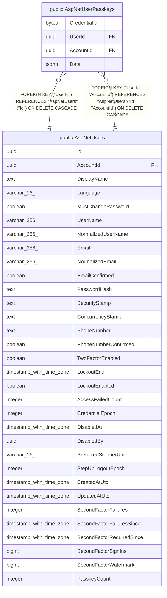

# public.AspNetUserPasskeys

## Columns

| Name | Type | Default | Nullable | Children | Parents | Comment |
| ---- | ---- | ------- | -------- | -------- | ------- | ------- |
| CredentialId | bytea |  | false |  |  |  |
| UserId | uuid |  | false |  | [public.AspNetUsers](public.AspNetUsers.md) |  |
| AccountId | uuid |  | false |  | [public.AspNetUsers](public.AspNetUsers.md) |  |
| Data | jsonb |  | false |  |  |  |

## Constraints

| Name | Type | Definition |
| ---- | ---- | ---------- |
| AspNetUserPasskeys_AccountId_not_null | n | NOT NULL "AccountId" |
| AspNetUserPasskeys_CredentialId_not_null | n | NOT NULL "CredentialId" |
| AspNetUserPasskeys_Data_not_null | n | NOT NULL "Data" |
| AspNetUserPasskeys_UserId_not_null | n | NOT NULL "UserId" |
| FK_AspNetUserPasskeys_AspNetUsers_UserId | FOREIGN KEY | FOREIGN KEY ("UserId") REFERENCES "AspNetUsers"("Id") ON DELETE CASCADE |
| FK_AspNetUserPasskeys_AspNetUsers_UserId_AccountId | FOREIGN KEY | FOREIGN KEY ("UserId", "AccountId") REFERENCES "AspNetUsers"("Id", "AccountId") ON DELETE CASCADE |
| PK_AspNetUserPasskeys | PRIMARY KEY | PRIMARY KEY ("CredentialId") |

## Indexes

| Name | Definition |
| ---- | ---------- |
| PK_AspNetUserPasskeys | CREATE UNIQUE INDEX "PK_AspNetUserPasskeys" ON public."AspNetUserPasskeys" USING btree ("CredentialId") |
| IX_AspNetUserPasskeys_UserId_AccountId | CREATE INDEX "IX_AspNetUserPasskeys_UserId_AccountId" ON public."AspNetUserPasskeys" USING btree ("UserId", "AccountId") |

## Relations

---

> Generated by [tbls](https://github.com/k1LoW/tbls)
