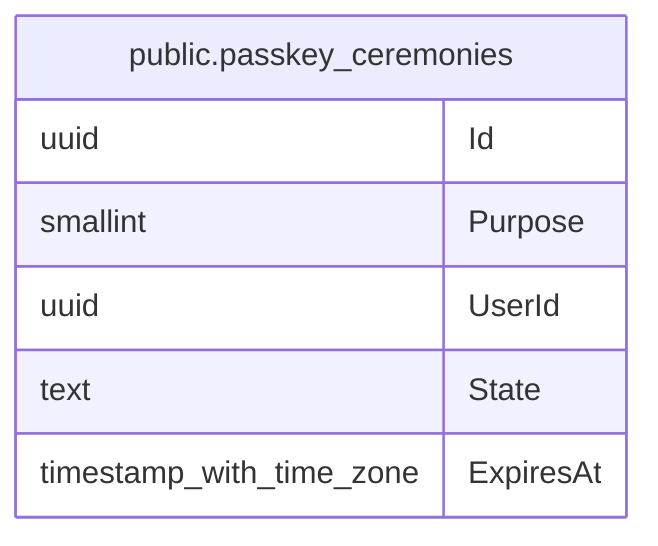

# public.passkey_ceremonies

## Columns

| Name | Type | Default | Nullable | Children | Parents | Comment |
| ---- | ---- | ------- | -------- | -------- | ------- | ------- |
| Id | uuid |  | false |  |  |  |
| Purpose | smallint |  | false |  |  |  |
| UserId | uuid |  | true |  |  |  |
| State | text |  | false |  |  |  |
| ExpiresAt | timestamp with time zone |  | false |  |  |  |

## Constraints

| Name | Type | Definition |
| ---- | ---- | ---------- |
| passkey_ceremonies_ExpiresAt_not_null | n | NOT NULL "ExpiresAt" |
| passkey_ceremonies_Id_not_null | n | NOT NULL "Id" |
| passkey_ceremonies_Purpose_not_null | n | NOT NULL "Purpose" |
| passkey_ceremonies_State_not_null | n | NOT NULL "State" |
| PK_passkey_ceremonies | PRIMARY KEY | PRIMARY KEY ("Id") |

## Indexes

| Name | Definition |
| ---- | ---------- |
| PK_passkey_ceremonies | CREATE UNIQUE INDEX "PK_passkey_ceremonies" ON public.passkey_ceremonies USING btree ("Id") |

## Relations

---

> Generated by [tbls](https://github.com/k1LoW/tbls)
